# Changelog

Every release of Frontline, newest first. The game updates itself; downloads, and this changelog with pictures,
are on [the website](https://web-production-5a4c1.up.railway.app/changelog/). Each change is written up in [`changelog/`](changelog/) as part of
the pull request that makes it.

## v1.0.10: Console tools and fuzzy completion

*17 October 2026* · [Release on GitHub](https://github.com/Dynasty9/Frontline/releases/tag/v1.0.10)

### Improved

#### Find console commands as you type

A scrollable command dropdown lists every command, then narrows to fuzzy matches and argument suggestions as you type.

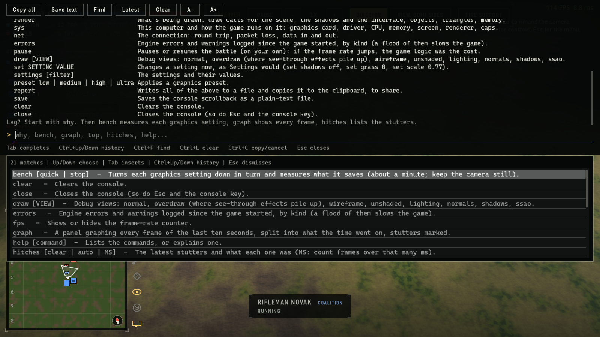

- An empty prompt shows every command with its description in a scrollable dropdown.
- Typing finds close matches, including partial spellings and small typos. Arguments get suggestions too.
- Use Up/Down to choose, then Tab or Enter to insert; you can also click a suggestion. Inserting never executes it.
- Ctrl+Up/Down browses your command history. Esc dismisses suggestions before closing the console.
- Completing in the middle of a line keeps the arguments that follow it.

#### A console you can copy, search and save

Select and copy console output, paste commands, search scrollback and save transcripts, with familiar terminal shortcuts.

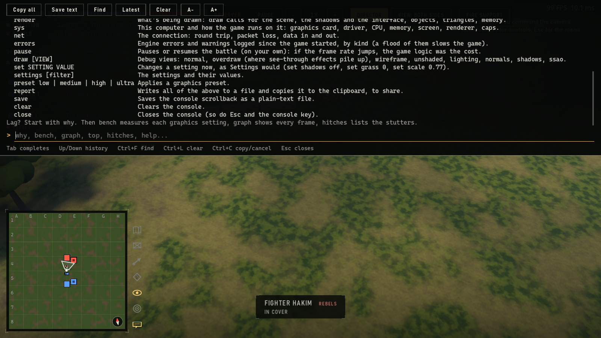

- Select text and copy it with Ctrl+C or the right-click menu. Paste into the command prompt with Ctrl+V or Ctrl+Shift+V.
- Copy all output or save a plain-text transcript with the toolbar.
- Find output with Ctrl+F; Enter and Shift+Enter move through matches.
- Clear output with Ctrl+L, jump through scrollback with Ctrl+Home/End, and adjust text size with Ctrl+plus/minus.
- Ctrl+C with nothing selected clears the prompt and safely stops a running benchmark.
- Command history, Tab completion, undo/redo and normal text editing remain available.

### Fixed

#### Sign in to the game from your website login

Already signed into the website? Signing in from the game now uses that account and returns you to Frontline automatically.

The website no longer asks you to sign in with GitHub again when you're already signed in.
Your game and website keep separate sessions, so both stay signed in. If the browser blocks opening the game
automatically, use **Open Frontline** to return.

## v1.0.9: A new look for the whole interface

*17 October 2026* · [Release on GitHub](https://github.com/Dynasty9/Frontline/releases/tag/v1.0.9)

### Improved

#### A new look for the whole interface

Every screen now reads like a battle management display: the battle's interface sits straight on the battlefield with no boxes, states are short codes, every figure lines up in mono, and one colour marks what's selected. The menus, the multiplayer screens, the Field Manual and the after-action report follow.

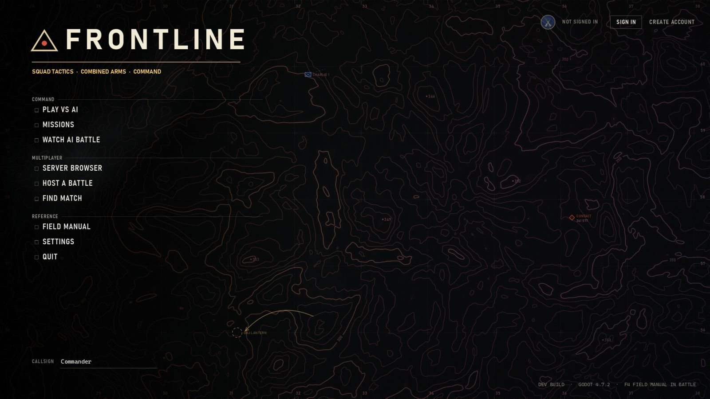

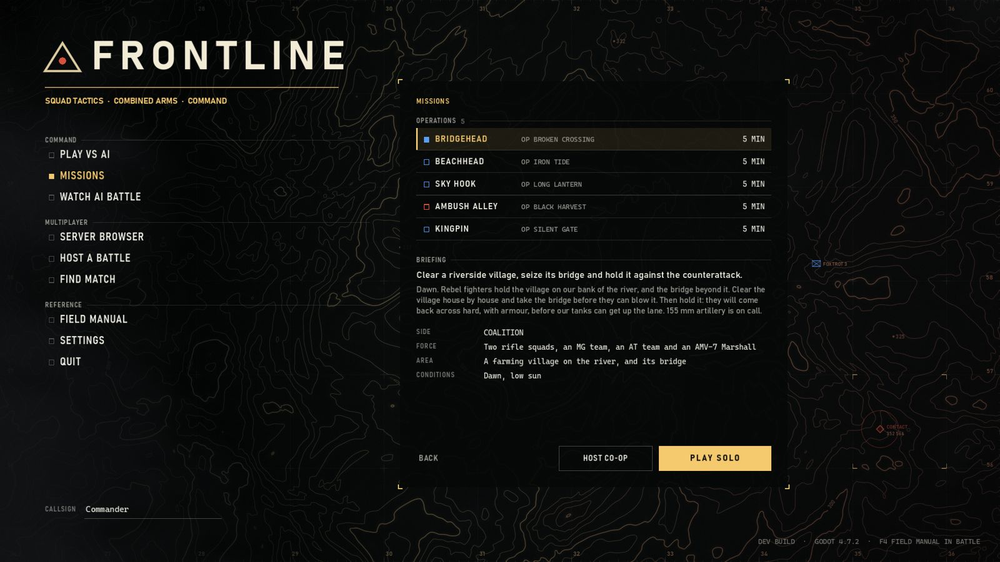

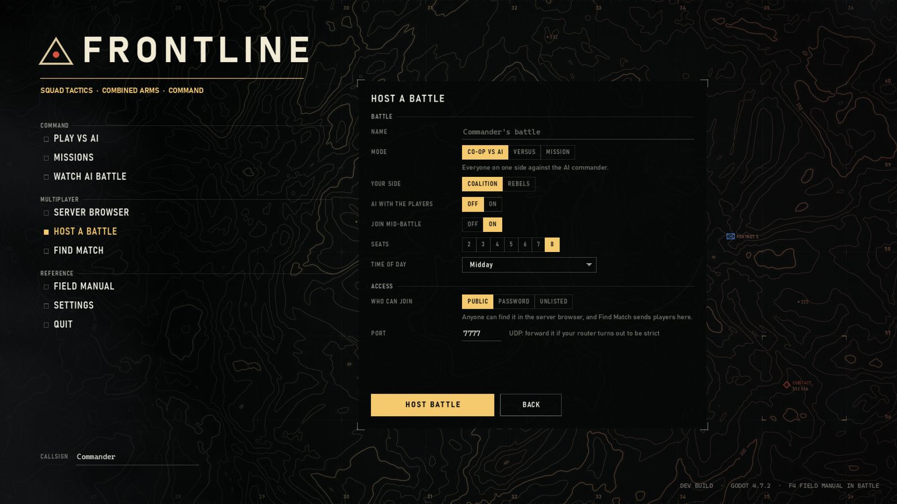

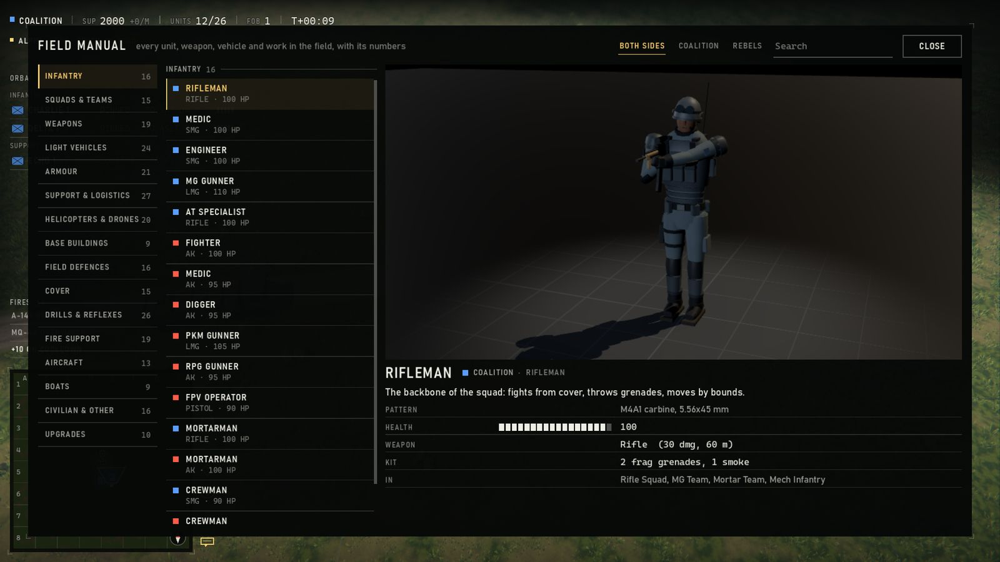

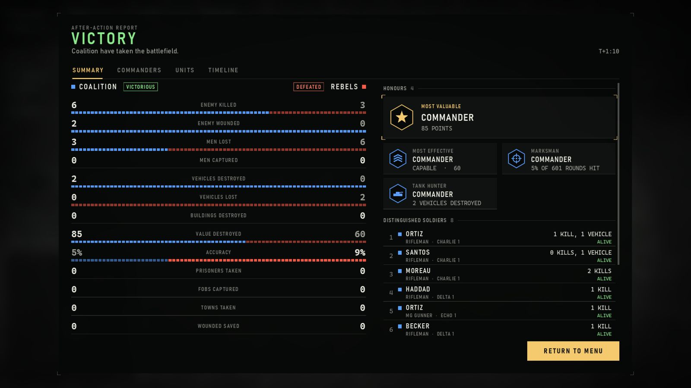

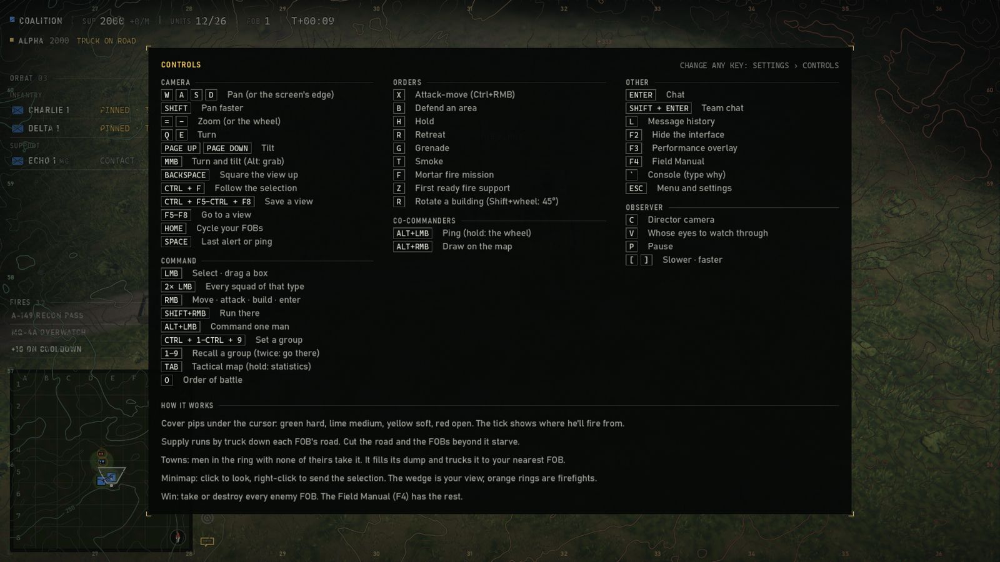

- **No more boxes:** the status line, the order of battle, fire support, the selection and the orders sit on the
  battlefield over a soft darkening at the screen's edges, with thin rules between rows.
- **Short codes:** each squad's line says what it's doing in a few characters (`PINNED · TO SPT D4`, `MOV E8`),
  supply reads `SUP 2115 +230/M`, the clock `T+04:31`, and a man's role `RFL`, `MG` or `MED`.
- **Fire support** lists the missions that are ready; the rest fold into one line with the next one's countdown.
- **Orders** are a grid of keys, the order you're giving lit up.
- **Alerts** come in three levels: a plain line, a yellow caution and a red warning that flickers in.
- **On the battlefield** base and town names, hover cards and cursor hints lose their boxes, and `+115 SUP` is a
  small tag rather than the biggest text on the screen.
- **The menus:** entries in capitals that light up while they're open, the account on one line top right, a new
  version or a battle to rejoin as one line each. New Operation picks a side from three rows and the time of day
  from one, and each mission is a line with its briefing under it.
- **Multiplayer:** the server browser lists battles as rows (players, status and connection as short codes) with
  the details beside them; hosting puts each choice on its own row; the lobby shows each side as a list of seats
  marked HOST, YOU, READY or OPEN, and its chat reads like the battle's message log.
- **The Field Manual** lists every entry with a small square in its side's colour, and its numbers as a table with
  counted bars. **The statistics and the after-action report** have every figure in mono, counted bars and plain
  lines on the timeline.
- **The loading screen** sets the briefing out in rows and counts its progress in steps; **the end of a battle**
  types VICTORY or DEFEAT on through a burst of interference, with the battle's clock under it.
- **Settings:** on/off and short choices are rows of segments, amounts are counted bars, and the tabs are
  underlined. New: **Settings > Interface > Reduce motion** makes everything appear at once instead of typing or
  flickering in.
- **F1** is a key reference in three columns, using your own key bindings, instead of a page of paragraphs.
- **The message history (L)** opens in place of the latest messages, only as tall as what's in it.
- **Fixed:** the sign-in panel could open as an empty strip down the screen, and the Missions and Insignia panels
  could run off the bottom of it.

#### Battles load sooner, and without freezing

A battle no longer freezes for several seconds after it has loaded, it's ready to play sooner, and the loading bar keeps moving while the battlefield is laid out instead of sitting still.

- **No freeze after loading:** the long stop between the loading bar filling and the battle starting is gone.
- **Ready sooner:** buildings, trees, vehicles and the town's street furniture are put together much faster, so you're
  playing several seconds earlier.
- **A window that answers:** the loading bar moves stage by stage, and Windows no longer calls the game "Not
  Responding" while a battle loads.
- Everything looks and plays exactly as before.

### Fixed

#### Joining a battle loads it before it starts

When you join someone else's battle, the loading screen now stays up until the whole battlefield has arrived and been built, and it arrives in a second or two, so you no longer drop into a half-built map that freezes for seconds at a time.

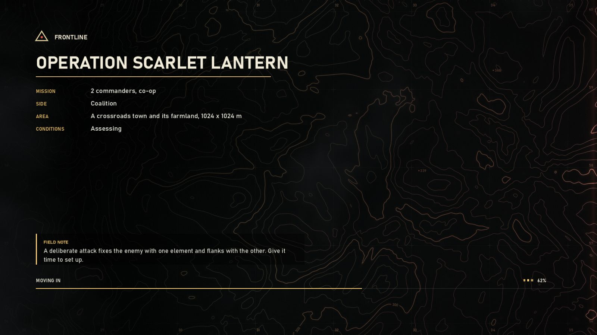

- **The loading screen waits for the battle**: it shows how far it has got (the water, the town, every building
  and tree, the cover) and only lifts once it's all there, instead of lifting on an empty field.
- **Faster to arrive**: the host sends the battlefield packed into about a twentieth of the space it used to take,
  so all of it arrives within a second or two instead of trickling in over half a minute or more.
- **No more long freezes after it lifts**: the buildings and trees are put up a few at a time behind the loading
  screen, rather than in a handful of frames that each held the game for seconds.
- **The ground matches the host's**: the paving in the town squares and the ground under bridges and the harbour
  quay were open ground on a joining player's map, though they're road in the battle itself; they're road now.
- Host and players must update together: a game with this change can't join a battle hosted by an older one.

## v1.0.8: UI and more!

*17 October 2026* · [Release on GitHub](https://github.com/Dynasty9/Frontline/releases/tag/v1.0.8)

### Improved

#### A new look for the battle's interface

The battle's interface now reads like a battle management display laid onto the battlefield: no more boxes, short codes instead of sentences, every figure lined up in mono, and one colour for what's selected.

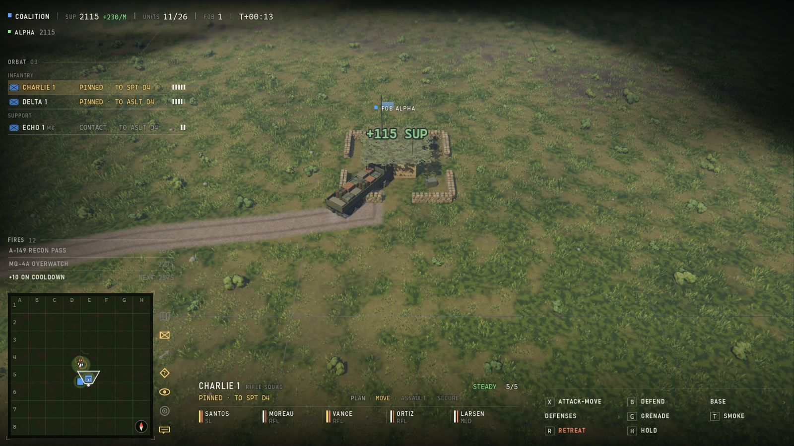

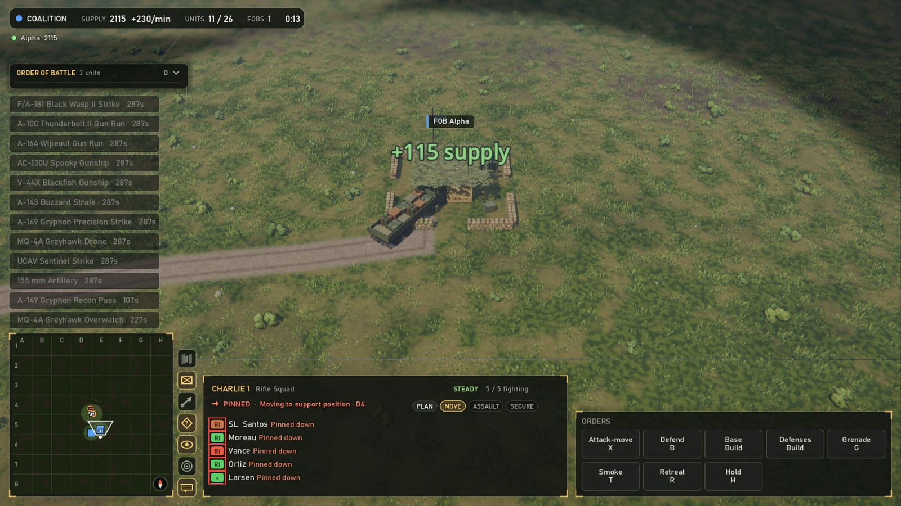

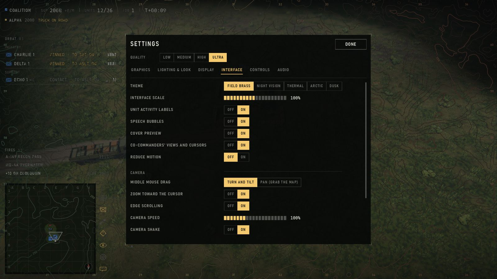

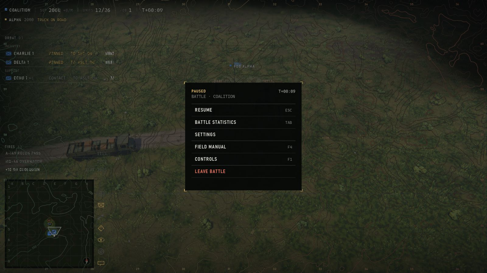

- **No more boxes:** the status line, the order of battle, fire support, the selection and the orders sit on the
  battlefield over a soft darkening at the screen's edges, with thin rules between rows.
- **Short codes:** each squad's line says what it's doing in a few characters (`PINNED · TO SPT D4`, `MOV E8`),
  supply reads `SUP 2115 +230/M`, the clock `T+04:31`, and a man's role `RFL`, `MG` or `MED`.
- **Fire support** lists the missions that are ready; the rest fold into one line with the next one's countdown.
- **Orders** are a grid of keys, the order you're giving lit up.
- **The selection** shows the squad's state once, its plan's stages, and a cell for each man with his role.
- **Alerts** come in three levels: a plain line, a yellow caution and a red warning that flickers in.
- **On the battlefield** base and town names, hover cards and cursor hints lose their boxes, and `+115 SUP` is a
  small tag rather than the biggest text on the screen.
- **Settings:** on/off and short choices are rows of segments, amounts are counted bars, and the tabs are
  underlined. New: **Settings > Interface > Reduce motion** makes everything appear at once instead of typing or
  flickering in.
- **F1** is a key reference in three columns, using your own key bindings, instead of a page of paragraphs.
- **The message history (L)** opens in place of the latest messages, only as tall as what's in it.

### Fixed

#### Website links work again after an uninstall

If the links from the website were taken away (uninstalling another copy of Frontline, or a registry cleaner), the game never claimed them back, so Join, Find Match and signing in on the website did nothing. Starting the game sets them up again now.

- Each time it starts, the game checks that your system still opens website links with it, and sets them up again
  if not.
- With more than one copy of the game, links open the one you started last.

## v1.0.7: Small fixes

*17 October 2026* · [Release on GitHub](https://github.com/Dynasty9/Frontline/releases/tag/v1.0.7)

### Fixed

#### Website links reach the game you have open

Signing in on the website, or pressing Join or Find Match there, could start a second copy of the game instead of going to the one you had open. It happened after the game had updated itself. The link goes to the open game now.

- The same happened to a game started while another copy of it was still running, once that other copy had closed.

## v1.0.6: Performance

*17 October 2026* · [Release on GitHub](https://github.com/Dynasty9/Frontline/releases/tag/v1.0.6)

### Improved

#### The game opens faster

The title and the menu come up seconds sooner after you launch the game. The rest of the game gets ready behind the title while it plays, instead of before anything shows.

- **The title shows sooner:** the game used to prepare everything it would need for a battle before showing
  anything at all. Now it shows the title and the menu as soon as they're ready, and prepares the battle behind
  them while the title plays.
- **Starting a battle straight away** (in the first few seconds) waits behind the loading screen for that to
  finish; after that, battles start as quickly as before.
- **The Field Manual and the Settings** are put together the first time you open them, not every time the game
  starts.

#### Battlefields are laid out faster

Laying out a new battlefield - the rivers and the sea, the roads, the cover the ground gives - is several times quicker, so a battle or a mission starts several seconds sooner. The ground comes out exactly as it did.

- **Why:** the water, the roads and the cover were worked out cell by cell over far more of the map than they
  touch, and some of it two or three times over. Now each is worked out only where it reaches, once, and the
  water and the cover are shared out over all your processor's cores.
- **What didn't change:** the battlefield. Every river, road, house, hedge and tree is where it was, the cover and
  the routes are the same, and a replayed battle plays out the same.

## v1.0.5: Performance and more

*17 October 2026* · [Release on GitHub](https://github.com/Dynasty9/Frontline/releases/tag/v1.0.5)

### New

#### Leaderboards, and a page for every commander

The website ranks the commanders with the most experience, of all time, this month and this week, and every player has a page of their own: their rank, their record, and the battles they've fought, after-action reports and all.

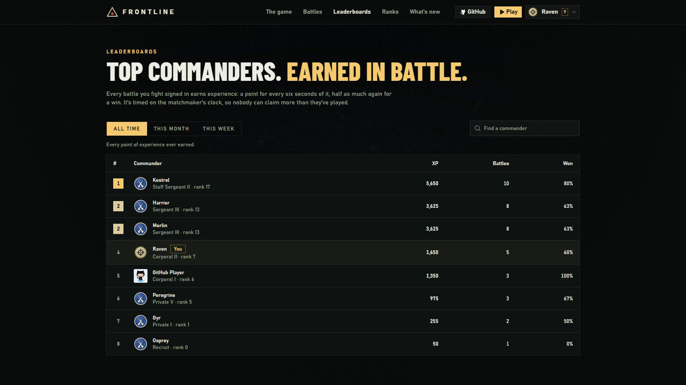

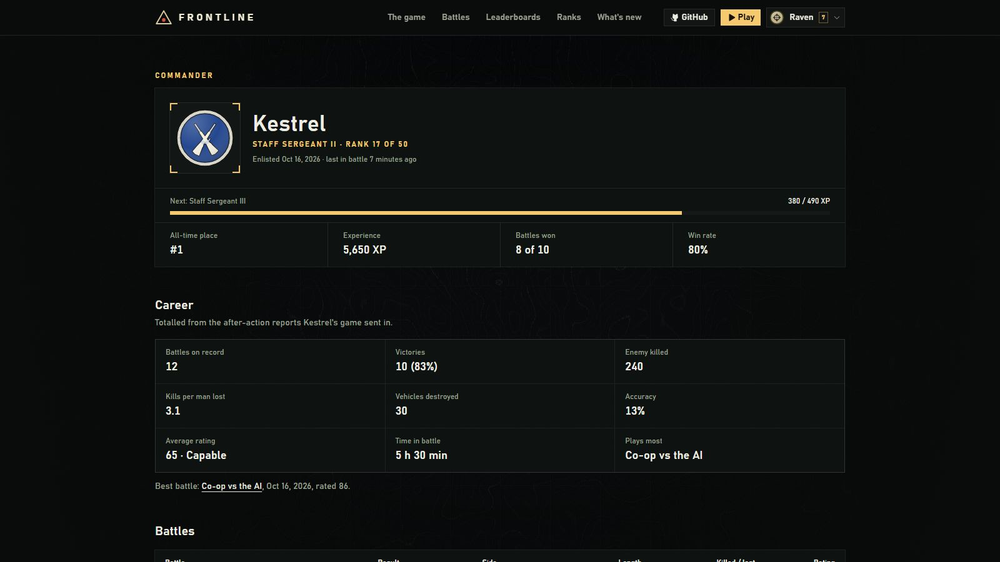

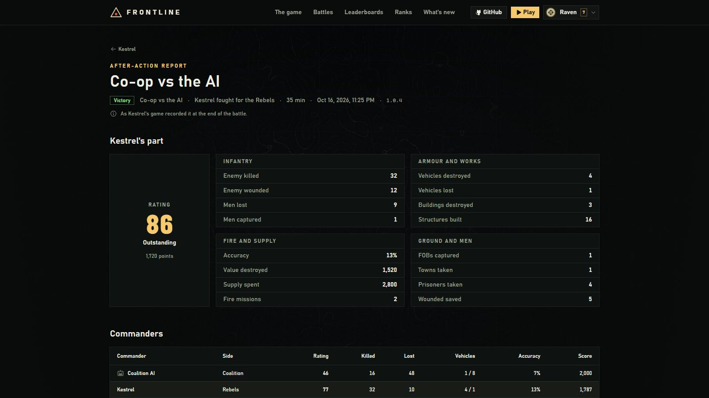

- **Leaderboards** on the website rank experience, all time, this month and this week. Signed in, you'll find yourself marked on it, wherever you are. Experience is timed on the matchmaker's clock, so nobody can claim more than they've played.
- **Every commander has a page**: their rank, experience, battles won and place on the board, their career, and every battle they've fought signed in, each with its after-action report and every commander in it rated the way the game rates them. Find anyone by callsign; a host's name in the battle list leads to theirs.
- **Your battles are public now.** Before, your service record was only ever shown to you. If you'd rather keep it that way, untick **Show my battles** on your profile: your rank and record stay on your page, your battles and career come off it, and the game still shows them to you.
- **Your picture**: your insignia, or the picture on your GitHub account, if you signed in with GitHub. Pick it on your profile.
- **Sign out everywhere** on your profile signs your account out of every game and browser it's signed in to.
- **A battle counts on your record** (battles fought and won) only if it earned experience: two minutes or more. A battle abandoned in its first minute no longer counts as fought, or won.

#### A console that tells you why the game is slow

Press the key under Esc (` or ~) for a console. Type why and it works out what's holding your frame rate back; bench measures what each graphics setting costs you; graph shows every frame and its stutters.

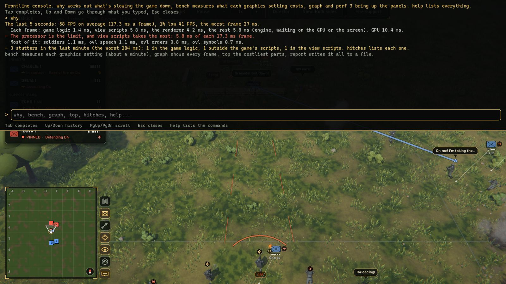

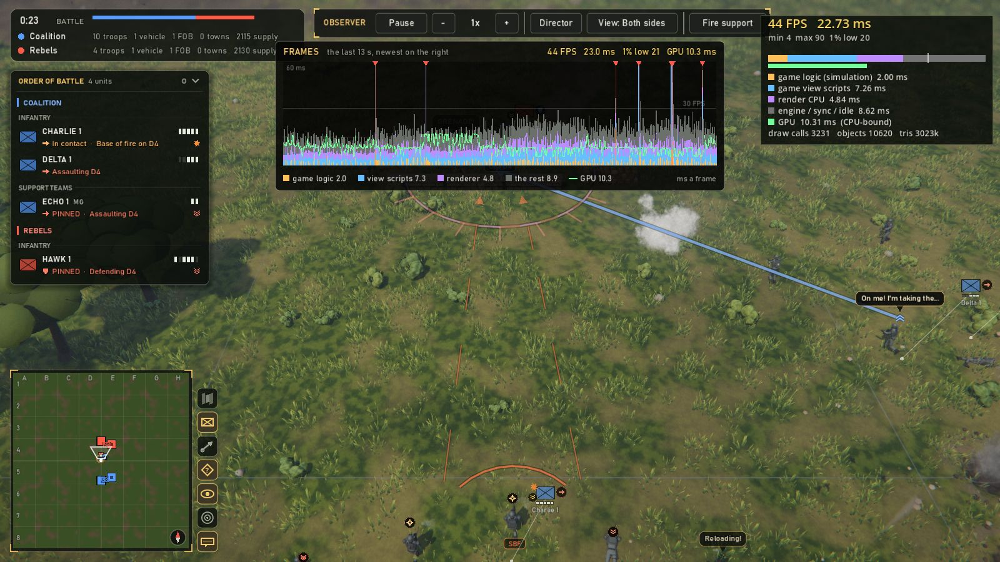

- **`why`** looks at the last few seconds and says what's limiting you: your screen's refresh rate, the graphics
  card, or the processor, and which part of the game takes the most. It also flags stutters, a flood of engine
  errors, an integrated graphics chip and a slow connection to the host.
- **`bench`** turns each graphics setting down in turn (shadows, ambient occlusion, grass, water, render scale and
  more), times it, and lists what each one saves, the most first. It puts your settings back when it's done.
  `bench quick` is faster.
- **`graph`** pins a frame-time graph to the screen; **`hitches`** lists the latest stutters and what each one
  was; **`top`** shows the costliest parts of the game.
- **`render`**, **`sys`**, **`net`** and **`errors`** show what's being drawn, your computer, your connection and
  anything the engine has complained about.
- **`set shadows off`**, **`preset low`** and the like change settings on the spot; **`perf 3`** brings up the
  full performance overlay.
- **`report`** writes all of it to a file and copies it to the clipboard, ready to paste to whoever is helping.
- Tab completes, Up and Down bring back what you typed, Esc closes it. The key can be changed in Settings >
  Controls.
- The compact performance overlay (F3) no longer draws its GPU bar over its first line, or its last line
  below the panel.

#### Installers for Windows and the Mac

The game now comes with an installer on Windows and a disk image on the Mac, so it lands where it can keep itself up to date, with a shortcut to start it from.

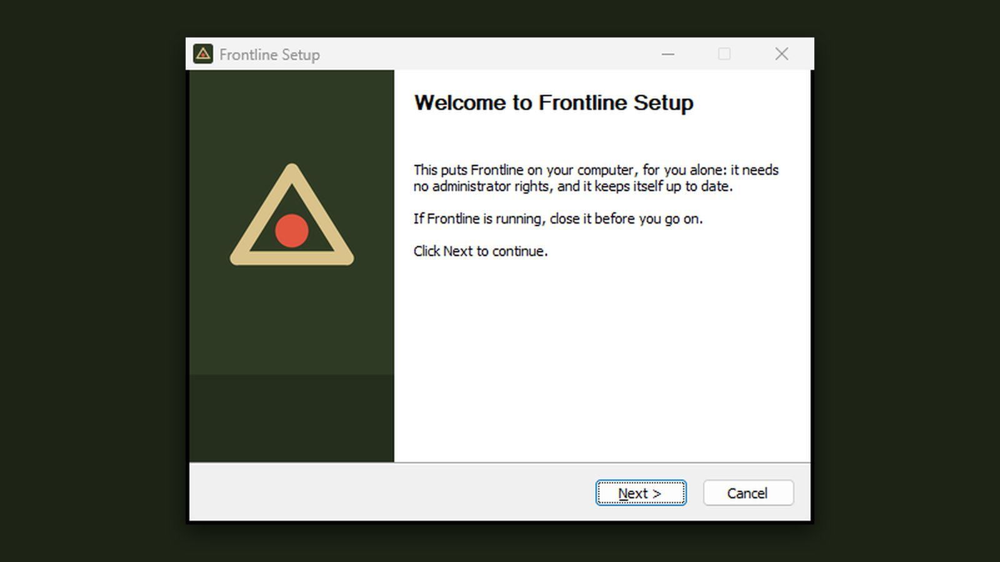

- **Windows:** the download is a setup wizard. It needs no administrator rights, puts Frontline in your Start menu
  (and on the desktop, if you like), and uninstalls from Settings > Apps.
- **Mac:** the download is a disk image: open it and drag Frontline into Applications.
- Either way the game goes where it can update itself. On Windows the website's Join buttons work straight away,
  before you've even started the game.
- The zips are still there, a link under each download button, to run the game from anywhere without installing it.
  Linux keeps its zip.

### Improved

#### Boats handle like boats

Boats no longer drive like cars on water. They slide through it, skid in a hard turn, have no brakes, answer the helm after a moment and are carried by a river's current, and their coxswains handle them like it.

- **No brakes:** a boat slows on the water's drag and goes astern to stop. An RHIB at full speed needs some
  40 m to stop, a patrol ship 60 m and more, so they ease off well before where they're going.
- **Skidding:** in a hard turn a boat slides, her bow pointing inside the turn and her stern swinging out,
  and loses speed doing it. At speed she can't turn as tight as she can going slow.
- **Steering needs water past the rudder:** a boat stopped turns by going ahead on her engines, and going
  astern she hardly steers.
- **A moment to answer:** engines and helm take a moment, a patrol ship a long one, so her coxswain puts the
  helm over early and meets her with opposite helm as she comes round.
- **Rivers have a current:** it runs south, fastest in mid-stream, and carries a boat with it.
- **The Gun Trawler** is a deep, slow fishing hull: the slowest to answer, the widest turner, and she heels
  out of a turn where the speedboats bank into it.
- **Fighting on the move:** on an attack a boat keeps going at a steady speed instead of stopping dead to shoot,
  and only lies to to fight it out with an enemy that's dropped astern of her.
- **Coming about:** an RHIB with its beach just behind it spins round and runs in bow first.

#### Wildlife caught in the fighting

The animals run from more of the battle now, and can be killed by it: a round through a flock or a shell among them brings them down in a puff of blood and feathers. It's only for the eye, so a round that hits a bird flies on exactly as it would have.

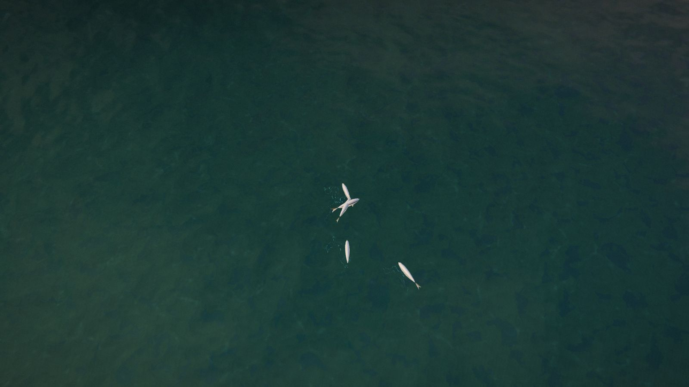

- **They can be killed:** a round through a bird, a rat, a hare or a dolphin, or into the water right over a
  fish, kills it in a puff of blood (and feathers, from a bird), and a shell kills whatever is close and throws
  it. Birds tumble out of the air and the dead lie on their sides where they fell, then are cleared away out of
  sight after a while. Fish stunned by a shell in the water float up belly-up.
- **Only for the eye:** none of it touches the battle. A round that hits a bird flies on as it would have, and
  each player's game has animals of its own.
- **They run from more:** rounds cracking past or striking nearby, a grass fire (they keep clear while it burns),
  a tree coming down, a helicopter flying low, and one of their own killed. Crows, gulls and bats now make off
  instead of circling on, and a fright spreads: when one flock goes up, the flocks feeding nearby follow.

### Fixed

#### A rare crash at the start of a battle

Starting a battle could, once in a long while, crash the game while it worked out the routes across the map. It no longer can.

- The crash came while the loading screen read "Plotting the routes", in the first battle after starting the game.
- The same fault could, even more rarely, crash the game as it started up and made its sounds.

#### Big ships come about without running aground

A patrol ship sent somewhere astern now turns the way it has room for and joins its route further on, instead of circling back to where it started and running up the beach. A boat that touches the shore backs off it.

- A patrol ship (or a gun trawler) needs a lot of water to turn round. Sent somewhere behind it, it used to come
  round, then turn back for the start of its route next to where it had begun, go round again and end up on
  the beach. Now it picks its route up further on once it's round, and reaches where it was sent.
- It comes about towards where it's going, and if the shore is in the way on that side, it turns the other way,
  out to sea.
- It backs into a spot not far behind it instead of swinging out in a wide loop.
- A boat that runs onto a bank or beach goes astern off it, swings its bow round and carries on, instead of
  sitting on the sand. Sent somewhere close in by the shore, it settles as near as it can get instead of
  backing off and trying again for ever.
- Where its route rounds a point of land, a boat no longer cuts the corner over it.
- A boat steering round another one standing in its way now keeps to the open water side.

#### No more crash when an attack outlasts a squad it lost

A battle could crash when a squad was wiped out partway through a planned attack and the attack dragged on for minutes after. The lost squad now drops out of the attack the moment it's gone.

- The rest of the attack carries on exactly as before. When it ends, only the squads still in the field get their new orders.

#### Roads no longer show through smoke and explosions

Smoke, flames and dust from a blast on or near a road now cover the road like the ground around it, instead of the road showing through them in hard-edged strips.

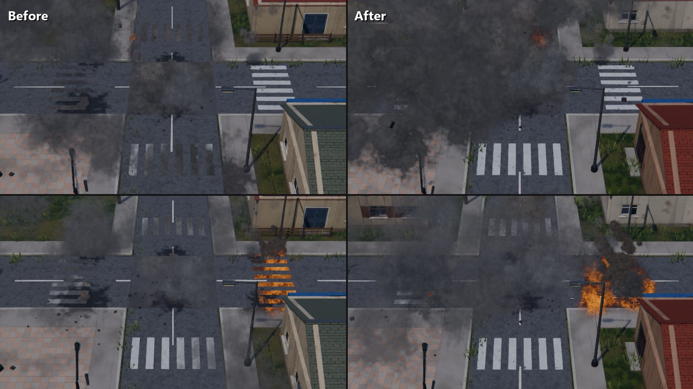

- Smoke drifting over a road no longer stops in a sharp line at the road's edges.
- Flames on a road now burn over the whole road, not just over the stripes of a zebra crossing.

#### The website opens the game on Windows, and signing in says what's happening

On Windows the website's Launch, Join and Find Match buttons, and its sign-in for the game, never reached the game: it couldn't set itself up to take them. Now it can, and signing in from the game shows each step as it goes.

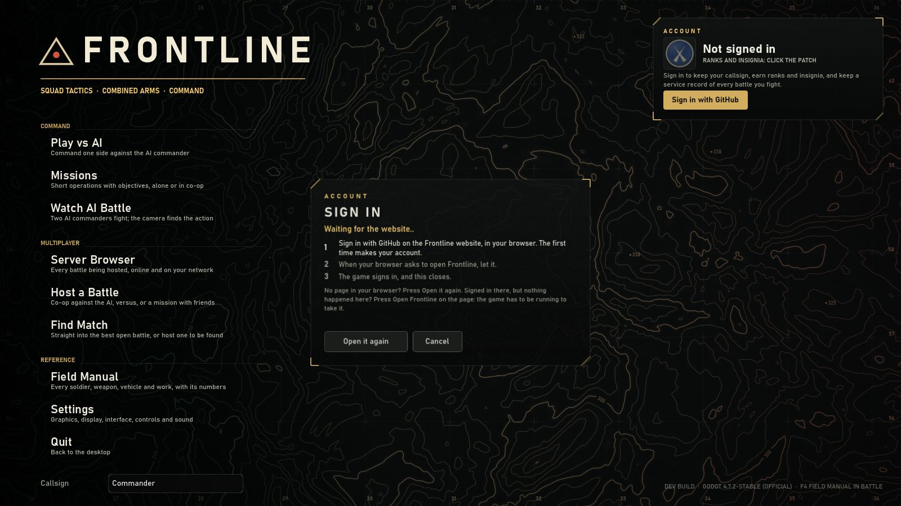

- **Fixed:** on Windows, the game never managed to set itself up to open the website's links, so Launch Frontline,
  Join, Find Match and the sign-in handed back from the website did nothing. Start the game once after it updates
  and they all work.
- **Signing in from the game** lists the steps (sign in with GitHub on the website, let your browser open
  Frontline, the game signs in) and shows which one you're on, with a line that keeps moving while it waits for the
  website. When the website hands the sign-in back it says it's signing in; if something went wrong it says what,
  with a Try again button.
- **On the website**, after you sign in for the game it shows the two steps, and whether your browser opened the
  game. If it didn't, it says what to do, with a button to open it again.

## v1.0.4: Touchups

*17 October 2026* · [Release on GitHub](https://github.com/Dynasty9/Frontline/releases/tag/v1.0.4)

### Improved

#### Scenarios and battles start sooner

Working out the routes across a new battlefield now takes about half the time and far less of your processor, so a scenario is ready in about half the time and a full battle a second or so sooner.

- **Why:** most of a battlefield is open ground much like the rest of it. The way across each patch is now worked
  out once for every patch that's just the same, instead of for each in turn.
- **What didn't change:** the routes. Soldiers and vehicles go exactly the way they did before, and a replayed battle
  plays out the same.

#### Signing in on the website, in one click

Sign in, in the website's header, opens a sign-in window over whatever page you're on, and once you're in it takes you to your profile. The front page is about the game now; ranks have a page of their own.

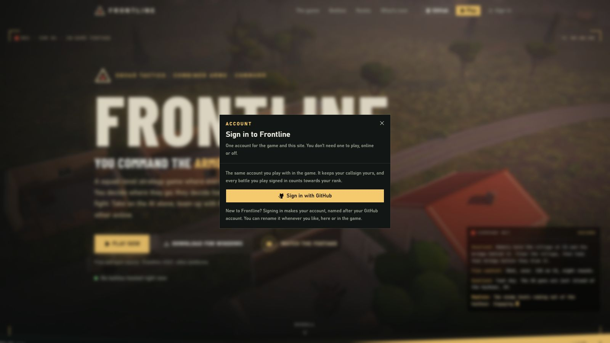

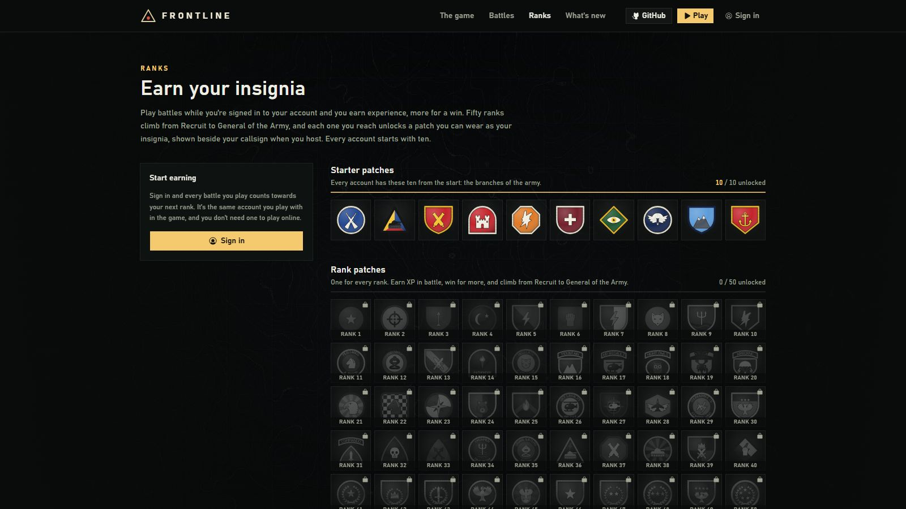

- **Sign in** in the header opens a sign-in window right where you are: no scrolling down the page to find it.
- Back from GitHub, the window says it's signing you in, then takes you to **your profile**: your rank, your record,
  your callsign and your insignia. If GitHub didn't sign you in, it says why, with the button to try again.
- The front page shows the game off. The live battles, the ranks and insignia, the downloads and your profile each
  have a page of their own, in the header.
- Old links still work: the game's Download button goes to the downloads, and `/account` to your profile.

### Fixed

#### Splashes leave rings of foam again

A shell landing in the water, a boat going down and rounds hitting the sea leave rings and boils of foam on the water again, instead of flat white squares that turned blue as the swell rolled over them.

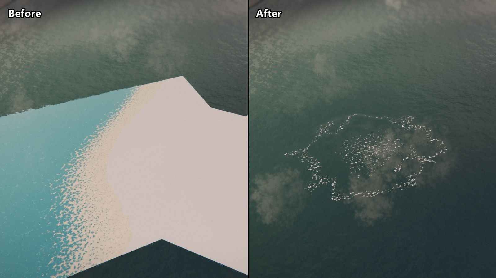

- A shell bursting in the water throws up its column and leaves a ring of foam running outward and breaking up,
  with white water boiling where the column fell back.
- A sinking boat churns the water white as she goes down, and leaves a slick of oil spreading where she sank.

## v1.0.3: Just a little more

*17 October 2026* · [Release on GitHub](https://github.com/Dynasty9/Frontline/releases/tag/v1.0.3)

### New

#### Wildlife: birds, rats, hares, fish, ducks and dolphins

The battlefield has life of its own now. Birds feed in the fields and burst up at gunfire, crows and gulls wheel overhead, rats run along the walls in town, fish jump in the rivers, ducks paddle on the ponds and dolphins roll through the swell offshore. Settings > Graphics > Wildlife turns it down, or off.

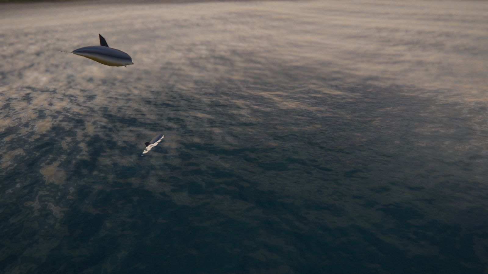

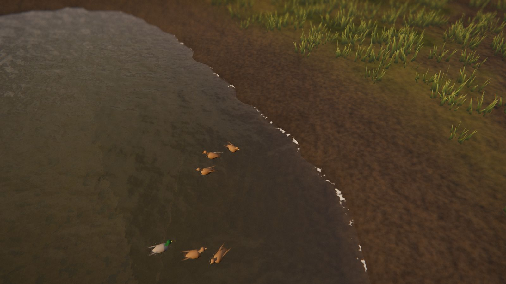

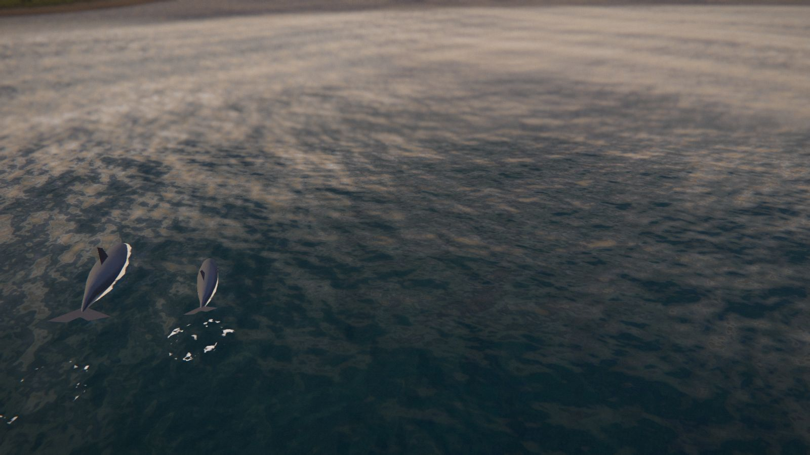

- **In the fields:** flocks of sparrows and starlings feed on the tracks, yards and mud, hopping and pecking, and
  move on now and then. Pigeons gather about the town. Hares sit out in the grass and graze.
- **Overhead:** crows and buzzards turn circles in the sky, gulls along the coast, and their shadows sweep over
  the ground. At night bats flit about low down instead.
- **In the water:** fish swim under the surface of the rivers and ponds and now and then jump, ducks paddle about
  and upend to feed, and out at sea a pod of dolphins rolls up through the surface to breathe, one sometimes
  leaping clear.
- **They take fright:** a burst of fire or a shell landing sends the birds up all at once with a rush of wings,
  and soldiers and vehicles coming near flush them too. Rats bolt for a hole in the nearest wall, hares zigzag
  away across the field, fish dart off and ducks take to the air. Animals only react to the troops you can see,
  so they never give away a hidden enemy.
- **You can hear them:** birdsong, a pigeon's coo, crows and gulls calling, the rush of a flock going up, a rat's
  squeak and the splash of a jumping fish, on the ambience volume.
- **The time of day matters:** small birds and the soaring ones roost at night, when more rats come out. Fewer
  birds fly in the rain.
- **It costs little and is yours to set:** only the area round your camera is alive, so a bigger map costs no
  more. **Settings > Graphics > Wildlife** sets it to Plenty, Some or Off, and the quality presets choose for you
  (Off on Low, Some on Medium, Plenty on High and Ultra).

### Improved

#### The website gets a Play button, and a page for your account

The Frontline website is more than one long page now: Play opens the game on your computer (or gets it for you), the live battles have a page of their own, and your account page is where you rename yourself and pick your insignia.

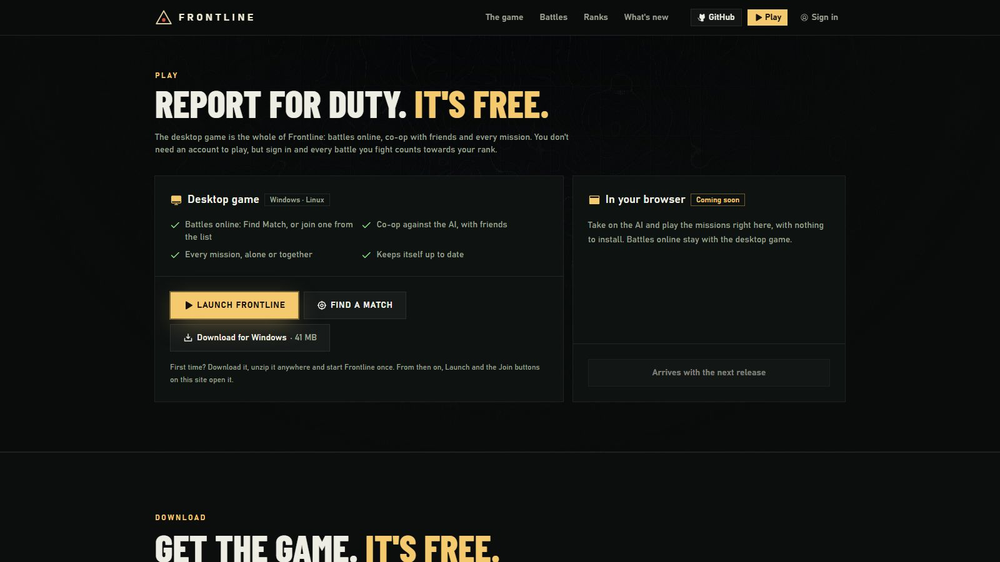

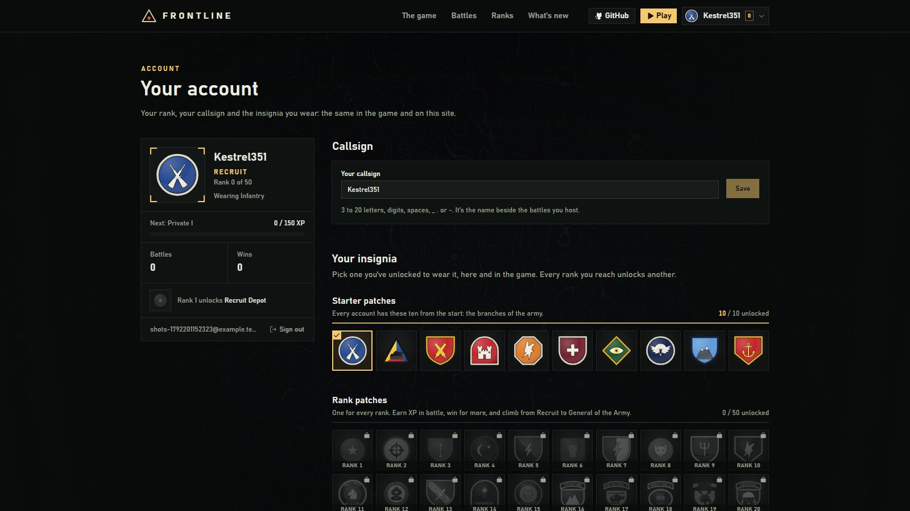

- **Play**, at the top of every page, opens the game you have installed, or Find Match straight away. If nothing opens, the page tells you how to get the game going the first time.
- **Live battles** have their own page, and the header says how many are on. A friend's invite link from the game opens it, with their battle at the top.
- **Your account** shows your rank and record, lets you change your callsign, and holds your insignia collection. The menu on your insignia in the header takes you there, or signs you out.
- On a phone, the site's links fold into a menu, and the Play page tells you the game needs a computer.

## v1.0.2: I don't even know

*17 October 2026* · [Release on GitHub](https://github.com/Dynasty9/Frontline/releases/tag/v1.0.2)

### New

#### Frontline on the Mac

Frontline now comes for macOS too, on Apple silicon and Intel Macs: the whole game, multiplayer included, and it keeps itself up to date like the others. On a MacBook, the trackpad drives the camera.

- **Getting it:** download it from the website, unzip it and move Frontline into Applications, where it can update
  itself.
- **The first time:** Apple hasn't notarized the game yet, so macOS won't open it at first. Open System Settings >
  Privacy & Security and choose **Open Anyway**; after that it opens like any other app.
- **Join links** on the website open the Mac game too.
- **On a trackpad:** scroll with two fingers to drag the map, pinch to zoom, and hold Option to turn and tilt the view
  instead. Shift and two fingers turn what you're placing. On a Magic Mouse, **Settings > Interface > Two-finger
  scroll** makes scrolling zoom instead.
- Keys are named the Mac way: the Command key shows as **Cmd**.
- Needs macOS 13 or later on Apple silicon, or macOS 11 or later on an Intel Mac.

#### Play in your browser

Frontline now comes as a browser build too: the same game, played alone, with nothing to download or install. Multiplayer still needs the desktop game.

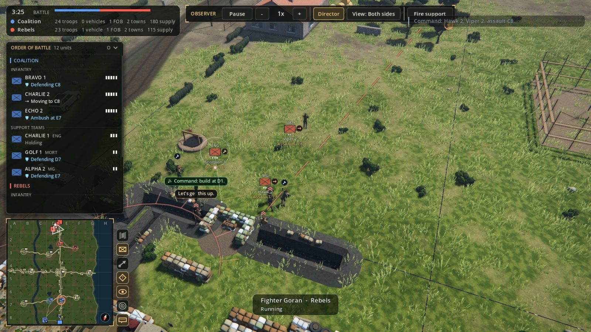

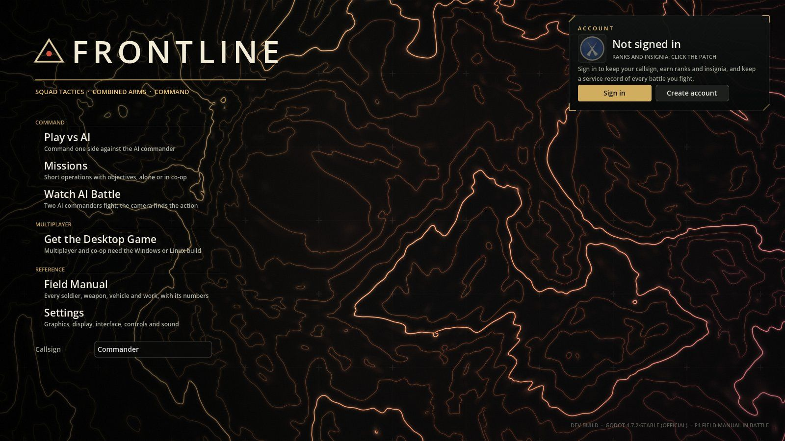

- **What you can play:** Play vs AI, Missions and Watch AI Battle, plus the Field Manual, Settings, and signing in to
  keep your service record.
- **Multiplayer and co-op** need the Windows, Mac or Linux game: a browser can't make the direct connections a battle
  between players runs over. The menu links to the downloads instead.
- **It looks a little different:** there's no screen-space lighting, volumetric fog or dust trailing behind flung
  earth, which the browser's renderer can't draw. Settings it can't use are hidden.
- The battlefield takes about 30 seconds to lay out, a stage at a time, with the loading screen showing how far it's
  got. After that the battle runs about as fast as it does on the desktop.
- **The first battle takes a while:** the first time, the browser also prepares the game's graphics, so the page
  holds for about a minute before the battle appears (if the browser asks, choose Wait). It keeps them, so after that
  a battle only waits for its map.
- **Lighter on effects:** particles run on the processor, and explosions, muzzle flashes and fires don't light up
  their surroundings, so nothing stalls the battle the first time it happens.
- Each release comes with the browser build alongside the Windows, Mac and Linux downloads.

#### Sign in with GitHub

Sign in with your GitHub account: the game opens the Frontline website, you sign in with GitHub there, and the game signs in by itself. The first time makes your account, named after you on GitHub.

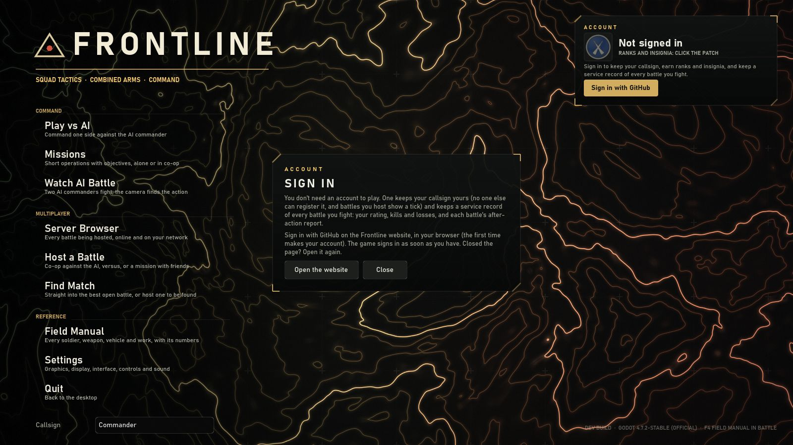

- **Sign in with GitHub** (on the main menu, or at the end of a battle) opens the website. Sign in with GitHub there, let your browser open Frontline, and the game is signed in. You never type a password into the game.
- **Your first sign-in makes your account**, with your GitHub username as your callsign. Rename it in the game whenever you like.
- **The website has it too**: sign in there with GitHub to see your rank and pick your insignia.
- **The game and the website sign in separately**, so signing out of one leaves the other signed in.
- **Closed the game while you were signing in?** The website starts it again, signed in.

### Improved

#### Smoother battles as the ground changes

When walls go up, buildings come down or fires take hold, the host now updates the map soldiers and vehicles plan their routes on about ten times faster, so a big battle spends far less of each moment on it.

- **What changed:** every change to the ground used to cost the host several milliseconds of re-planning, on about
  a third of all of the game's updates in a big battle. It now redoes only what the change can reach: a fraction of
  a millisecond as a rule.
- **What didn't:** the routes. Soldiers and vehicles go exactly the way they did before, and a replayed battle plays
  out the same.

#### Battles use less memory

Route planning keeps much less of the map in memory at once, so a battle needs about 120 MB less. Units find exactly the same routes as before.

- A battle now takes about 120 MB less memory, which matters most in the browser, where a page can't use more than
  2 GB.
- Units take exactly the same routes as before.

#### An ocean that swells, and a sea for every weather

Real waves roll in off the sea now: a long swell crossed by the wind's chop, which boats ride. The weather sets the sea, from glassy at dawn to a storm in the rain, and a new Water quality setting keeps it quick on slower machines and in the browser.

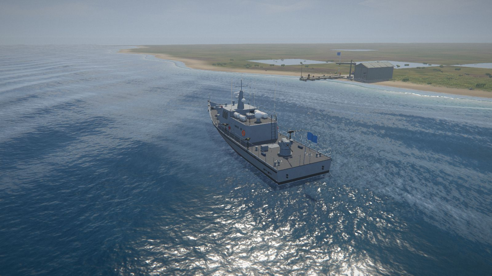

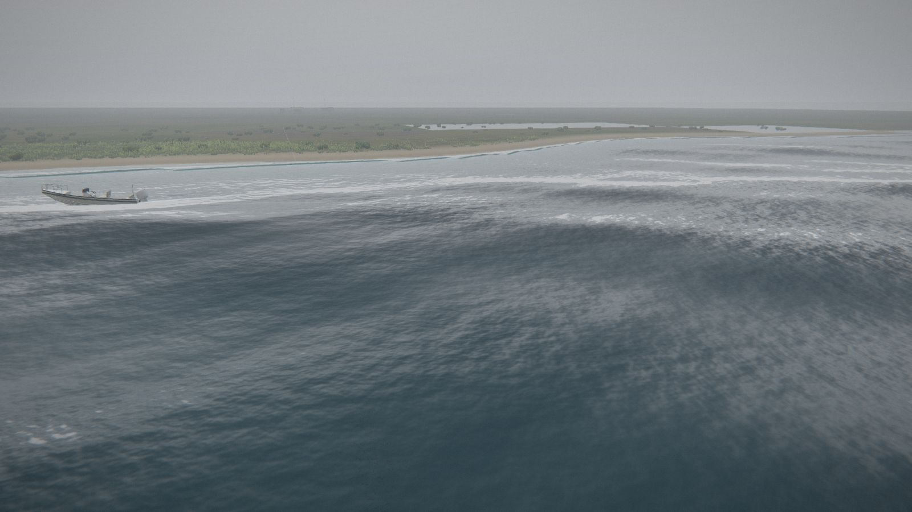

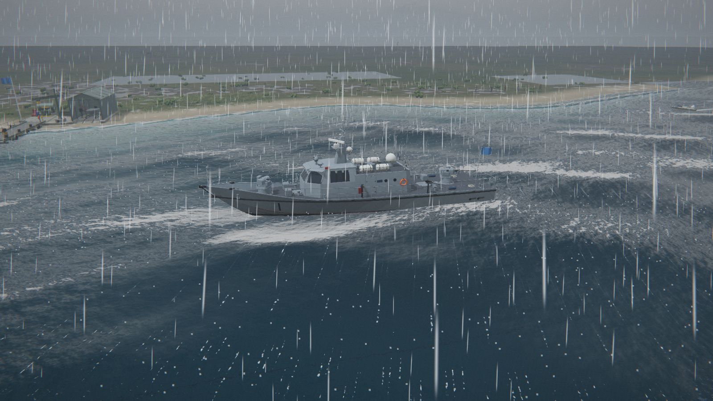

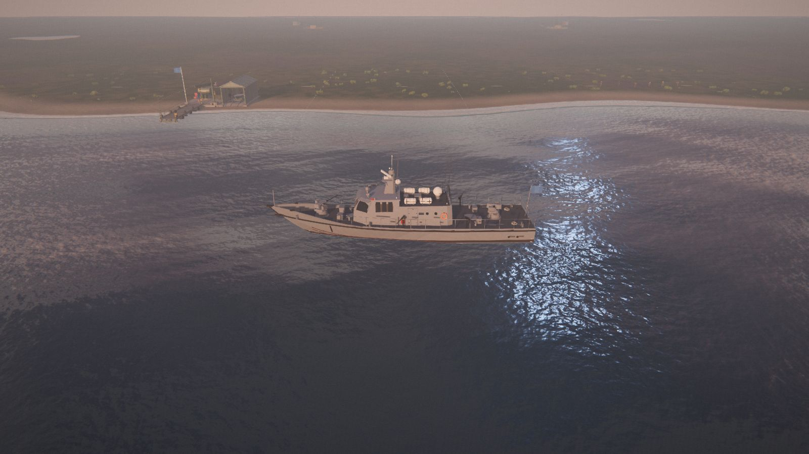

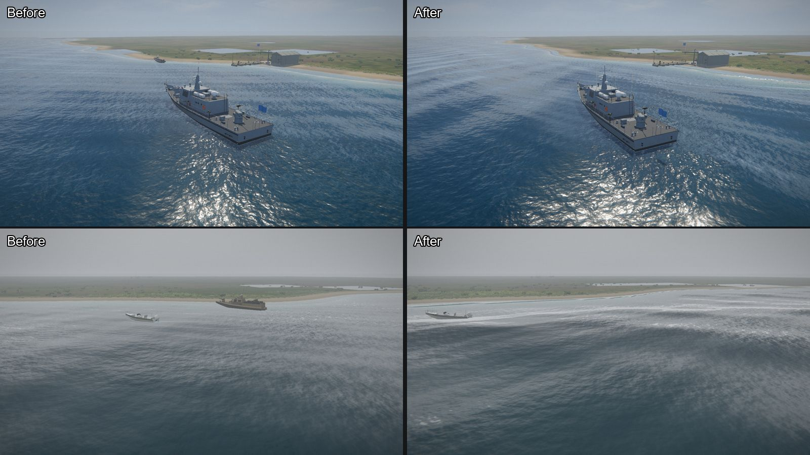

- **Waves you can see:** a long swell rolls in off the open sea in sets, and the wind's own shorter waves run across it. The crests come up sharp and the troughs broad, and boats rise, pitch and roll on the same waves.
- **The weather sets the sea:** glassy at dawn, dusk and golden hour, a moderate sea by day, choppy under cloud, and a storm sea in the rain, with whitecaps tearing off the crests and streaks of foam down the wind.
- **The surf** now rises as it comes in over the shallows before it breaks on the beach.
- **Light on the shallows:** the ripples throw dancing light onto the sand under clear water.
- **In the browser,** the sun glitters on the water as it does on the desktop.
- **Water quality** (Settings > Graphics): Low skips the see-through water for speed, Medium is the full sea, High adds the light on the shallows and the wind's streaks, and Ultra a finer swell. The browser starts on Medium.

#### Gunfire that looks like the real thing

Muzzle flashes, tracers, bullet impacts and gun smoke are now sized and timed to life: small, quick, bright flashes, thin tracers that glow at night, and smoke that billows and shades itself instead of hanging in round puffs.

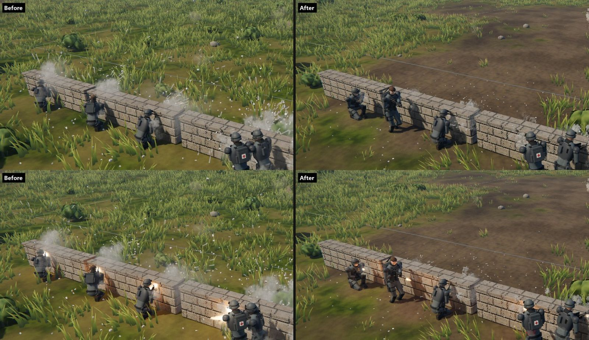

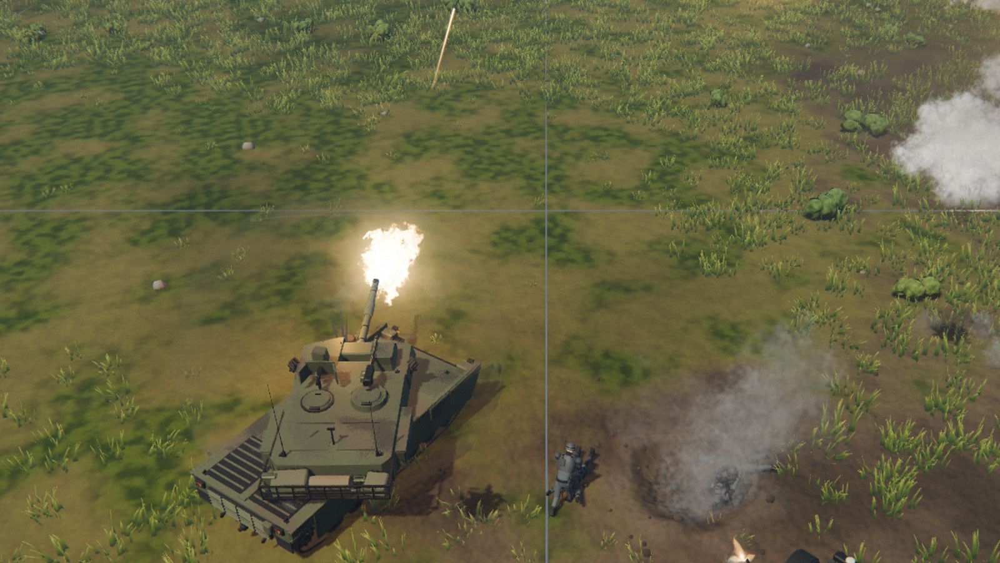

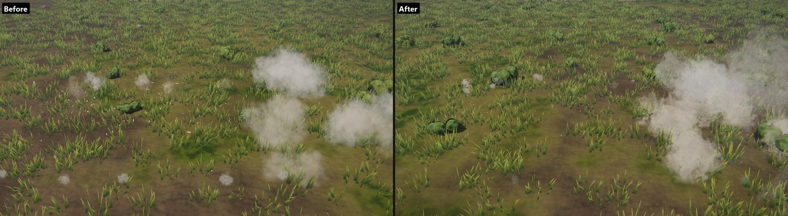

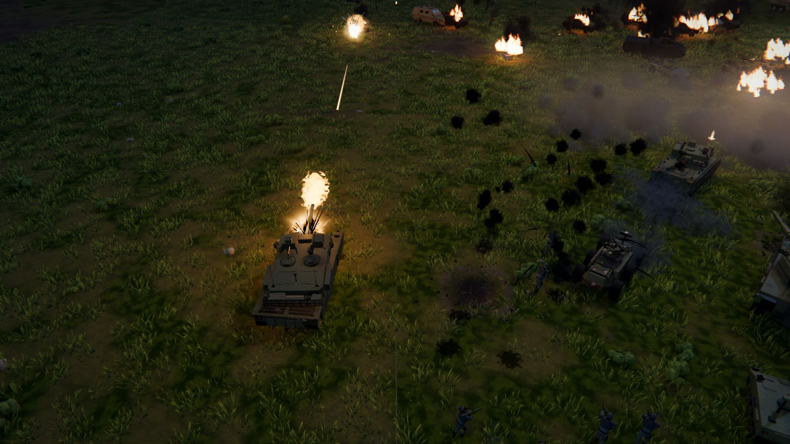

- **Muzzle flashes at real size:** a rifle's is a hand's breadth of flame, a .50's a forearm's, an autocannon's a
  man's height, each gone in a frame and split into petals by the flash hider (or thrown out sideways by a heavy
  gun's muzzle brake). Seen from high up they still twinkle, so you can tell who's firing.
- **Burning gas:** a shot's gas glows for an instant before it cools into a breath of smoke. A tank's gun throws
  out a fireball that rolls into a cloud hanging in front of it; rockets and mortars do the same at the tube.
- **Tracers** are thin, bright threads at night and fainter and shorter by day, as they really look.
- **Bullet impacts** are small and quick: a crown of dust and soil off the ground, a puff of stone dust and chips
  off a wall, a dry burst off sandbags, instead of the big bursts of before.
- **Smoke billows:** gun smoke and dust are shaded as clouds, lit on the sun's side and in their own shadow on the
  other, and no two come out round.

#### A tactical survey map behind the menus

The living map behind the title, menu and loading screen is now a tactical survey sheet with lettered contours, spot heights and a numbered grid. It's calmer, the view pans slowly as clouds drift over, and now and then a burst of interference turns up a contact or a plan.

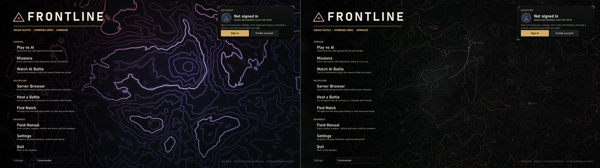

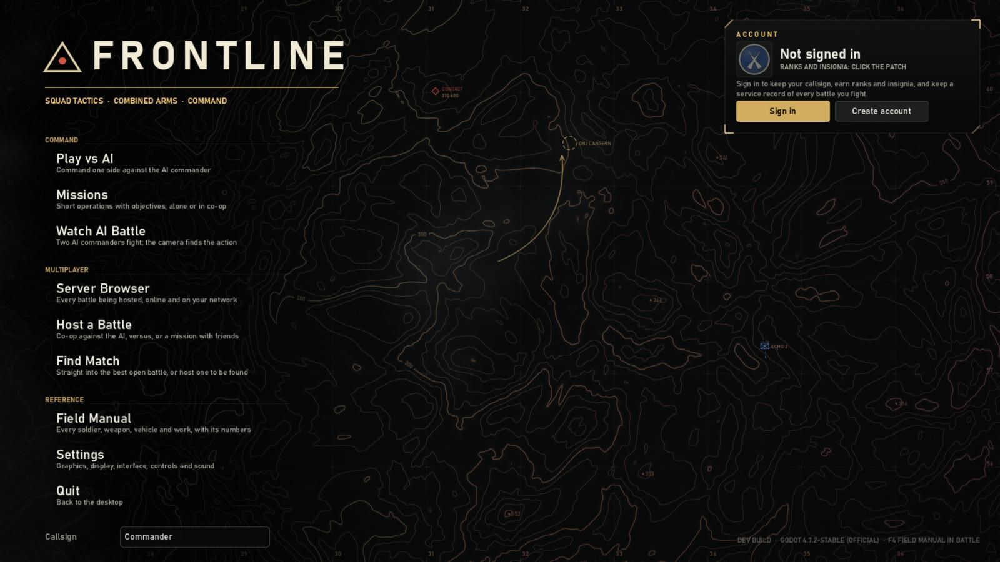

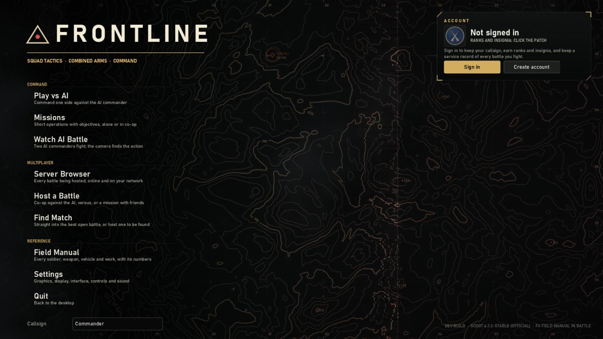

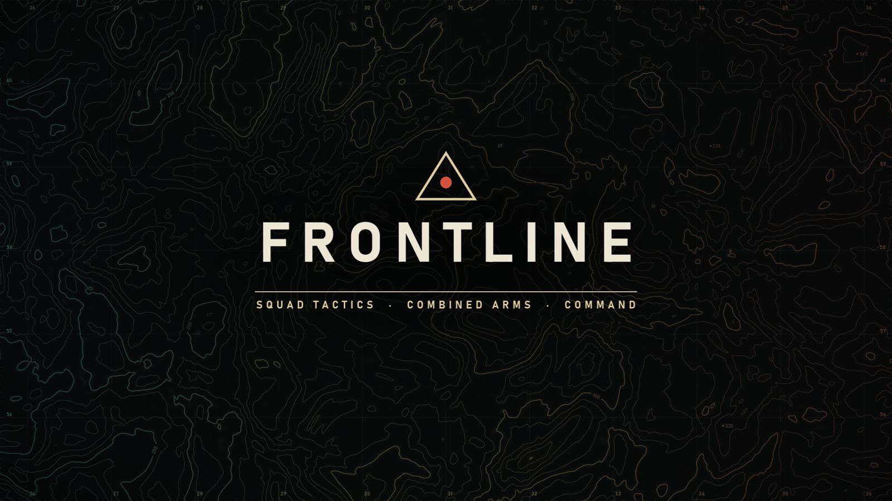

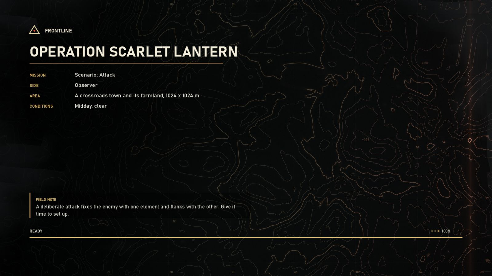

- **A survey sheet:** the map is drawn like a military survey of hill country seen from high up. Fine contours with a heavier index contour every fifth line, lettered with its height; spot heights on the summits; and the map grid numbered round the edges, with a ruler in the margins.
- **Calmer:** the lines are about as faint as the map on the splash screen, and the ground drifts at a quarter of its old speed, so it stays in the background.
- **The view pans:** the map slides slowly by as the view moves east, new ground is surveyed in from the right, and clouds drift over it, casting soft shadows.
- **It follows you:** instead of a hill rising under the cursor, the whole map leans a little after it. A click sends a faint ring across the map instead of a ripple.
- **The map at work:** every few seconds a burst of interference flashes across the map, and what it passes turns up for a few seconds: an enemy contact with its grid reference, a unit moving off along its track, or an axis of advance pencilled in to an objective.

### Fixed

#### Boats come about for a destination astern

A boat sent somewhere straight behind it now turns round and goes there, instead of sailing off the other way with its men still aboard. Wheeled vehicles turn round sooner for a point behind them too.

- An RHIB, gunboat or patrol ship lying still and sent back the way its stern points could hold its course and keep
  going the wrong way for good, so a landing party never reached its beach. Now it puts the helm over and comes
  round, the enemy's boats as well as yours.
- Trucks, cars and other wheeled vehicles sent somewhere behind them turn round on full lock straight away, rather
  than rolling on ahead before they start to turn.

#### The Field Manual opens over the account card

Opened from the menu, the Field Manual and Settings now cover everything behind them, so the account card no longer hides the manual's side filter, search and Close button.

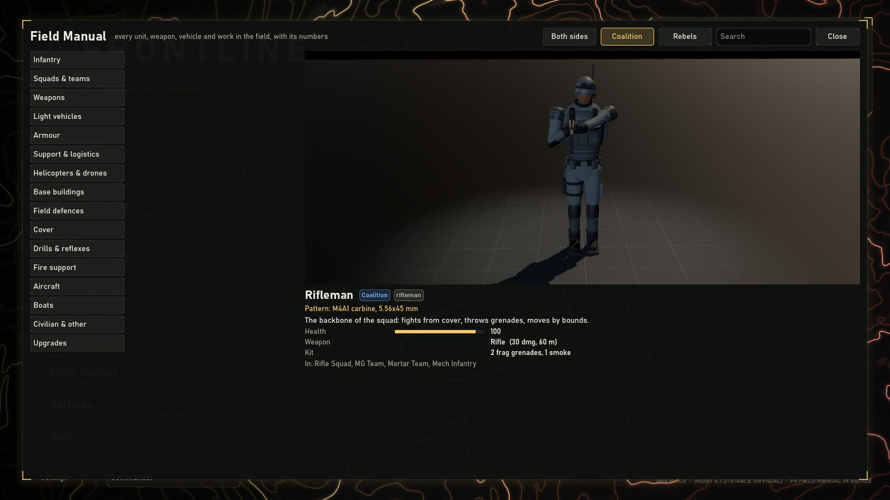

- The account card and the menu's notices sat on top of the Field Manual and Settings when they were open from the
  main menu. Both now come to the front as they open (a join invitation still shows over them).

## v1.0.1: Tons of stuff 2

*16 October 2026* · [Release on GitHub](https://github.com/Dynasty9/Frontline/releases/tag/v1.0.1)

### New

#### Ranks and insignia

Sign in and every battle you fight earns XP. Climb 50 ranks from Recruit to General of the Army, and each one unlocks a military patch to wear beside your callsign.

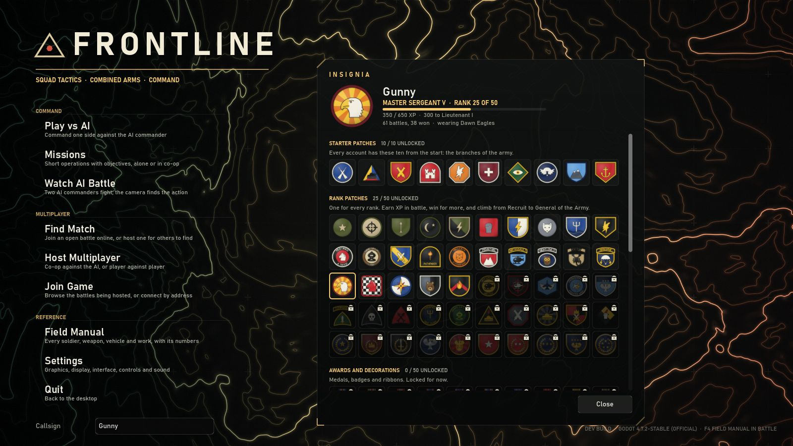

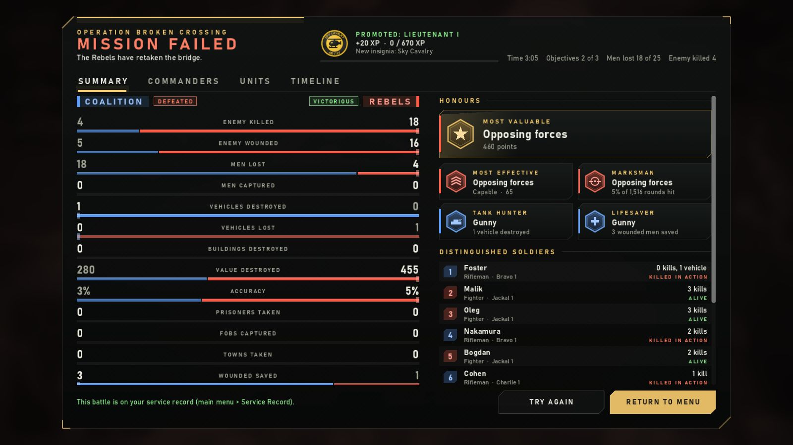

- **XP:** every battle you fight while signed in counts, the longer the better, and a win is worth half as much again. Leaving early still earns half. Battles under two minutes, and battles you only watch, don't count.
- **50 ranks:** Private, Corporal, Sergeant, Staff Sergeant, Master Sergeant, Lieutenant, Captain, Major and Colonel, five grades each, then the five grades of general. The first comes in a battle or two.
- **Insignia:** you start with ten patches, one for each branch of the army, and every rank adds its own, from subdued training patches up to the generals' gold stars. Another 100 are on show but locked for now: medals, badges, ribbons, and company patches in the style of the Vietnam war.
- **Wear one:** click the patch on the account card at the top right of the main menu to open your collection and pick one. Players in the lobby see it beside your name, and the after-action report shows what each battle earned.
- **On the website:** the Insignia section shows the same collection, and lets you pick your insignia there too.

#### Error reports

When something goes wrong in the game, or it crashes, it now tells the developers what failed and where, so it can be fixed. Nothing about you is sent, and Settings turns it off.

- **What's sent:** what went wrong and where in the game's code, the game's version, your operating system and
  graphics card, and whether you were in the menus or a battle.
- **What isn't:** your name, callsign, account, files or address. Paths on your computer are taken out before
  anything is sent.
- **Crashes** are sent the next time you start the game.
- **To turn it off:** Settings > Interface > Send error reports.

#### Rejoin a battle you dropped out of

Lost your connection, crashed or left by mistake? The main menu now offers Rejoin for as long as the battle lasts, and you're back on your side with whatever of your force is still fighting.

- **Rejoin from the main menu:** after a lost connection, a crash or Leave Battle, a card in the corner says whose battle you left and when, with **Rejoin**. It's still there after you restart the game, and **Forget** clears it.
- **Your own place back:** the same side and colour, and your squads and vehicles that are still fighting, including units you'd queued that came out while you were gone.
- **While you're away** your teammates command your forces, or the AI if nobody is left on your side. When you come back, an AI that was only standing in for you hands everything back.
- **Closed battles too:** a battle closed to new players, behind a password or with every seat taken still lets its own players back in, without asking for the password again.
- **In missions** you get your share of the force back.
- **One record for the whole battle:** the after-action report and your service record count what you did before and after you dropped out as one, and if the battle ended while you were away, you get its report when you rejoin.
- **After a crash** you can rejoin straight away: the host lets your old connection go as soon as you're back, instead of waiting a minute or more for it to time out.
- **HQ reserves** go to a commander who is still in the battle, not to one who has left.
- Playing online needs this version on every computer in the battle.

#### A server browser, and a lobby that shows who's coming

Find any battle being hosted, online or on your own network, in a proper server browser. Hosting sets up co-op, versus or a mission (with a password if you like), and the lobby shows who's on which side, the seats left, who's connecting and who's ready.

- **Server Browser** (it replaces Join Game) lists every battle being hosted: its name, host, mode (and side or
  mission), players and seats, whether it's waiting in the lobby or already running, and how good the connection
  should be. Search it, filter it, sort it by any column; it keeps itself up to date. Double-click a battle to join.
- **Battles on your own network** show up there too, marked LAN, even with no internet.
- **Host a Battle** (it replaces Host Multiplayer): pick co-op against the AI, versus, or a mission; your side; how
  many seats; the time of day; and who can join: anyone, friends with a password, or only your network.
- **Host Co-op on a mission** now lists it in the server browser, so friends can find it without your IP address.
- **The lobby** shows both sides with every player, where the AI will play, the open seats, anyone still connecting,
  and who's ready. Players press Ready; the host can change the settings, remove a player and start when they like.
  You hear a chime when someone arrives, and the taskbar flashes if the game is in the background.
- **Copy invite link** in the lobby gives a link to send a friend: it opens the battle on the website, and Join
  there starts the game and brings them in.
- **Joining shows each step** as it happens, asks for the password if there is one, and says plainly what went wrong
  if it can't get in.
- Players with the same name get a number, so two "Commander"s can tell themselves apart.

### Improved

#### Battles and the game start sooner

The host lays out a new battle about a second faster, and the game is ready about half a second sooner after you launch it.

- **New battles:** the routes soldiers and vehicles plan across the map are now worked out on all of your
  processor's cores at once, instead of one.
- **Launching the game:** its sounds are made in the background while the menu comes up, instead of holding it up.
  Each sound is now the same every time you play.

## v1.0.0: Tons of stuff

*16 October 2026* · [Release on GitHub](https://github.com/Dynasty9/Frontline/releases/tag/v1.0.0)

### New

#### Battle statistics and the after-action report

Hold Tab for your side's figures as the battle goes. When it ends, the result slams onto the screen, your rating fills its bar, and the after-action report shows the whole battle: both sides head to head, every commander rated, every unit, and how the fight swung.

- **Hold Tab** for the battle statistics; a tap still opens the tactical map. **Esc > Battle Statistics** keeps them open. Until the battle is over, the enemy's figures are classified.
- **The end of a battle** greys out the battlefield behind a banner: VICTORY or DEFEAT lands with a hit, your rating fills its bar, and the report rises into place. Click to skip.
- **Summary:** the two sides head to head on kills, losses, vehicles, buildings, the value of what each destroyed, accuracy, prisoners, FOBs and towns taken, wounded saved and supply; honours such as Most valuable, Marksman and Tank hunter; and the soldiers with the most kills.
- **Commanders:** every player and AI gets a rating out of 100, mostly what they destroyed against what they lost, then their marksmanship and their share of the fight. Click one to see how it was made, and everything they did.
- **Units:** every squad and vehicle with its kills, losses, men still standing, time in action and fate.
- **Timeline:** men, vehicles, kills and supply over the whole battle, with FOBs, towns, vehicles lost and fire missions marked. Hover for the figures at any moment.
- Every tab comes in row by row: numbers count up, bars and dials fill, honours land one at a time, and the lines draw themselves.
- Kills go to whoever did them, fire support and mines included, even when a wounded man bleeds out later.

#### A changelog for every release

Every release now comes with a changelog: what changed and why it matters, with screenshots. It's on the website, and the game's update notice links straight to it.

- **The website's new Changelog page** lists every release, newest first: its name, the date, a summary, and each change with its screenshots. The front page shows what's new in the latest.
- **What's new in the game:** the update notice has a button that opens the changelog for the version it's installing.
- **The release notes on GitHub** are the same changelog.
- **Updates check the Frontline server first** for the latest version, so the game, the website and the server always agree on what's current.

#### Field defences rebuilt, and four new ones

Sandbags, wire, tank traps, minefields, walls, nests, pits, bunkers and towers all look like the real thing now. New: HESCO walls, Rebel barricades, camouflage nets and ammo caches.

- **Sandbags** are stacked the way soldiers really lay them, and each side fills its own: tan and olive bags for the Coalition, hessian and white feed sacks for the Rebels.
- **Barbed wire** is now three coils of razor wire on steel pickets (wooden stakes for the Rebels). **Tank traps** are steel hedgehogs standing on three legs.
- **Minefields** are buried under loosened earth inside a taped cordon with red warning triangles. Only your own side ever sees them.
- **Concrete walls** are now rows of T-wall slabs. Mortar pits, AT posts, bunkers and watchtowers get proper weapons, bracing, ladders, roofs and earth banked against their walls.
- **New: HESCO barrier** (Coalition): earth-filled cells, chest high. Stand and fire over it. It stops even a .50 cal, and vehicles can't get through.
- **New: Barricade** (Rebels): drums, tyres, rubble and scrap, chest high. Stand and fire over it. A tank shoves it aside, and the tyres burn with thick black smoke.
- **New: Camouflage net** (both sides): put it over a gun pit, a mortar or a parked vehicle. Enemies on the ground or in the air have to come twice as close to spot what's under it. It doesn't stop bullets.
- **New: Ammo cache** (both sides): men within 7 m top up their rounds, grenades and rockets until it runs dry, and soldiers out of ammo head for it before the FOB. If it's destroyed, it explodes, and rounds keep going off for a few seconds.
- The computer opponent builds all four.

#### Change any key

Every key the game uses can now be changed in Settings > Controls: grouped by category, two keys per action, with a search box and a reset for each.

- **Every action, by category:** camera, saved views, orders, abilities and fire support, building, control groups, co-commanders, interface, and the observer's controls. The mouse's own controls are listed at the end.
- **Two keys for each**, including combinations with Ctrl, Shift or Alt, a modifier on its own, and the mouse's side buttons. Click a key and press the new one; Esc cancels, right-click clears it.
- **A key that's already taken** moves to the new action, the page says which action lost it, and Undo puts it back.
- **Search** for an action or a key, reset one action, or reset everything.
- **The hints follow your keys:** the command card, the controls help (F1), tooltips and the loading screen's tips all show the keys as you've set them.
- **Two new optional keys:** one to ping at the cursor (hold it for the ping wheel), and one to step through your co-commanders' views.

#### Interface themes, and the living map in battle

Pick a theme for the whole interface in Settings > Interface: Field Brass, Night Vision, Thermal, Arctic or Dusk. Panels get a new tactical frame, and the living map now shows through behind the menus in a battle.

- **Five themes:** Field Brass (the original), Night Vision, Thermal, Arctic and Dusk. Each recolours the interface and the living map's contour lines; green, red and yellow still mean what they always did.
- **Changes live:** the interface recolours as soon as you pick a theme, and the map's colours flow into the new ones.
- **A tactical frame:** panels have accent brackets on their corners, like the crosses on the map's grid, and a faint glow. The button under the cursor glows too.
- **The map in battle:** the Esc menu, the help, the settings and the end of the battle sit over a see-through version of the living map, with the battlefield showing through. At the end of a battle a wave wakes it from the middle of the screen.

#### A living map behind the title and menu

The title screen, the main menu and the loading screen now sit on a living topographic map: its ground slowly shifts, its contour lines glow in changing colours, and it reacts to your cursor.

- **The map moves:** hills slowly drift, merge and part, and the contour lines slide up and down the slopes.
- **The colours change:** the lines turn through brass, ember, rose, violet, blue and jade over a minute and a half, blending across the screen.
- **It follows you:** the ground rises in a hill under your cursor, and a click sends a ripple across the map.
- **The title comes alive:** it starts exactly as the splash screen looks, then a wave runs out of the emblem and wakes the map. The title lifts away and the menu glides in. Click or press a key to skip it.
- **The loading screen:** a survey beam sweeps the map and the view closes in on the ground, then dives into it as the battle fades in.
- The menu's 3D gun position is gone; the map replaces it.

#### A service record, and a sign-in you can find

Sign in from the account card at the top right of the main menu. Signed in, every battle you fight goes on your service record, and you can open any of their after-action reports again.

- **Signing in** is now at the top right of the main menu, with **Create account** beside it. The end of a battle offers it too. You still don't need an account to play.
- **Your service record** keeps every battle you fight as a commander: what it was, your side, the result and length, your rating, kills and losses.
- **Service Record** on the main menu shows your career (battles, wins, kills, K/D, average rating and time in battle) and every battle, newest first. Click one for its after-action report.
- **Battles fought signed out** or offline wait on your computer (the last ten) and go on your record when you sign in.

### Improved

#### Gunfire that hits hard

Muzzle flashes, tracers, recoil and bullet impacts are rebuilt from scratch: every shot flashes and kicks, tracers glow in each side's colour, and what a round hits decides what flies off it.

- **Muzzle flashes:** a white-hot burst with a tongue of flame thrown out ahead, bigger for a machine gun and bigger
  again for a .50 or an autocannon. Each one lights up its surroundings for a moment, which is striking at night,
  and leaves a breath of smoke. Spent cases spin out of the rifle and pile up round a machine gun.
- **Recoil on every shot:** rifles kick back into the shoulder and the muzzle climbs, mounted guns jump on their
  mounts, and a tank's turret jolts back when the main gun fires.
- **Tracers** glow red for the Coalition and green for the Rebels, and stay visible however far out you zoom.
- **Impacts depend on what's hit:** earth spurts up with clods raining down, stone walls throw grit and chips,
  sandbags burst into dust, wood splinters, hedges and trees shed leaves, steel throws sparks, and water throws up
  a white splash. The impact shows when the round arrives, and now and then a round ricochets off and goes
  whining away.
- **Tank guns** fire with a blinding flash, a fireball, burning flecks, a rolling cloud of smoke and dust blasted
  off the ground. **Rockets** kick up a back-blast behind the launcher.
- Heavy firefights run about as fast as they did before.

#### Water that looks like water, and sea battles to match

The sea rolls in and breaks on the beach, you can see the sand through the shallows, and boats leave real wakes. A boat that's sunk now goes down burning and leaves an oil slick, instead of just vanishing.

- **The sea:** a swell rolls in off the open sea, and boats rise and roll on the waves you see. Breakers spill along the beach, run up the sand and drain back, leaving it dark and wet.
- **See into the water:** sand shows through the shallows and the sea turns turquoise, then deep blue farther out. Rivers and ponds are murky.
- **Light on the water:** the sky and clouds reflect in it, the sun glitters off the ripples (a moon path at night, only a sheen under cloud), and rain dimples it with rings.
- **Wakes:** boats churn up white water astern and push a bow wave out in a V; fast boats throw spray. A boat hidden in the fog of war hides her wake too.
- **Sinking:** a boat that's sunk blows up, lists over and goes down by the bow or the stern, burning until the water closes over the fire. Foam boils up where she went, and an oil slick spreads with wreckage drifting in it.
- **Fire on the water:** shells throw up a column of spray and leave a ring of foam, bullets kick up white spouts, and a shell that hits a boat bursts in flame instead of a splash.

#### Towns in the help and loading tips

The in-game help (F1) now explains towns: how to take one, what holding it gives you, and that you can click a dump for its details.

- **F1 help:** a new Towns line covers taking a town, what it gives you, and clicking its dump. The Supply line points at the income shown in the top bar.
- **Loading screen:** two new tips point new players at the villages, and warn that a town shelled to ruins gives far less.

### Fixed

#### No network error when more players join

In a battle with three or more players, everyone else's game reported a network error each time another player joined. It no longer does.

- **More players:** a third or later player joining no longer sets off an error on the other players' games.
- **Long map builds:** every player's connection to the host still waits patiently while the host lays out the map,
  so nobody is dropped before the battle starts.

## v0.1.8: Co-commanders

*16 October 2026* · [Release on GitHub](https://github.com/Dynasty9/Frontline/releases/tag/v0.1.8)

In co-op you can see what the other commanders on your side are doing: where they're looking, what they've selected and what they're about to order. Pings and map sketches let you talk without typing.

### New

#### See what your co-commanders are doing

Each commander on your side gets a colour, and you see where they're looking, their cursor, what they control and what they're about to commit to, so two of you don't shell the same wood or storm the same house.

- **Where they're looking:** a viewfinder on the ground labelled with their name, a wedge on the minimap, and a marker at the edge of your screen when they're looking elsewhere. Click it to look there.
- **Their cursor**, with a tag saying what they're doing: "Digging a trench line", "Aiming 155 mm Artillery", "Ordering an attack".
- **What they control:** their name and colour in the order of battle, their initials on their units' symbols, and a ring round whatever they have selected.
- **What they're about to do:** the building they're placing, the line they're dragging out, or a fire mission's target area with a hazard sign.
- **The Command Net** (top right) lists each teammate's latest move, with buttons to look at their view or follow it live.
- When a teammate builds, calls in support, trains a unit or starts research, the rest of the side is told, so everyone knows where the shared supply went. Settings > Interface can turn all of this off.

#### Pings and map sketches

Mark an enemy, a unit or a spot with a ping, pick a call from the ping wheel, or draw on the map for your side.

- **Ping:** Alt + click on the battlefield or the minimap. A ping on an enemy sticks to him while he's in sight.
- **Ping wheel:** hold Alt and the left button, then let go on attack, on my way, need support, danger, defend or look. "On my way" draws a line from your units to the spot.
- **Sketch:** Alt + right-drag draws a line your side can see, on the battlefield or the minimap.
- **Space** jumps to the newest alert or ping. Pings chime and go in the message log.

## v0.1.7: Window Size

*16 October 2026* · [Release on GitHub](https://github.com/Dynasty9/Frontline/releases/tag/v0.1.7)

The game opens at the window size you chose, and the squad card fits even at the largest interface scale.

### Fixed

#### The game opens at the window size you chose

Settings > Display > Window size was saved but ignored at launch, so the game always opened small. Now it opens at your size, and maximises if that doesn't fit your screen.

- The window opens at the size you picked, so the interface (which follows the window) is the size you expect from the start.
- If the size doesn't fit your screen with its title bar, the window is maximised instead of being pushed off the top.

#### The squad card fits a narrow panel

At the largest interface scale, an attack's PLAN › MOVE › ASSAULT › SECURE steps were drawn over the squad's orders. Now they move to a line of their own when there's no room.

## v0.1.6: Towns and Supply

*16 October 2026* · [Release on GitHub](https://github.com/Dynasty9/Frontline/releases/tag/v0.1.6)

The town and every village now have a supply dump worth fighting for. Hold one and it sends trucks of supply to your nearest FOB; lose it and the enemy gets them.

### New

#### Capturable towns that give supply

Each village and the town has a named supply dump. Hold the ground round it and the place is yours: it produces supply, and its own truck drives it to your nearest FOB.

- **Eleven places to take:** the town and ten villages, each with a name. Nobody holds them at the start.
- **Taking one:** have men inside its ring with none of the enemy's. A squad takes a village in about 30 seconds and the town in about 50, faster with more men. With both sides inside, the capture freezes, and the holder is warned as soon as the enemy starts.
- **Supply:** a held village makes 24 a minute and the town 60. Shelled or burnt houses cut that. Whatever's in the dump changes hands with the town.
- **The town's truck** drives each load to your nearest FOB on a road of its own, which can be ambushed or blocked like any supply road. A destroyed truck loses its load.
- **More reasons to hold them:** you can build a FOB near a town you hold, your men refill ammunition at its dump, and it gives you sight around it. Prisoners can tell you about towns and their trucks.
- **The AI goes for them too:** it sends squads to take towns from the start, holds them, and counts enemy-held towns as targets.

### Improved

#### A clearer supply picture

The top bar shows your income per minute and how many towns you hold, and the order of battle lists each town's stock, rate and truck.

- **Top bar:** income per minute beside your supply, and **TOWNS 3 / 11**.
- **Town lines** beside the FOB lines show each town's stock and rate and where its truck is going. A town being taken, or whose truck was destroyed or blocked, gets a red line of its own.
- **On the minimap** each town is a flag in its holder's colour inside its ring, and the ring fills with the colour of whoever is taking it.
- **On the battlefield** each town has a name plate, its ring is drawn on the ground when the camera is near, and a capture bar shows over the dump.

## v0.1.5: Roaring Fires

*16 October 2026* · [Release on GitHub](https://github.com/Dynasty9/Frontline/releases/tag/v0.1.5)

Fires roar and crackle instead of surging like surf, and many explosions at once no longer distort.

### Fixed

#### Fires roar instead of surging

Burning buildings had the same rolling-surf sound the wind used to have. Now a fire is a steady roar with crackles on top.

- The roar sits in the middle of the range instead of a low rumble, at the same loudness as before.
- It loops without a dip or a jump.

#### No more distortion when shells land together

When several explosions went off at once the sound could clip. A limiter on the master volume now holds it just under the top, and everyday levels are unchanged.

## v0.1.4: Reconnaissance

*16 October 2026* · [Release on GitHub](https://github.com/Dynasty9/Frontline/releases/tag/v0.1.4)

You can see what your side can see: the fog of war is drawn on the battlefield and the minimap. Aircraft spot as they fly, and recon flights, overwatch drones and manned watchtowers push the fog back.

### New

#### A fog of war you can see

Ground your side can't see right now is drawn darker on the battlefield and the minimap, so you know where your vision ends and where you need eyes.

- The edge is soft, aircraft overhead aren't darkened, and at night it's lighter because everything is dark already.
- **What you see darkened is exactly what's hidden from you:** enemies inside it don't show.
- **Last-known positions:** an enemy anyone on your side has seen stays marked where it was last seen for 90 seconds, with how long ago.
- The new eye button in the map layers turns the fog off.

#### Aircraft that spot, recon flights and overwatch drones

Every aircraft now reveals the ground it flies over. New fire-support calls fly recon passes along a line you draw, or put a drone overhead to watch one spot.

- **Aircraft spot as they fly:** bomb runs, gun runs, gunships and armed drones all reveal what's around them. The minimap shows every aircraft.
- **Recon passes** (from minute two): the Coalition's A-149 Gryphon flies fast and high, the Rebels' Caesar spotter flies slow and low. Drag out a line; the strip they fly over stays lit for six seconds.
- **Overwatch drones** (from minute four): an unarmed drone circles a spot for about a minute and shows what's around it.
- **Watchtowers** see further, and further still with a lookout up them. Placing one shows its reach.
- **The Rebels get a drone too:** the AR-2 Tayran quadcopter, at the Helipad.
- The enemy is warned when a recon flight or overwatch drone comes over, and the AI calls recon flights before it attacks ground it can't see.

## v0.1.3: Soundtrack

*16 October 2026* · [Release on GitHub](https://github.com/Dynasty9/Frontline/releases/tag/v0.1.3)

A synthesised orchestral soundtrack that follows the fighting, a volume slider for each kind of sound, and wind that sounds like wind.

### New

#### A soundtrack that follows the fighting

Music, made in code like everything else: a theme for the menu, and a battle score that builds as the fighting heats up and eases off in the lulls.

- **Instruments:** strings, horns, a wordless choir, piano, timpani, a war drum and a snare, played through a concert-hall reverb.
- **The menu** has a two-minute theme in D minor.
- **In battle** the score comes in layers: strings and a few piano notes when it's calm; a low-strings pulse, drums and horns as the fighting grows. After a long stretch at full intensity it eases off, and in quiet spells it rests.
- **Victory and defeat** each get a short sting.

### Improved

#### A volume slider for each kind of sound

Settings > Audio has separate sliders for music, effects, ambience and the interface, plus a switch for music in battle and one to mute the game in the background.

- **Master, Music, Effects, Ambience and Interface**, each on its own slider.
- **Music in battle** can be switched off while keeping the menu music.
- **Mute in the background** silences the game when you switch away.
- The sliders follow your ears: halfway sounds about half as loud.

### Fixed

#### Wind that sounds like wind, not surf

The ambience used to sound like waves breaking. Now it's rushing air with gusts that come and go, over far-off artillery and gunfire.

- The wind no longer swells and fades on a fixed four-second cycle, or gets louder as you zoom out.
- The distant battle is far-off thumps and bursts instead of a low rumble.
- Wind, rain and the distant battle loop without a seam.

## v0.1.2: Fire and Smoke

*16 October 2026* · [Release on GitHub](https://github.com/Dynasty9/Frontline/releases/tag/v0.1.2)

Things catch fire now: woods, hedgerows, timber roofs and wrecks burn and spread it downwind. Explosions and smoke are bigger and look the part.

### New

#### Fire that spreads

Shells, bombs and burning wrecks set things alight. Fires take hold, roar, spread to whatever will burn nearby (much more readily downwind), and burn themselves out.

- **What burns:** trees, hedges, crates, watchtowers, log dugouts, tents and plank huts, timber roofs and parked cars. Stone, brick, concrete, earth, sandbags and steel don't.
- **What sets it off:** blasts (a shell or bomb often, a grenade rarely), cars that have been badly shot up, and destroyed vehicles, which now burn where they died.
- **Grass fires:** a heavy round in long grass or undergrowth can start a ring of low flames creeping outward over blackened ground.
- **Spreading:** at full blaze a fire jumps to what's nearby, so a hedgerow or a wood can go up one tree after another.

### Improved

#### Bigger explosions and smoke

Explosions throw a proper fireball and debris, and smoke rises as one billowing column instead of a string of puffs.

- Fireballs last long enough to see, and the bigger the round, the bigger the blast.
- Smoke from fires and wrecks rises as a continuous column and drifts with the wind.

## v0.1.1: Interface Scale

*16 October 2026* · [Release on GitHub](https://github.com/Dynasty9/Frontline/releases/tag/v0.1.1)

The interface grows with your window, stays sharp at any size, and can go much bigger without panels running into each other.

### Improved

#### An interface that's big enough, and stays sharp

Interface scale now follows the size of your window, text and symbols stay crisp at any scale, and it goes much bigger without the panels overlapping.

- **Follows the window:** at 100% the interface takes the same share of the screen at any resolution, so it's bigger at 1440p and 4K than before.
- **Sharp at any size:** text and map symbols are drawn at the scale they're shown, not stretched.
- **Goes bigger:** the slider reaches the largest scale your window has room for (2× at 1080p, 2.67× at 1440p).
- **No collisions:** the minimap, selection panel and command card make room for each other, and the Field Manual and observer bar stay on screen.
- It follows window resizes and fullscreen switches as they happen.

## v0.1.0: First Release

*16 October 2026* · [Release on GitHub](https://github.com/Dynasty9/Frontline/releases/tag/v0.1.0)

The first build you can download and play: the whole game as it stands, now with online play through Find Match, missions, camera controls from other RTS games, restyled soldiers, and a game that keeps itself up to date.

### New

#### Online play: Find Match and a list of battles

Press Find Match to drop into an open battle, or host one for the next player to find. Join Game lists every battle being hosted, and most home routers need no setup.

- **Find Match** joins the best open battle (ones still in the lobby first, then the fullest). If there isn't one, it hosts a battle and lists it for others.
- **Join Game** shows every battle being hosted: its commander, how many are in it, and whether it's still in the lobby or already fighting.
- **No port forwarding for most players.** Your game and the host's are introduced to each other and connect directly; the game traffic never goes through a server. A few strict networks (some mobile and campus ones) can't be reached this way, and the lobby says so.
- **Join by address** still works for LAN and VPN games.
- **Accounts are optional.** Sign in beside your callsign and it's yours: no one else can register it, and battles you host show a tick.

#### Missions

Five short operations with objectives and radio traffic, to play alone or in co-op.

- Each mission sets a side, a goal and a time of day, and ends in **Mission accomplished** or **Mission failed**.
- Play them alone, or host one for friends to join in co-op.

#### The game keeps itself up to date

When a new version comes out, the game downloads it in the background, checks it, and asks you to restart. Quitting works too: the next launch is the new version.

- The menu shows the download's progress, then **Restart**.
- Every download is checked against the checksum published with the release before it's installed.
- If the game's folder can't be written to, it links to the download instead.
- The version you're running is shown at the bottom right of the menu.

#### The Frontline website

The battles being hosted right now, a Join button that opens the game and connects you, and the latest download.

- **Join from the browser:** click Join on any battle and the game opens (or the one you have open takes over) and connects you.
- **Downloads** for Windows and Linux, always the latest version.
- Start the game once after downloading, so your computer knows how to open the site's Join links.

### Improved

#### Camera controls from other RTS games, and a clearer minimap

The mouse wheel zooms towards the cursor, middle-drag turns and tilts, and the minimap's edges aren't hidden under buttons any more.

- **Zoom toward the cursor:** whatever you aim at stays under the mouse.
- **Middle-drag** turns (left and right) and tilts (up and down). **Alt + middle-drag** grabs and drags the map.
- **Shift** pans faster, and panning eases in and out.
- **Backspace** (or the compass on the minimap) resets the view, **Ctrl + F** follows the selection, and **Ctrl + F5 to F8** save views that **F5 to F8** recall.
- Jumps to alerts, bases and groups glide instead of cutting.
- The minimap's buttons moved off the map, so its top row and right-hand column are visible.

#### Restyled soldiers

Soldiers have a new look, after the early Metal Gear Solid games: chunkier, clearer silhouettes that read well from the battle camera.

- New proportions and gear for both sides, so riflemen, gunners and engineers are easier to tell apart at a glance.
