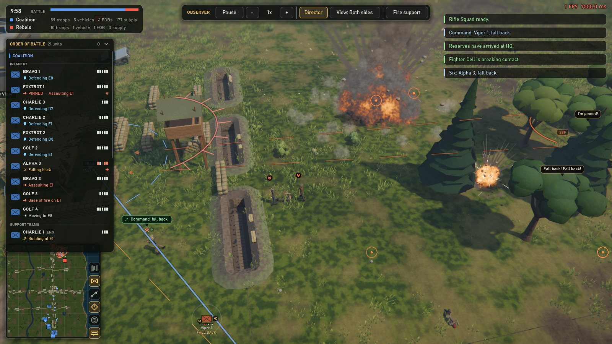
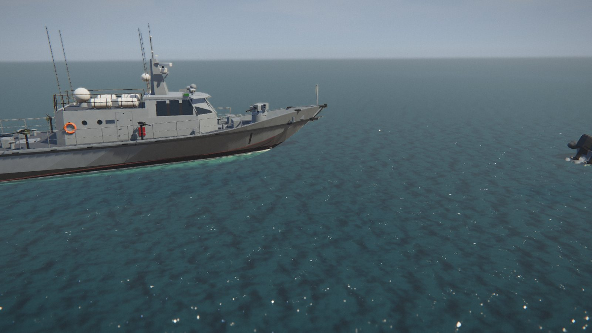
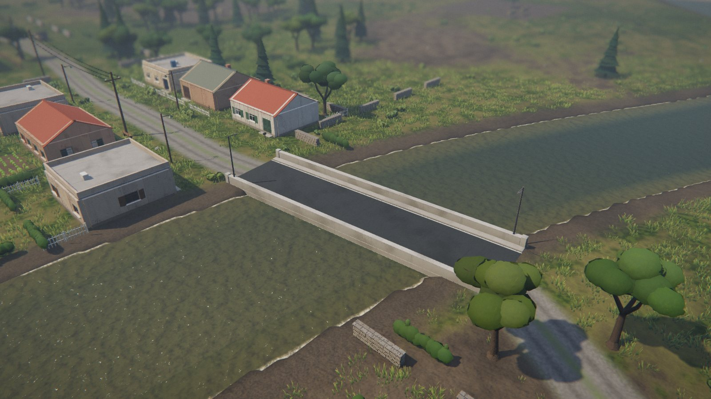
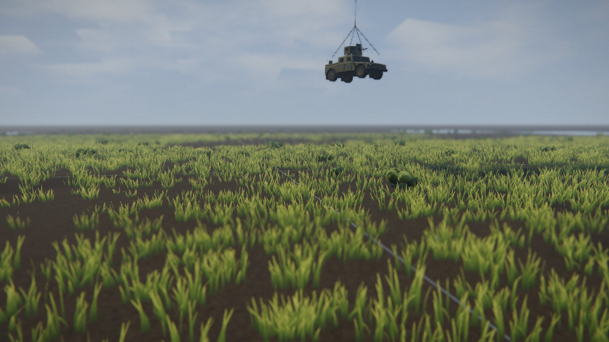
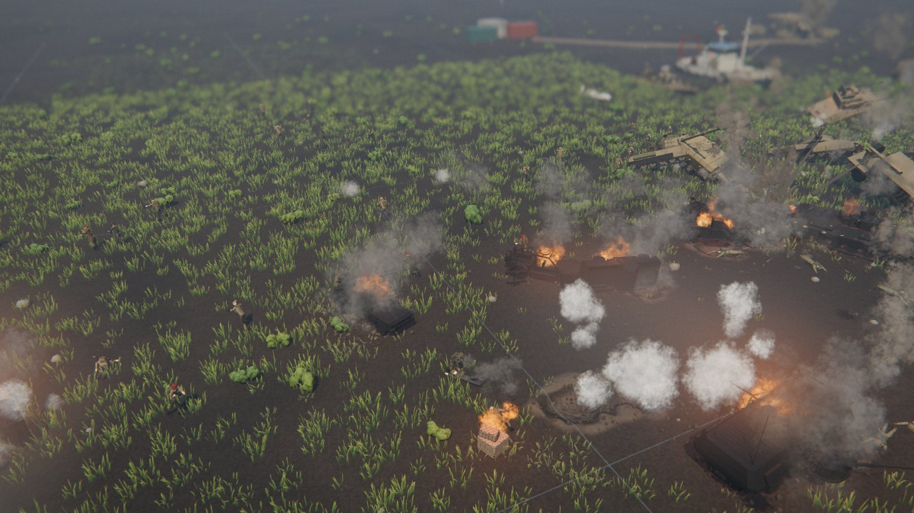
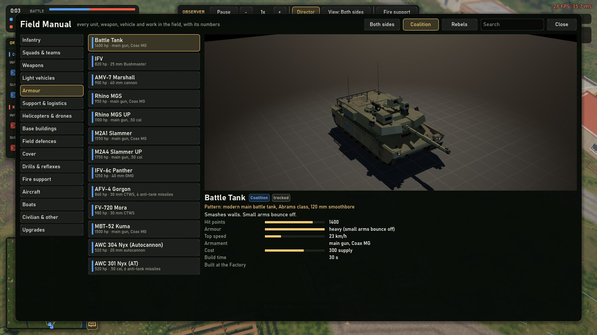
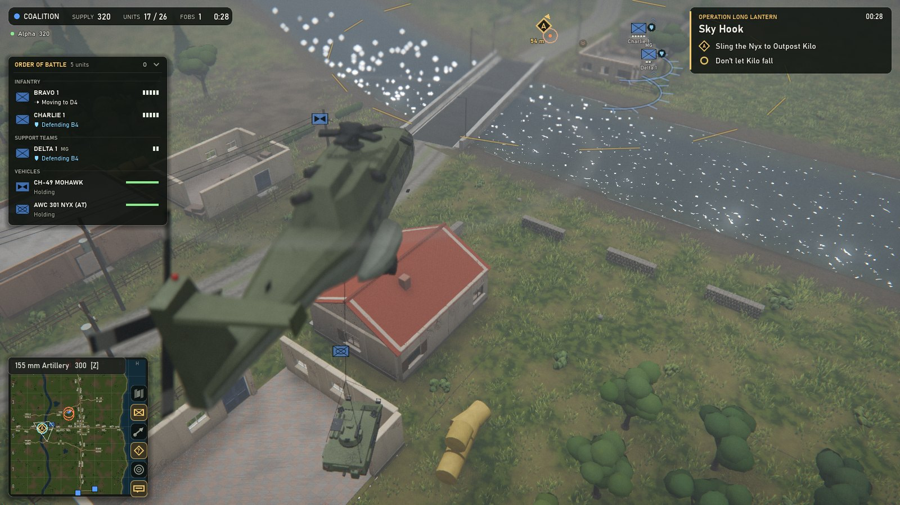
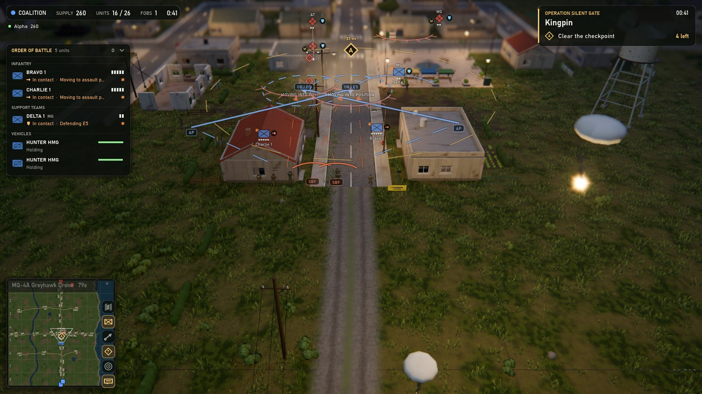

# Frontline

**A squad-level military strategy game where every soldier thinks for himself.**

## What is it?

Frontline is a real-time strategy game about modern infantry combat. You command squads, not individual soldiers: you decide where they go, and they decide how to get there and how to fight.

Your soldiers take cover behind real walls and wrecks, keep their heads down under fire, drag their wounded to safety and throw enemy grenades back. Squads leapfrog forward one team at a time, clear houses room by room, set ambushes on the roads, and break and run when a fight goes badly. Tanks pop smoke when a missile is fired at them. Shellfire sets woods, hedgerows, roofs and cars alight, and the fire spreads with the wind and drives men out of their cover. Boats land raiding parties on the beach, and helicopters carry vehicles to the front on a cable.

You can play alone against the computer, team up with friends against it, or fight each other online. The battlefield is a square kilometre of countryside with a town, villages, a river and the sea.

Everything you see and hear is made in code, the music included. There are no imported 3D models, textures or sound files.

## Screenshots

| | |
|---|---|
|  |  |
| A patrol ship off the coast | A bridge over the river, by a village |
|  |  |
| A helicopter carrying a Humvee | A tank battle |
|  | |
| The Field Manual: every unit, with its stats | |

## Quick start

The easiest way: download the latest build for Windows or Linux from **[the Frontline website](https://web-production-5a4c1.up.railway.app)** (or the [releases page](https://github.com/Dynasty9/Frontline/releases)), unzip it and run it. It updates itself when a new version comes out. The website also lists the battles being hosted right now, with a **Join** button on each that opens the game and connects you.

To run it from source instead:

1. Download **Godot 4.7** (the standard version, not .NET) from [godotengine.org](https://godotengine.org/download).
2. Download this project: click **Code > Download ZIP** above, or run
   `git clone https://github.com/Dynasty9/Frontline.git`
3. Open Godot, click **Import**, choose the `project.godot` file in this folder, then press **F5** to play.

## Your first battle

The easiest way in is to watch first. Choose **Watch AI Battle** from the main menu: two computer commanders fight, and the camera follows the action on its own.

When you're ready, choose **Play vs AI** and pick a side. You start at your base with a rifle squad and some engineers.

1. **Select a squad.** Left-click any of its soldiers, or drag a box around it.
2. **Move it.** Right-click the ground. Coloured dots show where each man will stand: green is good cover, yellow only hides him, red means he's out in the open.
3. **Attack.** Press **X** and click a spot. The squad advances in bounds, one team covering the other, and fights whatever it meets.
4. **Hold ground.** Press **B** and click an area. The squad spreads into the best cover there and stays put.
5. **Build.** Select your engineers and use the build menu at the bottom of the screen. Barracks train more squads, a factory builds vehicles, and new FOBs extend your reach.
6. **Call support.** The buttons above the minimap call in mortars, artillery and air strikes.
7. **Get eyes on.** Ground your side can't see right now is drawn darker, on the battlefield and the minimap. Watchtowers, drones from the helipad and recon flights (on the support panel) see further, and every aircraft you call in spots for you as it flies over. Whatever they spot stays on the map as a last-known position.

Press **F1** at any time for help, and **F4** for the Field Manual.

## Missions

Want something shorter, with a story? **Missions** on the main menu has five-minute operations you can play alone or with friends:

- **Bridgehead**: clear a village and seize the bridge behind it, then hold it against the counterattack.
- **Beachhead**: land from the sea, knock out the harbour's anti-aircraft guns and take the harbour.
- **Sky Hook**: carry a tank destroyer to a cut-off outpost under a helicopter, then stop the armour coming for it.
- **Ambush Alley**: play the Rebels, ambush a Coalition convoy and vanish before the reaction force arrives.
- **Kingpin**: a night raid into the town to take down a Rebel commander.

Each has objectives on screen and marked on the map. Choose **Host Co-op** to play one with friends: it's listed in the server browser for them to join.

| | |
|---|---|
|  |  |
| Sky Hook: the Nyx on its way to Outpost Kilo | Kingpin: the checkpoint, at night |

## Controls

**Camera**

| Action | Keys |
|---|---|
| Move the camera | WASD, arrow keys, or push the mouse to the screen edge (hold Shift to go faster) |
| Grab and drag the map | Alt + drag with the middle mouse button |
| Zoom | Mouse wheel (zooms toward the cursor), or + / - |
| Turn | Q / E, or drag with the middle mouse button |
| Tilt | Page Up / Page Down, or drag the middle mouse button up and down |
| Square the view up again | Backspace, or click the compass on the minimap |
| Follow the selected units | Ctrl + F |
| Save a view / go back to it | Ctrl + F5 to F8 / F5 to F8 |
| Look somewhere else | Click or drag on the minimap |
| Jump to your bases | Home |
| Jump to the latest alert | Space |

Prefer the middle mouse to pan rather than turn? Swap them in **Settings → Interface**, where you'll also find the minimap's size and an option to turn it with the camera.

**Selecting**

| Action | Keys |
|---|---|
| Select a squad | Left-click one of its soldiers |
| Select several squads | Drag a box |
| Select every unit of that type on screen | Double-click |
| Command one soldier on his own | Alt + click him |
| Save a group / recall it | Ctrl + 1-9 / 1-9 |

**Orders**

| Action | Keys |
|---|---|
| Move | Right-click (hold Shift to run; drag to set which way they face) |
| Attack a unit | Right-click it |
| Attack-move | X, then click (or Ctrl + right-click) |
| Defend an area | B, then click |
| Retreat to the nearest base | R |
| Hold position | H |
| Throw a grenade / smoke | G / T |
| Mortar fire mission (mortar teams) | F |
| Board a vehicle or boat | Right-click it with a squad selected |
| Carry a vehicle by helicopter | Select a transport helicopter, right-click one of your vehicles, then right-click where to drop it |

**Building**

| Action | Keys |
|---|---|
| Place a building | Select engineers, pick from the build menu, left-click |
| Rotate it | R (90 degrees) or Shift + mouse wheel (45 degrees) |
| Lay a line of trenches, sandbags or wire | Click and drag |
| Garrison a bunker | Right-click it with a squad |

**Screens**

| Action | Keys |
|---|---|
| Tactical map | Tab |
| Order of battle (all your units) | O |
| Help | F1 |
| Hide the interface | F2 |
| Performance overlay | F3 |
| Field Manual | F4 |
| Chat (team chat) | Enter (Shift + Enter) |
| Message history | L |
| Menu and settings | Esc |

When watching an AI battle: **C** hands the camera back to the director, **V** picks whose view you see, **P** pauses, and **[** and **]** change the speed.

## Playing with friends

The quickest way in is **Find Match**: it drops you into an open battle someone is hosting, or, if there isn't one, hosts a battle that the next player to press it will join.

To play with particular people:

1. One player chooses **Host a Battle** and picks what kind:
   - **Co-op vs AI:** everyone on one side, and the computer commands the other.
   - **Versus:** players pick sides; the computer can take a side nobody plays, or help either side.
   - **Mission:** one of the missions, played together.

   They also choose how many seats there are, the time of day, and who can join: **Public** (anyone, from the server browser), **Password** (listed with a padlock; only friends with the password get in) or **Unlisted** (players on your network, or with your address).
2. Everyone else opens the **Server Browser** and joins it: search for its name, or double-click it. Battles on your own network show up there too, marked **LAN**, with no internet needed. The host can also press **Copy invite link** in the lobby and paste it to a friend; the link opens the battle's page on the website, whose **Join** button starts the game and brings them in.
3. The lobby shows who's on which side, the seats still open, anyone connecting, and who's ready. Players press **Ready**; the host clicks **Start Battle** (and can change the settings, or remove a player, until then).

The game connects players straight to the host, through most home routers, without anyone opening ports. A few networks (some mobile and campus ones) are too strict for that; the server browser and the lobby say so, and then the host needs UDP port **7777** open, or you can play over a LAN or a VPN such as Tailscale, ZeroTier or Hamachi (**Direct connect** in the server browser takes an address). Friends can also join a battle that's already running.

You can sign in with an account (next to your callsign on the main menu). It keeps your callsign yours: no one else can register it, and battles you host show a tick. You don't need one to play.

## Learn more

- **[How it all works](docs/FEATURES.md)**: the soldier and squad AI, vehicles, the map, water, supply, the interface and the AI commander, in depth.
- **[Developer guide](docs/DEVELOPMENT.md)**: how the code is organised, and how to run the automated tests.
- **[Contributing](CONTRIBUTING.md)**: how to report bugs and send changes.
- **[AGENTS.md](AGENTS.md)**: notes for AI coding assistants working on the project.

## License

Frontline is free and open source under the [MIT License](LICENSE). © 2026 Alexander Dines.

Many vehicle names nod to the fictional vehicles of Bohemia Interactive's *Arma 3*. Frontline is an independent fan project. It is not affiliated with or endorsed by Bohemia Interactive, and all its models are original, built in code from real-world references.
