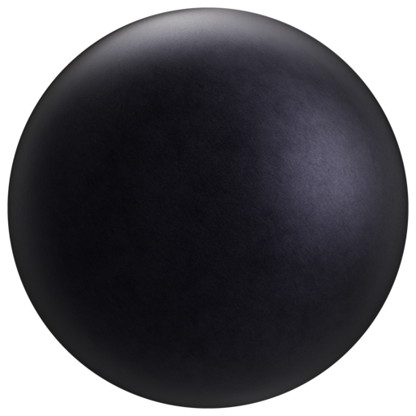
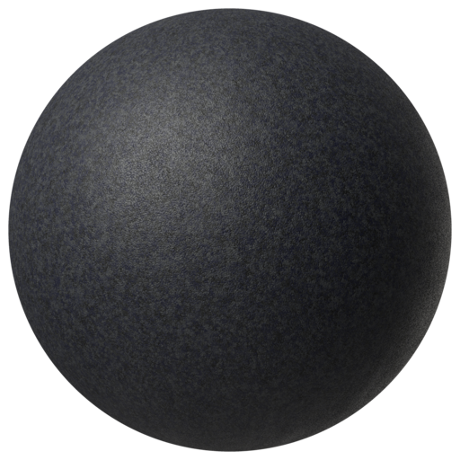
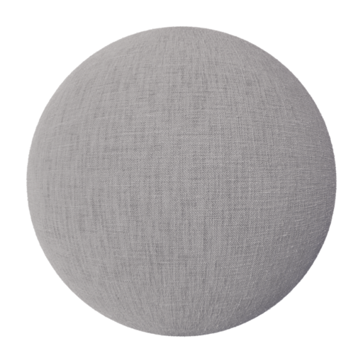
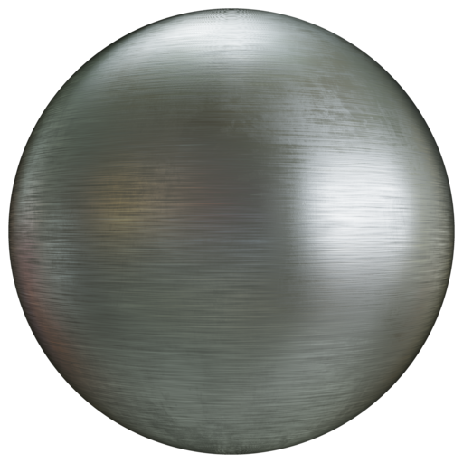
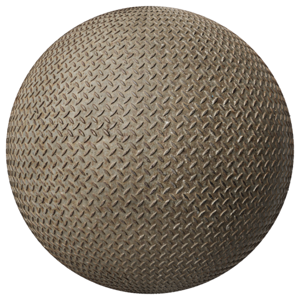
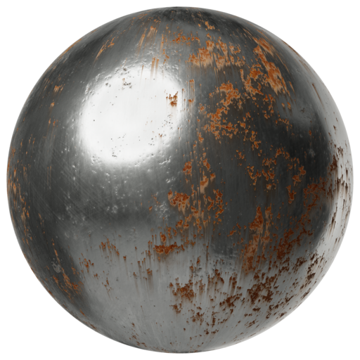

# CC0 vehicle texture sources

Six ambientCG PBR sets, bundled for developing the shared vehicle materials.
**These are source candidates, not yet applied to the vehicles.** The current
in-game finishes still use the original maps in [../surfaces](../surfaces/README.md).
The provider previews below show the source materials, not Frontline renders.

All texture maps are 1024 × 1024. Each set includes color, roughness,
OpenGL normals and displacement; metalness and ambient occlusion are included
where supplied. Duplicate DirectX normal maps are omitted. The bundle occupies
about 27 MB; `.gdignore` keeps these authoring sources out of Godot's import pipeline.

| Source and preview | Intended use | Adaptation needed |
| --- | --- | --- |
| [Metal027](https://ambientcg.com/a/Metal027)  | Coating grain for armor and utility bodywork | Preserve faction colors; treat intact paint as dielectric. This is not a universal automotive clearcoat. |
| [Rubber004](https://ambientcg.com/a/Rubber004)  | Tyres, hoses and inflatable tubes | Use fine grain at real scale; this does not supply tyre tread geometry. |
| [Fabric036](https://ambientcg.com/a/Fabric036)  | Canvas covers, seats and stowage | Tint and scale the weave; folds and seams need separate treatment. |
| [Metal009](https://ambientcg.com/a/Metal009)  | Exposed fittings and hardware | Orient brushing to each part; keep it off painted panels. |
| [DiamondPlate009](https://ambientcg.com/a/DiamondPlate009)  | Selected steel walking decks | Raised tread is distinct from abrasive nonslip paint. Tune scale and weathering. |
| [Metal053B](https://ambientcg.com/a/Metal053B)  | Localized corrosion and abandoned equipment | Mask rust deliberately; do not cover operational vehicles uniformly. |

## Integration notes

Color maps use sRGB; roughness, normals, metalness, AO and displacement are linear
data. Some sources are procedural PBR materials, not photographs; the manifest
retains the provider's creation-method metadata. A permissive license alone does
not establish visual suitability.

The current shader consumes packed height/roughness/wear maps rather than these
separate channels. Bake appropriately scaled source detail into that format, or
add properly oriented normal-map sampling before using these normals. Preserve
camouflage, compare at gameplay distance and close up, and check both renderers.
Avoid amplifying grain to compensate for missing seams, panel edges or geometry.

## Provenance and verification

See [LICENSE.md](LICENSE.md) for CC0 terms and attribution.
[sources.json](sources.json) records source URLs, original download URLs, archive
SHA-256 and every bundled file's byte count and SHA-256. Provider preview spheres
are included unchanged. Run from the repository root:

```sh
python3 tools/fetch_vehicle_texture_sources.py --verify
python3 tools/fetch_vehicle_texture_sources.py # Restore missing/changed files from pinned archives
```

Restoration verifies the downloaded archive before writing files. If a provider
changes a pack, it fails instead of silently replacing the reviewed assets.
