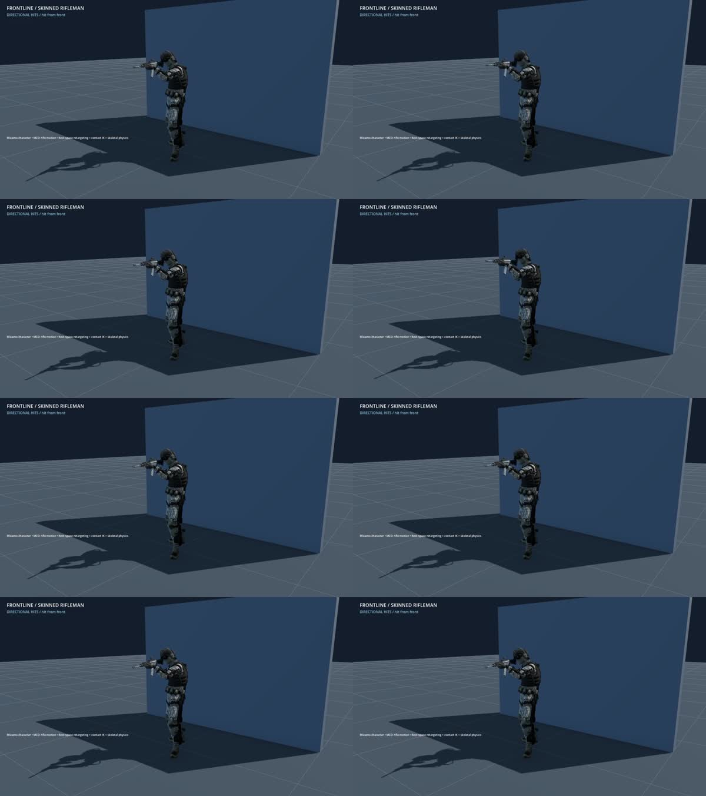
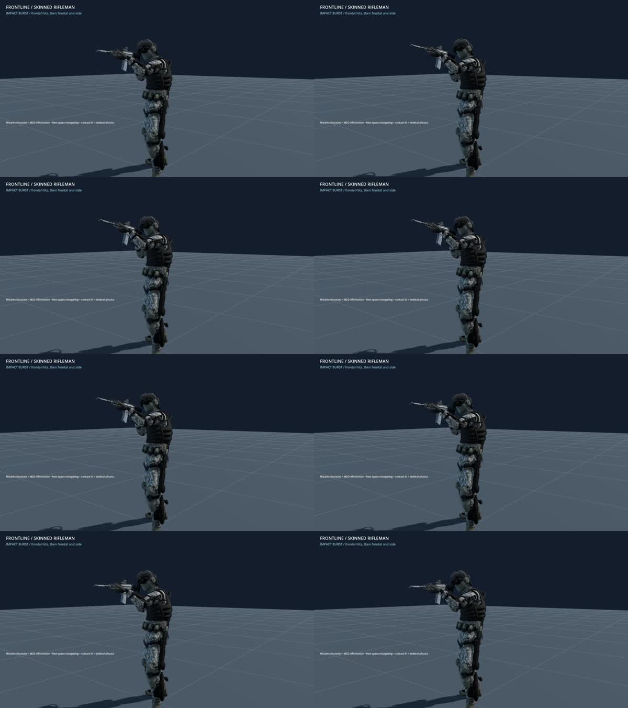

+++
title = "Captured frontal rifle flinch"
summary = "Frontal hits blend a captured upper-body flinch over the rifleman's directional reaction."
kind = "improved"
+++

The skinned rifleman now uses the supplied short hit-reaction clip for frontal impacts. Spine and head motion blend over the directional reaction while the movement controller retains the legs and weapon contacts. Side and rear hits retain their directional response.

Rapid hits no longer rewind the captured flinch, and a side hit does not abruptly erase an active frontal reaction. Additional hits still add directional spring momentum.

