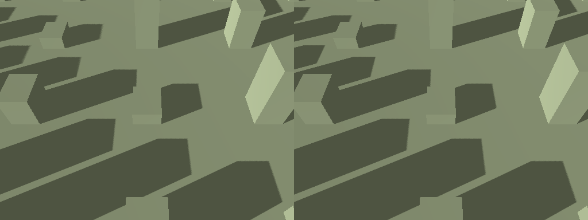
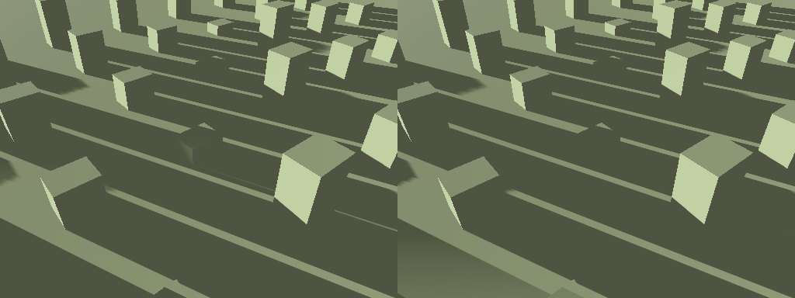

+++
title = "Less shadow work beyond the command view"
summary = "Downward camera views keep their shadows while drawing less distant shadow geometry."
kind = "improved"
+++

Shadow coverage now fits the ground visible from the camera, with room for fading
and shell holes. Tilting toward the horizon restores the configured range right
away. The existing shadow quality, four cascades and distant objects casting onto
visible ground are preserved.

On a 3 km map with 500 starting soldiers, alternating the old and new ranges
reduced drawn primitives by about 17%, renderer CPU time by 9–16%, and GPU time by
4–5%. Background load varied; this is a rendering-cost improvement, not a promise
of steady 60 FPS. Methodology and limits are in `docs/performance/shadow-range.md`.

Controlled shadow fixtures, original on the left and fitted on the right:

