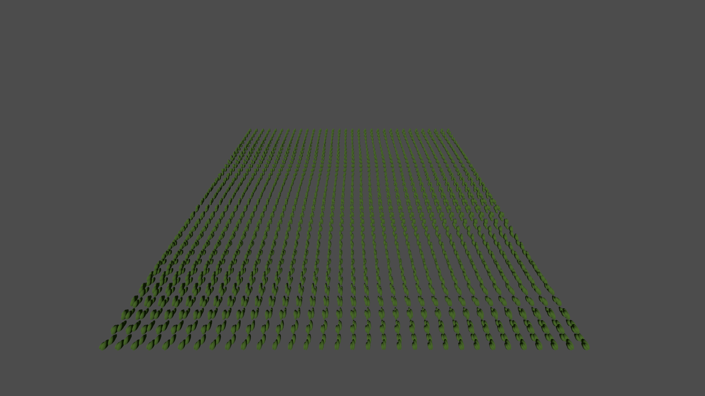

+++
title = "Smoother camera movement through scenery"
summary = "Prepare scenery before it enters view, reuse nearby vegetation, and keep camera panning at a manageable speed."
kind = "improved"
+++

Buildings and scenery are prepared farther beyond the screen edges and kept
active through a wider retention band when you pan back. Grass, bushes and
stones preload nine chunks in each direction and retain nearby chunks longer.
Their meshes remain shared through instancing; transforms and colors now upload
as one buffer per chunk instead of separate calls for every instance.

Continuous camera movement is capped at 120 metres per second, including Shift,
dragging, following and glides. Explicit minimap jumps remain immediate.

A dense scripted pan had zero missing visible-object samples, down from 4,479.
This is a scheduling diagnostic, not a live-battle FPS result. Wider preloading
uses more resident memory and can add startup work. Teleporting into an unvisited
area can still require loading. See the detailed measurement and test conditions
in `docs/performance/camera-streaming.md`.

The matched instance-buffer diagnostic renders below are pixel-identical; they
check retained bush geometry and placement, not live camera motion.

