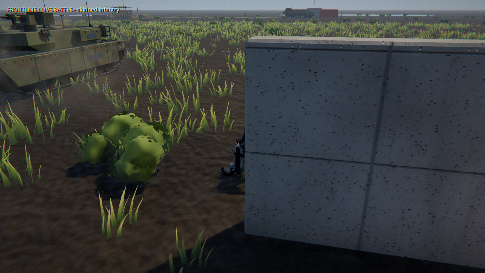
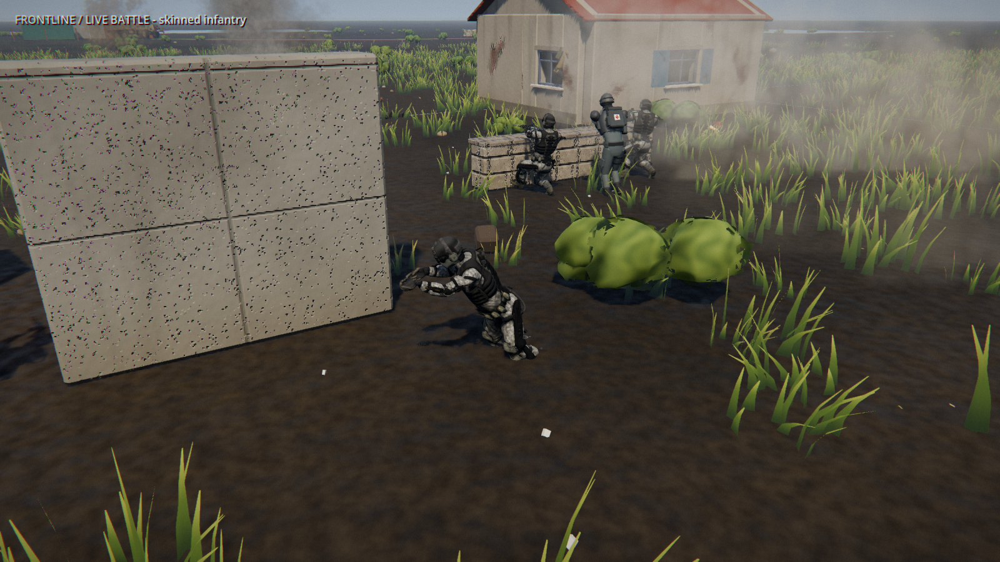

+++
title = "Clearer battle animation inspection"
summary = "The motion-demo camera checks more of the character before choosing its viewpoint."
kind = "fixed"

[[screenshots]]
file = "before.jpg"
caption = "Inspection with inherited RTS depth-of-field settings."

[[screenshots]]
file = "after.jpg"
caption = "Close inspection with a sharp lens and body-height cover checks."

[[screenshots]]
file = "battle-sequence.jpg"
caption = "Current in-game sequence: infantry, staged blast, and tank wreck. Nearby troops and cover can still obscure the subject."
[[screenshots]]
file = "smoke-before.jpg"
caption = "Previous recording: smoke obscures the infantry inspection. Battle outcomes vary between recordings."

[[screenshots]]
file = "smoke-after.jpg"
caption = "Updated recording: the inspection camera chooses a view around the persistent smoke."
[[screenshots]]
file = "foliage-before.jpg"
caption = "Previous recording: a foreground bush hides the fall. Battle outcomes vary between recordings."

[[screenshots]]
file = "foliage-after.jpg"
caption = "Updated recording: the camera avoids nearby bush bounds and keeps the fallen rifleman visible."
+++

The optional battle inspection camera follows the animated pelvis and checks sightlines across the character height. It tries alternate sides and shorter viewing distances when cover obstructs the subject. The inspection lens also avoids the overhead RTS depth-of-field settings. It also considers the smoke from grenades and fires when choosing an infantry viewpoint. A clear route is preferred; otherwise it chooses a shorter path through smoke. Transient blast dust and fully enveloped subjects can still obscure the view.

Scripted reloads and hits now select their actual recipient for inspection. Unscripted deaths stay on camera briefly before it returns to a living rifleman; the staged blast retains its victim through the ragdoll segment. A focused test covers subject switching as well as cover clearance.

The inspection camera also checks nearby instanced bushes, which have no physics colliders. It uses their rendered bounds, with allowance for leaf movement, and skips bushes removed by deep terrain deformation.

When foliage already hides part of a character, equal-scoring viewpoints now prefer fewer solid-cover obstructions. This prevents a bush from masking an additional wall in the camera's visibility comparison.

Visibility checks now cover shoulder width as well as body height, so a clear line to the pelvis no longer lets the inspection camera hide the rifleman behind a wall edge.

