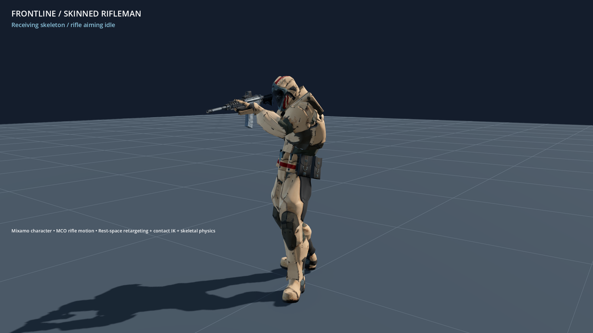
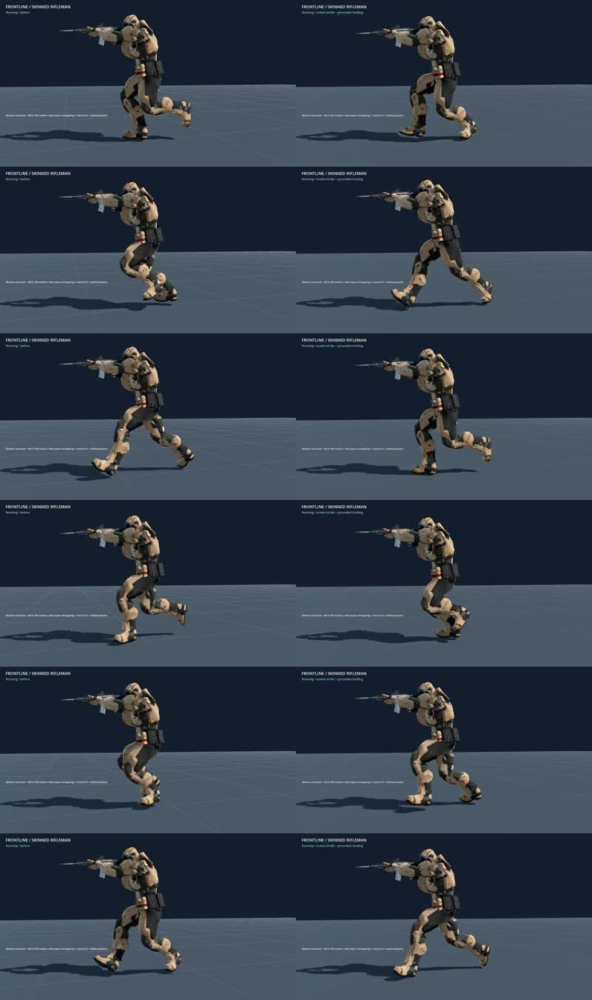

+++
title = "Preserve character proportions during rifle animations"
summary = "Imported rifle motion now respects each character's bone axes and limb lengths."
kind = "fixed"
+++

The original character no longer collapses when playing the downloaded rifle animations. Shared animation loading converts rotations and pelvis motion into the receiving skeleton's coordinate system, retains its authored limb lengths, and converts stride travel into the same units.

Pelvis motion and stride distance now scale with the receiving character height, restoring ground contact when the original taller character runs. Newly acquired plants retain their contact immediately, and low-rate pose updates bound the release correction to avoid adding a large jump to the swing.

The animation viewer now exposes installed Mixamo clips for the original character as well as the SWAT model, including projectile hits and native-animation ragdoll handoff.
