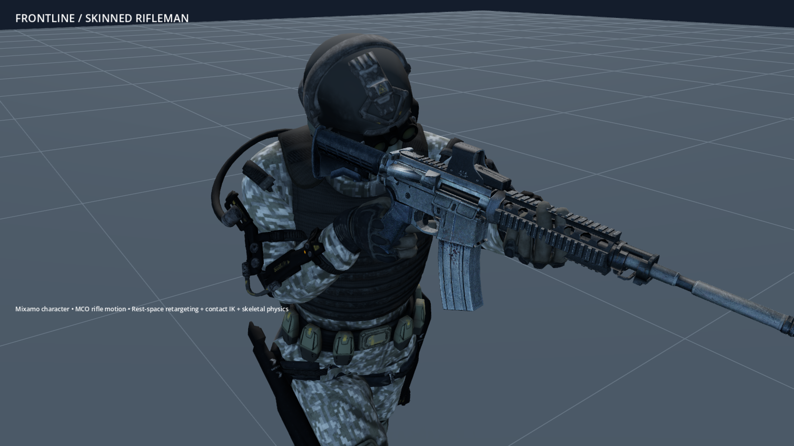
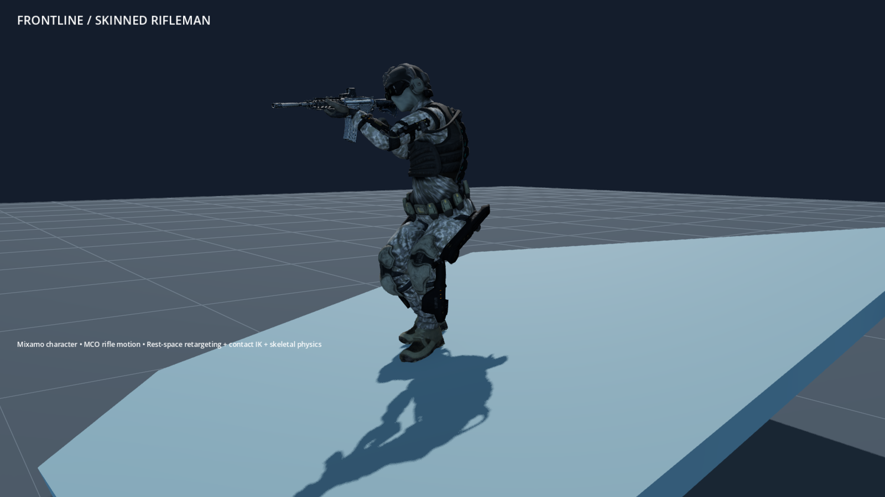
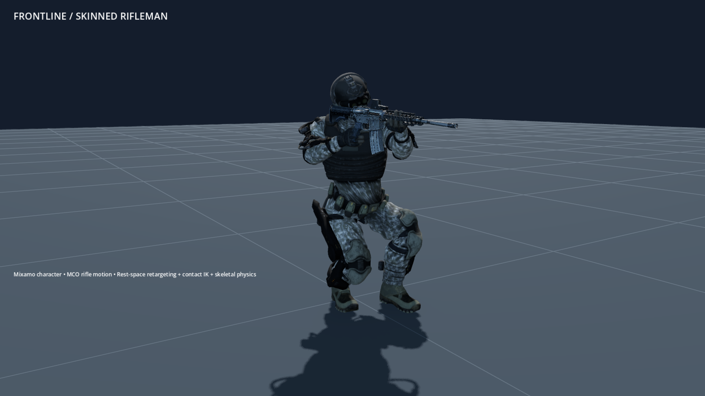
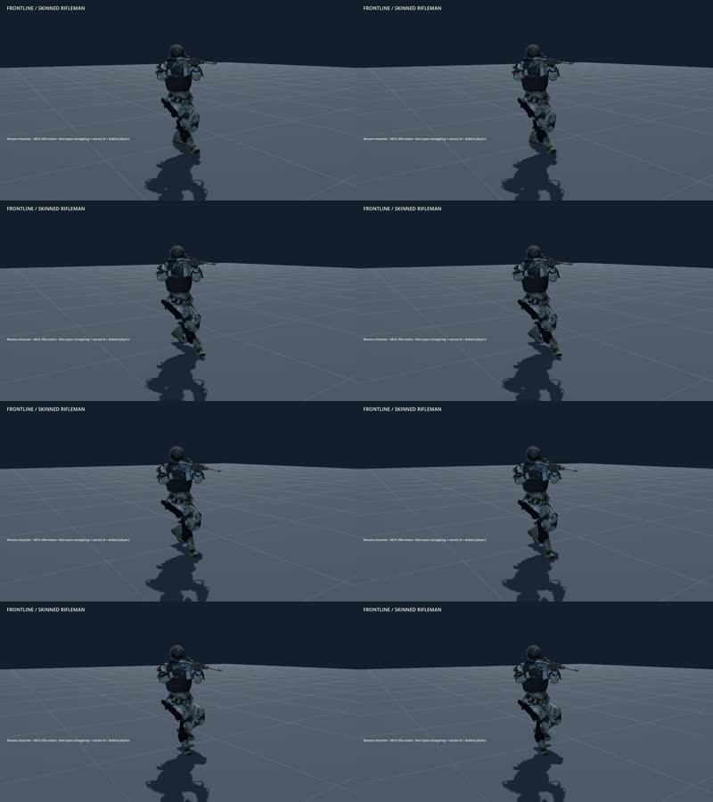
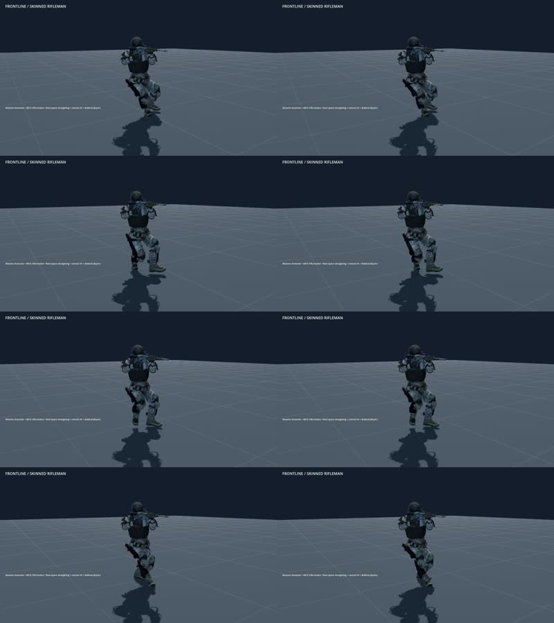
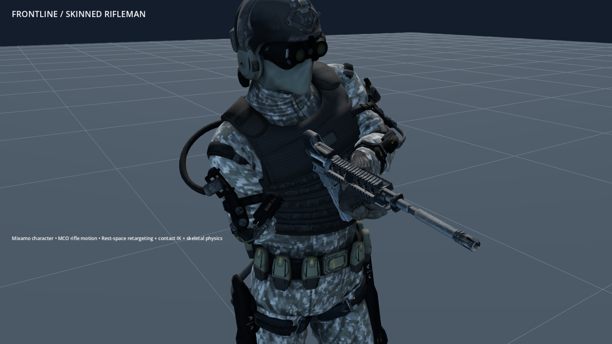
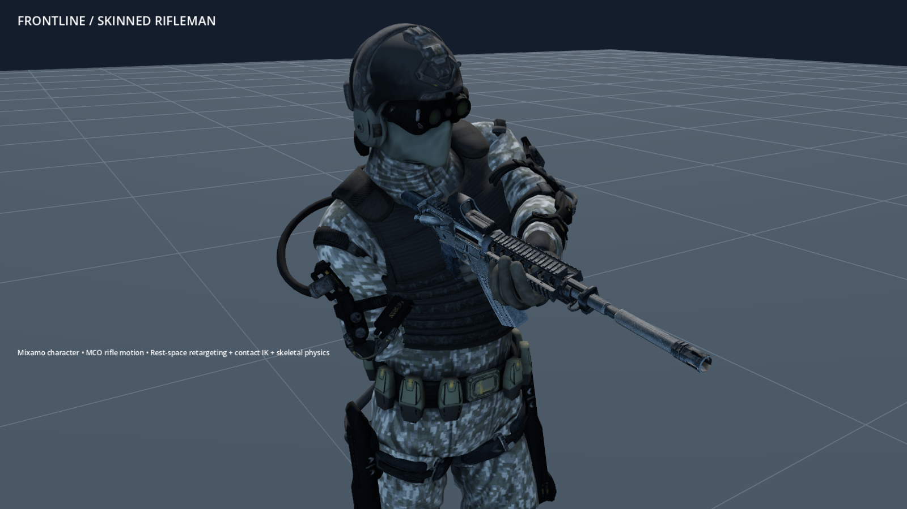
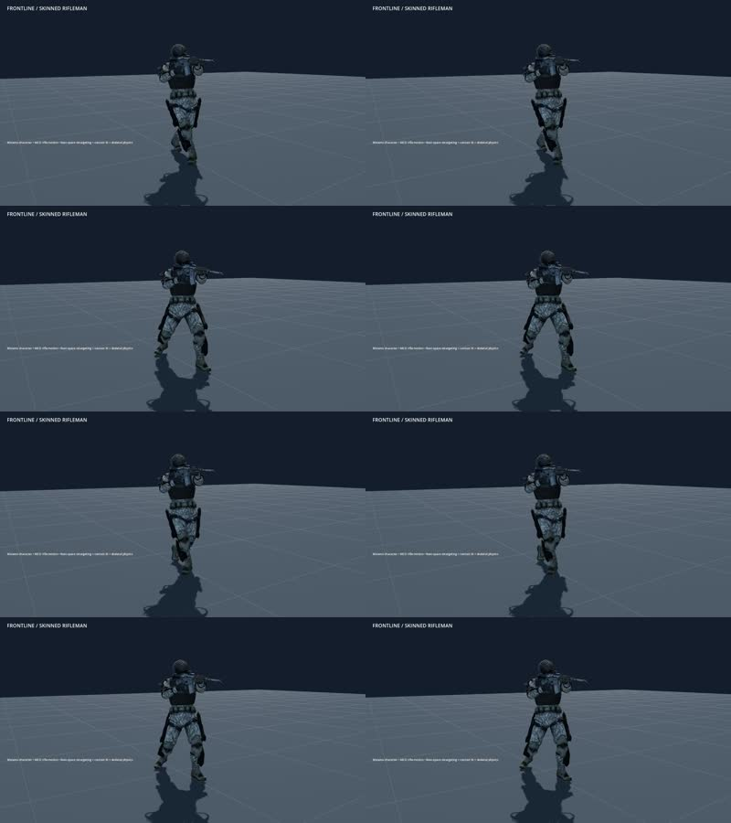
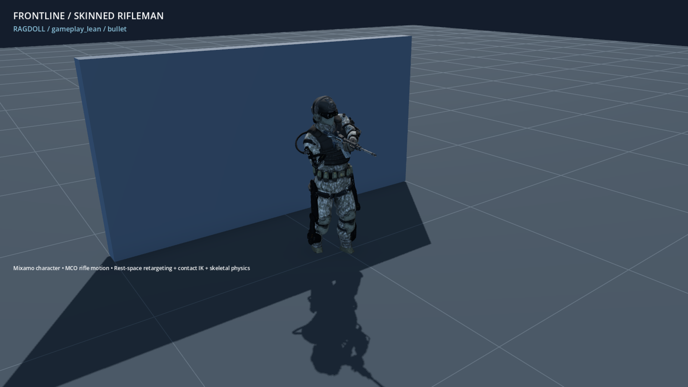
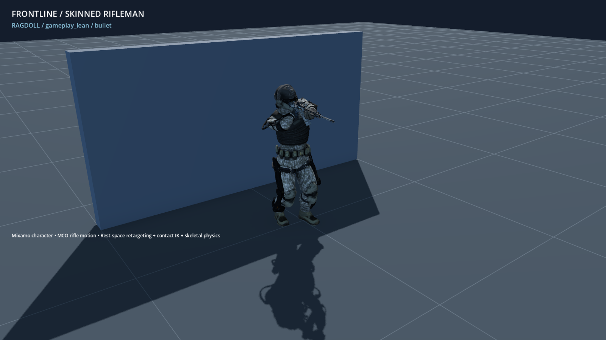

+++
title = "Seat rifle support hands on the handguard"
summary = "Riflemen hold the M4 fore-end more closely during movement and prone reactions."
kind = "improved"
+++

The support hand now targets the M4 handguard instead of hanging below it. The locomotion grip sits slightly farther back so the running animation can reach it without stretching the arm. Reloads still release the hand, and the prone correction fades in at the end of the descent.

Stationary crouched riflemen now keep the captured rifle pose when they stop moving, rather than switching to fallback arms. Both feet settle onto the ground while idle or reloading.

Planted crouch soles also follow sloped terrain instead of retaining the swing-foot angle.

At rest, the crouch settles another 12 cm into cover while keeping both soles planted. This extra drop fades out as the character starts walking.

Ragdoll ankles have a separate flexion limit so a planted crouch does not force the joints apart at death.

Crouch settling now eases in and out when starting or stopping, and reversing strafe direction no longer causes a sudden hip dip.

Crouched feet now keep their ground anchors until release, reducing sliding. Released feet ease back into the walking pose more slowly to reduce snapping.

Leaning at cover now reuses the captured rifle attachment, keeping the trigger hand on the grip instead of recalibrating it from the lean pose.

Backward walking and side steps now retain their planted foot anchors until release. Released standing feet ease back into the animation to reduce snapping during turns.

Cover aiming now restores the captured rifle finger pose, preventing a preceding reload from leaving the support hand open underneath the rifle.

Leaning riflemen now keep the captured rifle-arm hold as their torso turns, reducing the forearm's intrusion into the chest and giving the ragdoll a cleaner starting pose.

Stationary cover poses now place each boot on the terrain and align the soles with the slope. The contact correction fades as the soldier starts moving, and the grounded pose carries into the ragdoll.

