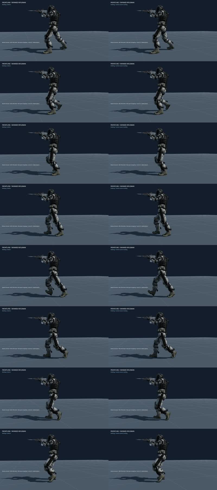

+++
title = "More stable rifleman foot contacts"
summary = "Fast swing steps no longer trigger premature foot plants near the ground."
kind = "fixed"
+++

The rifle movement controller now considers the foot's world motion when deciding whether it has landed. Fast swings retain ground clearance until they slow into contact, preventing a premature plant followed by a sliding release. Diagonal toe contacts retain their existing landing rule.

