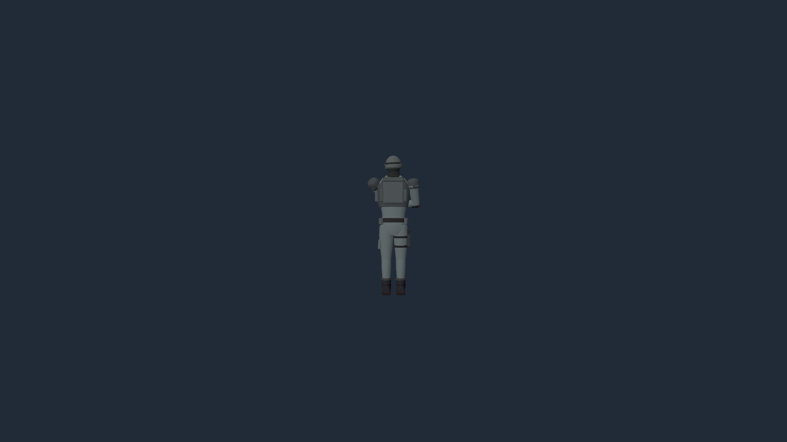

# Rust simulation migration

Status: **desktop solo play runs in the separate Rust server; multiplayer lobby,
and browser integration are still being completed.** This branch
is not ready to release. The socket server already accepts multiple authenticated
Godot clients, but the multiplayer menu still starts the legacy host path.

## Process boundary

Godot authors the initial battlefield in a short-lived headless process, then
exits. `frontline-server` loads that handoff and owns every subsequent gameplay
tick. The visible Godot process sends orders and draws filtered observations.
Local play connects over loopback; remote clients use the same application
protocol. Rendering never advances gameplay randomness or decides a casualty.

| Component | Owner |
| --- | --- |
| Infantry, vehicles, drones, ordnance, buildings and entity lifecycle | Rust `frontline_core` |
| Combat, injuries, rescue, prisoners, transport and construction | Rust `frontline_core` |
| Squads, perception, pathfinding, morale and tactical plans | Rust `frontline_core` |
| Economy, visibility, supply, support and victory rules | Rust `frontline_core` |
| Strategic commanders, naval plans and all five mission programs | Rust `frontline_server` |
| Authenticated commands, input ordering, checkpoints and verification | Rust `frontline_server` |
| Initial procedural map authoring and immutable content export | Godot, before the first tick |
| Models, animation, smoothing, effects, sound, camera, minimap and UI | Godot client |

The GDExtension in `native/src` remains necessary for map preparation and reference
comparisons. The engine-independent code in `native/core` and `native/server`
contains no Godot objects. The old GDScript simulation remains as a parity
reference and for the multiplayer/browser paths still awaiting integration.

## Socket protocol

Raw ENet/UDP carries versioned application messages, not Godot scene RPCs.
The 16-byte header contains `FLNP`, protocol version, message kind and sequence.
Reliable channel 0 carries authentication, orders, baselines, births, removals,
properties, ground tiles, roads, HUD updates, messages and reports. Channel 1 carries independently
applicable tick-stamped entity snapshots. Channel 2 carries expendable effects.

The trusted host supplies a 192-bit ticket, commander identity and team for each
admitted player. Clients present their ticket and exact simulation build ID;
they cannot supply another commander or choose a team through a gameplay packet.
Commands are bounded and checked again against current ownership and resources.
New connections and reconnects receive their own reliable baseline. Hidden enemy
IDs and private supply, orders and intelligence are filtered before transmission.
Map and large report data are chunked. Reliable queues, acknowledged bytes,
command rates and per-frame client parsing are bounded; a stalled peer is closed.

Protocol 2 sends the current deformation and crater layer in the compressed map
baseline, then absolute 32 m surface tiles on the reliable channel. Tiles are
idempotent and retained for late joiners; explosions only play cosmetic effects
on socket clients. Loading queues the latest copy of each tile, then applies a
bounded amount per frame through the existing progressive terrain texture upload.
Replay seeks receive the ground at the re-simulated tick. Roads also have current
baselines and reliable updates.

Simulation ticks run at 60 Hz. Observations currently publish at 15 Hz, with Godot
interpolation independent of tick advancement. Catch-up work is bounded; a slow
host changes wall-clock pacing without skipping deterministic simulation ticks.
Pause and playback speed change pacing, not the simulation delta.

Desktop packaging includes the server beside the Windows/Linux executable and
in `Contents/Helpers` on macOS. The updater installs and rolls back the game,
GDExtension and server together. Closing a game asks its owned server to finish
and flush the recording; unrelated applications are never stopped.

## Deterministic recording and verification

`.flrp` command recordings contain the exact initial checkpoint, simulation build
and content identifiers, ordered admitted commands, joins and disconnects, then
a declared final tick, state hash, input-chain hash and winner. They do not record
AI decisions: the verifier recomputes them. Initial checkpoints retain all random
streams, entity allocation, task queues, timers, navigation, commanders and mission
state. A seed and visible entity snapshots alone are insufficient.

`frontline-server verify RECORDING` independently restores and advances the battle
without Godot, graphics or network access. It rejects incompatible builds/content,
malformed or reordered inputs, truncation, trailing data, changed input digests
and a different final state or winner. A recording stopped before victory can be
verified as an unfinished battle; it is not a verified victory. Existing Format 1
observer archives remain a different format and are never relabeled as verified.

Verification establishes consistency with the supplied starting state and inputs.
It does not authenticate a client-created history. Competitive result acceptance
must additionally trust the server that admitted and recorded those inputs.

The native replay viewer opens `.flrp` files from the Replays menu or `--replay`.
Its play/pause, speed and timeline controls drive a private Rust playback process
using the same parser and tick entry point as the verifier. Seeking re-executes
from the starting state and reconnects a fresh observer so transient effects and
entities cannot survive a rewind. Seeking far into a long battle therefore costs
simulation work; it does not load an unverified visual snapshot as game state.
A readable footer supplies the timeline length only. The viewer labels the result
verified after the input digest, final state hash and winner all match, including
when seeking directly to the end. It distinguishes unfinished battles from
concluded games. Viewer commands and connections never enter the recorded world.

Numeric version 2 pins Rust 1.94.0, glam 0.32.1 with `libm`, and libm 0.2.16 with
`force-soft-floats`. Gameplay iteration, tie-breaking and work quotas have explicit
orders. Cosmetic randomness and wall-clock/network scheduling are outside state.
Cross-platform tests compare committed numeric transcripts and complete mission/
commander checkpoints in debug and release without tolerances. Godot parity tests
separately allow documented differences from the engine's platform math functions.
These covered trajectories are not a proof for every possible floating-point input.

Large map handoffs and server checkpoints compress their largest state block with
zlib in independent 64 KiB blocks. The versioned `FLZB` envelope records the exact
expanded size; decoding validates each stream's checksum, consumed bytes and
output length before appending it. The outer file limit remains 512 MiB and the
expanded match limit is 1 GiB. Raw core checkpoints retain their canonical bytes,
so the numeric gameplay goldens do not change. Compression does not quantize
positions, terrain, timers or random state. The Godot handoff is `FLIN` version 2
and the server checkpoint is `FLSS` version 2; older builds remain fail-closed.

The generated 3,072 m test reached 14,352 entities and 91 squads but exceeded the
old 512 MiB initial-state limit before simulation could start. That failure is
recorded in `build/rust-socket-generated-3072-cap-check/`. The compressed repeat
completed successfully; its performance and replay results are recorded below.

## Build and exercise

Run from the repository root with Rust 1.94.0 and Godot 4.7.2 installed:

```text
python tools/build_native.py
godot --headless --path . --import
godot --path . -- --local-server --mission=bridgehead --seed=1
cargo +1.94.0 test --locked --manifest-path native/Cargo.toml -p frontline_core -p frontline_server
godot --headless --path . res://tests/local_server_test.tscn
```

The launcher stores logs in `user://local_servers/` and recordings in
`user://replays/battle-<session>.flrp`. `FRONTLINE_SERVER` selects a server binary
in a source checkout. Set `FRONTLINE_GODOT` and run the ignored `godot_connects`
network test to exercise actual Godot/Rust ENet interoperability.

A generated initial state can also be run without a renderer:

```text
godot --headless --path . -- --mission=bridgehead --seed=1 --export-simulation=build/bridgehead.initial --port=7961
frontline-server run build/bridgehead.initial build/bridgehead.flrp 180
frontline-server verify build/bridgehead.flrp
```

`prepare INITIAL CHECKPOINT` imports without advancing. `serve INITIAL CONFIG
RECORDING` starts the socket host. Its private JSON config contains `bind`, admitted
`players` (`peer`, `team`, `name`, `token`) and optional `ready`, `stop`, `speed`,
`error` control-file paths. A private launcher can supply a `lease` heartbeat path;
the server finishes its recording if that owner stops renewing it for 30 seconds.
An optional `profile` (`path`, `warmup`, `duration`) measures wall-clock tick,
observation and individual simulation-phase costs outside deterministic state.
The clock never changes AI work quotas or enters a checkpoint. Keep admission tickets private. The initial importer
rejects already-running Godot worlds with active ordnance/plans rather than
silently losing state. Output recordings are created exclusively, never overwritten.

## Validation and remaining completion gates

The preceding commit, `30b6019`, passed the complete Godot comparison job and debug/
release Rust checks on Windows x64, Linux x64, Linux ARM64 and macOS ARM64.
Current socket checks cover two teams, admission failures, privacy, bounded
messages, event projection and Godot interoperability. The normal launcher check
covers movement orders, pause/resume, ownership after reconnect, graceful recording
completion, independent verification and an owned-server crash. An 80-soldier
rendered socket battle completed without script errors. These are not 500-unit
rendering results or natural full-mission balance playthroughs.

Remaining release gates:

- Connect multiplayer lobby, drop-in/rejoin and co-command interactions to Rust.
- Carry current roads, terrain deformation and remaining cosmetic lifecycle events
  through joining and live observations.
- Integrate browser transport/runtime without a desktop process assumption.
- Run generated large-map, 500-unit rendered cases and inspect tail frame times,
  frame-to-frame variation and memory with other applications running.
- Complete exports/installers and current-head cross-platform CI. Preserve gameplay
  with full scenario/mission regressions and visible comparison evidence.

## Standalone infantry scale measurement

On November 2, 2026, the release server with initial navigation finalized ran 600 fixed ticks with 500
soldiers, two depots and the production rifle/fighter loadouts. Other applications
remained running. Each map produced 4,047 shots, 269 soldiers moving more than one
metre and 423 survivors; the benchmark asserts movement and combat occurred.

| Square map side | Mean tick | p95 | p99 | Maximum | Initial setup |
| --- | --- | --- | --- | --- | --- |
| 1,024 m | 3.202 ms | 4.527 ms | 5.723 ms | 7.945 ms | 616.19 ms |
| 2,048 m | 2.775 ms | 3.695 ms | 4.671 ms | 8.231 ms | 2,675.80 ms |
| 3,072 m | 2.823 ms | 3.776 ms | 5.285 ms | 9.758 ms | 6,600.55 ms |

These are short simulation-only samples on flat, mostly empty maps, without
strategic commanders, scenery, rendering or socket traffic. They are not a
before/after comparison with the original Godot measurement or proof of 60 FPS.
The smaller timing differences between map sizes are within uncontrolled desktop
variation. Larger maps increase startup memory/work; the tick does not scan the
entire map just because its dimensions increase.

Run the ignored benchmark explicitly in release mode. `FL_BENCH_SIDE` accepts
1024, 2048 or 3072:

```powershell
cargo +1.94.0 test --locked --release --manifest-path native/Cargo.toml -p frontline_server --test scale -- --ignored --nocapture --test-threads=1
```

## Rendered 500-soldier socket measurement

On November 3, 2026, a 12-second sample after eight seconds of warm-up used 500
soldiers, 200 scenery objects and active combat on the 1,024 m stress map. The
Godot renderer used the high preset at 1280 by 720 on an RTX 3090. Other apps
remained running. The client reported 499 living soldiers; the server had recorded
3,271 shots by its sample end. Simulation and rendering were separate processes.

| Measurement | Mean | p95 | p99 | Maximum |
| --- | --- | --- | --- | --- |
| Rendered frame | 95.3 FPS overall | 15.87 ms | 19.10 ms | 26.36 ms |
| Rust tick including observation generation | 3.86 ms | 5.66 ms | 6.55 ms | 27.58 ms |
| Simulation and input recording | 3.73 ms | 5.52 ms | 6.03 ms | 27.58 ms |
| Observation/event generation | 0.13 ms | 0.60 ms | 0.95 ms | 1.71 ms |

Frame-to-frame absolute differences were p95 8.19 ms and p99 11.21 ms. The largest
measured client categories averaged 2.22 ms/frame for distant soldier presentation,
1.36 ms for soldier views and 0.72 ms for minimap drawing. Peak sampled process RSS
was 2,223 MiB for Godot and 621 MiB for Rust. Startup and warm-up are excluded.

This sample exceeds 60 FPS on average but fails the tail-frame target. One Rust
tick also exceeded 16.67 ms. It is a stress layout, not a fully generated 2–3 km
battlefield, and is not directly comparable to the original 130 ms observation.

## Generated 2 km battlefield and phase costs

The November 3 follow-up used the generated 2,048 m map, seed 3, 500 infantry,
commanders and 8,640 entities, with the high preset at 1280 by 720. Each sample
measured 20 seconds after 15 seconds of warm-up. Other applications remained
running. Both the control and optimized builds used the separate Rust server.

| Measurement | Instrumented control | Optimized `cfad834` |
| --- | ---: | ---: |
| Rust tick mean, including observations | 9.569 ms | 7.405 ms |
| Rust tick p95 / p99 | 16.321 / 20.313 ms | 13.128 / 16.308 ms |
| Simulation and recording mean | 8.383 ms | 6.393 ms |
| Infantry mean | 4.154 ms | 3.374 ms |
| Rules and ledger mean | 1.272 ms | 0.770 ms |
| Vehicle phase mean, with no vehicles | 0.663 ms | 0.001 ms |
| Rendered average FPS | 73.64 | 74.98 |
| Frame p95 / p99 | 21.128 / 25.877 ms | 20.722 / 25.907 ms |
| Adjacent-frame difference p95 / p99 | 10.691 / 14.422 ms | 10.736 / 14.641 ms |

Prepared weapon profiles, indexed supply/statistics scans, reused snapshot buffers
and shared team observations reduce repeated work without changing AI cadence.
Stationary minimap camera wedges cache their ground intersections. The optimized
minimap cost was 0.763 ms/frame; distant soldier batches cost 2.118 ms/frame and
soldier presentation 1.291 ms/frame. A transform-cache prototype did not improve
rendered timings and was removed.

The clean optimized run had no script/server errors and 482 surviving soldiers at
server tick 2,102, with 6,310 shots. The earlier control ended at tick 2,101 with
482 survivors and 6,303 shots. Fixed-state numeric/replay tests, rather than these
wall-clock sampling boundaries, check unchanged gameplay. The first optimization
run exposed wildlife reading ground while a loading worker replaced it; the
repeat above includes the loading guard and its regression check.

The roughly 23% reduction concerns server tick time, not FPS. Navigation still
peaked at 18.30 ms, total ticks at 26.54 ms, and frames at 37.40 ms. Eleven of
1,200 server samples exceeded 16.67 ms. This is progress toward the frame target,
not proof of sustained minimum 60 FPS. Raw local reports are in
`build/rust-socket-generated-2048-phases/` and
`build/rust-socket-generated-2048-optimized/`.

The generated 3,072 m repeat at `2b8da93` used the same seed, 500 infantry,
commanders, preset and measurement window, with other applications running.
It completed without script/server errors: 72.56 FPS average, frame p95/p99
21.673/26.507 ms, and adjacent-frame difference p95/p99 10.670/14.205 ms.
The Rust tick averaged 11.613 ms, with p95/p99 28.483/36.183 ms. Navigation alone
averaged 3.408 ms and peaked at 50.167 ms; infantry averaged 3.803 ms. Thus the
larger map works but still misses the minimum frame and tick budgets. The client
spent 73.15 seconds loading after its terrain allocation; the complete harness
took 442.61 seconds including generation and shutdown.

Reports and the rendered view are in `build/rust-socket-generated-3072-compressed/`.
Independent verification reproduced all 3,023 ticks of its command recording,
matching final hash `ac892adeaad9a10f3d39de02d26bf10a09b832902a60024083bb2b8a80fd3627`.
The battle was unfinished, with no declared winner. Verification output is in
`build/verify-3072-compressed.log`.

The distant-soldier regression view places the same baked rifleman at 180 m with
an unchanged camera and lighting. The before image restores the former fixed
bounding box; the after image runs the corrected batch update. The CPU fixture
also checks a soldier below the waterline and preservation of spatial batching.

| Former bounds | Bounds expanded to the actual soldiers |
| --- | --- |
|  |  |
