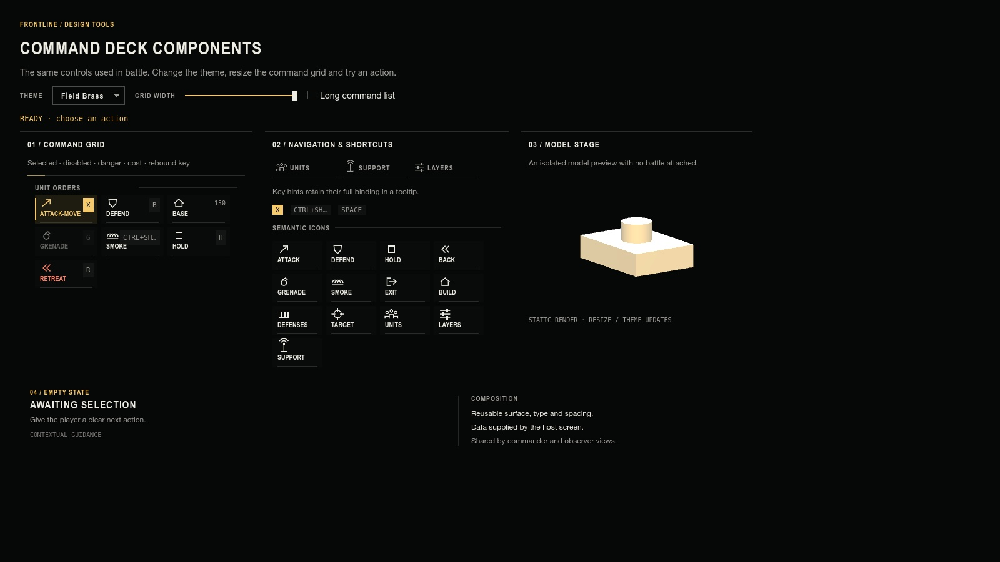

# Command deck component library

The battle HUD and the interactive workbench compose the same controls from `scripts/ui/components/`.
`UiKit` remains the source of fonts, colours, spacing conventions and native Godot theme resources.
Components handle presentation and interaction; the host screen owns gameplay, permissions and data.
None of these components depends on `Hud`, `World`, `Soldier` or `Vehicle`.

| Component | Use | Public interface |
| --- | --- | --- |
| `UiDeckSurface` | Flat ink surface with a fine top rule | Add one layout container child; set `accented`. `paint(canvas, rect, accented)` supplies identical chrome to custom-drawn HUD regions. |
| `UiDeckIcons` | Shared vector icon vocabulary | `IDS`, `paint(canvas, icon_id, center, colour)`; semantic IDs are independent of translated captions. |
| `UiDeckNav` | Compact icon-and-label tool switch | `icon_id`, `caption`, native `pressed`/`toggled` signals, `button_pressed`, `disabled`. |
| `UiDeckKeycap` | Shortcut hint with optional width limit | `set_binding(text, max_width=54)`, `set_active(bool)`; zero width limit shows the complete binding. |
| `UiDeckAction` | Illustrated action, cost, shortcut and targeting state | `configure(spec)`, `set_active(bool)`, native `pressed`, `disabled`; supports native keyboard focus outside battle. |
| `UiDeckGrid` | Three-column command group with bounded scrolling | `title`, `add_action(spec, callback)`, `clear_actions()`, `fit_width(available_width)`, `max_rows`. |
| `UiDeckEmptyState` | Contextual empty-state and help panel | `configure({surface, eyebrow, title, body, code, help_title, help_lines})`; 76 px compact presentation; `surface=false` omits the backdrop. Extra code/help needs at least 100 px height, and the help column yields below 580 px. Keep copy concise. |
| `UiModelPreview` | Static lit model in an isolated transparent viewport | Add to the scene tree, then `set_model(detached_node, bust=false)`. Takes ownership and frees the previous model. `frame_model()` reframes an edited model; resize/theme changes request a fresh render. |



## Compose a screen

```gdscript
var orders := UiDeckGrid.new()
add_child(orders)
orders.title.text = "Unit orders"
orders.add_action({
    "id": "attack",
    "label": "Attack-move",
    "icon": "attack",
    "key": Keys.label("attack_move"),
    "tooltip": "Advance and engage enemies on the way."
}, func(): issue_attack_order())
orders.add_action({
    "id": "retreat", "label": "Retreat", "icon": "back",
    "dangerous": true, "tooltip": "Withdraw to safety."
}, func(): issue_retreat_order())
orders.fit_width(348)
```

Action specifications accept `id`, `label`, `icon`, `key`, `value`, `tooltip`, `dangerous`, `disabled` and
`active`. A key takes precedence over a value. Complete rebound keys remain in the action tooltip when the
keycap truncates. Calling `configure` replaces the entire presentation state; it does not attach callbacks.
Use `pressed.connect` or the grid's callback argument to bind behaviour once. `clear_actions` detaches old
controls immediately and releases them at the end of the frame, so rebuilding cannot leave stale visible
commands. Decide whether an action is affordable/authorized in the host and set `disabled` there.

`fit_width` reserves room for the scrollbar and reduces tiles from 100 to 80 logical pixels while retaining
three predictable columns. The minimum supported grid width is 288 logical pixels. Longer lists scroll after
three rows by default. Screens own positioning; the HUD reserves the fixed map and selection region before
passing available width to the grid.

`hud.gd` adapts selection, key bindings and callbacks into these controls. `hud_command_deck.gd` places shared
surfaces under the map/status/events/task regions and configures the empty-state component.
`hud_unit_portrait.gd` is the small entity-to-model adapter for `UiModelPreview`. Keep entity lookup and model
construction in this adapter, rather than importing game types into the reusable preview.

## Interactive workbench and captures

Open the workbench without a battle:

```sh
godot --path . -- --deck-gallery
```

Change themes, resize the command grid, enable a long command list, and click or keyboard-focus actions.
Selected, disabled, dangerous, priced and rebound-key examples use the production controls. The model stage
uses a simple fixture mesh so the workbench does not compile or start a simulation.

For a repeatable capture that exits cleanly:

```sh
godot --path . -- --offscreen --deck-gallery=deck.png
godot --rendering-method gl_compatibility --path . -- --offscreen --deck-gallery=deck-night.png --gallery-theme=night
```

Use `brass`, `night`, `thermal`, `arctic` or `dusk` for `--gallery-theme`. The original `--ui-gallery=PATH`
continues to show the broader Signal kit. Both galleries share `UiKit`; this is a specialized workbench for
the battle components, not a second theme system.

## Verification

```sh
GODOT=godot node --test tests/deck-components.test.mjs tests/ui-layout.test.mjs
```

Component contracts cover theme changes, native keyboard activation, label/icon independence, reconfiguration,
long key bounds, resize bounds, model ownership and callback replacement. HUD layout tests exercise the
composed controls with fixed-map geometry, long command lists, task workspaces and narrow viewports.
Also render commander and observer states after changing components; a passing isolated test does not prove
the whole battle composition remains readable.
