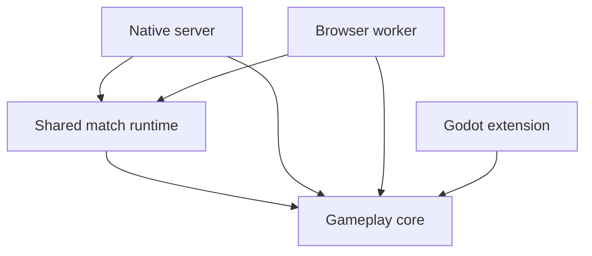

# ADR: Rust workspace and match runtime

**Status:** Accepted
**Date:** 2026-11-03
**Deciders:** Frontline maintainers, following the requested interface cleanup

## Context

Native hosts and browser workers run the same authoritative match and verify the
same command recordings. Previously, the browser imported the server library,
which also contained native sockets, process controls and file-based profiling.
Conditional compilation made that build, but the package boundary obscured ownership.

The priority is clear interfaces and shared rules. This change preserves gameplay,
wire messages and numeric golden results; it does not pursue frame-rate changes.

## Decision

Keep one Cargo workspace and separate packages by dependency boundary. Use modules
inside each package for gameplay features, codecs and other related responsibilities.

| Package | Owns | Boundary |
| --- | --- | --- |
| `frontline_core` | Gameplay state, rules and algorithms | No runtime or platform dependencies |
| `frontline_runtime` | Content, match ticks, commanders, missions, observations, protocol and replay | Depends on core; owns no sockets, files or processes |
| `frontline_server` | Native admission, socket scheduling, process controls and report files | Calls runtime; connection internals are private |
| `frontline_browser` | Worker session and WebAssembly ABI | Calls runtime directly; no native-server dependency |
| `frontline_sim` | Godot map-preparation bindings and parity checks | Depends on core; no authoritative match loop |

The shared runtime exposes concrete interfaces:

- `Content` validates immutable definitions; `initial::load` imports an authored battlefield.
- `Simulation::step` accepts ordered `Input` values and returns one tick's `Frame`.
- `Recorder`, `Playback` and `verify` use that same tick and checkpoint encoding.
- `View` projects team-visible state. `render::Output` lets adapters deliver the
  same messages over a socket or worker queue; `protocol` owns their wire encoding.

Native files and browser buffers implement the existing standard `Read`/`Write`
interfaces for recordings. No custom storage or generic transport framework is added.
Workspace metadata and shared dependency versions live in `native/Cargo.toml`.

## Options and trade-offs

Keeping the combined server library minimizes file moves, but leaves native
application concerns beside the browser's shared runtime. Splitting every AI,
navigation or replay feature into a crate would add interfaces between components
that evolve together. One shared-runtime extraction enforces the useful boundary;
ordinary private modules organize its internals.

## Consequences and checks

Runtime tests and numeric goldens move with the runtime. Native socket and CLI
verification tests remain with the server; browser tests consume runtime fixtures.
CI runs core, runtime and server contracts in debug and release across platforms,
and runs the actual WebAssembly worker. Goldens are not regenerated for this move.

The engine fingerprint hashes core and runtime source, manifests, lockfile and
content. Moving that source changes the fingerprint, so earlier recordings still
require their original build. Native socket changes do not change gameplay identity;
incompatible packet changes require a protocol-version bump.

The retained GDScript simulation remains necessary for map authoring and parity
checks. Removing it is separate work, not part of organizing the Rust code.
