# Military paint and material-aware construction

`origin/main` at **2dad9d2** was merged first (merge commit **b1db5f4**).
Matched whole-vehicle comparisons use **b1db5f4 before** and **25a2c2b after**.
Godot **4.7.2**, Compatibility, 1600×900, seed 3, team 0, same studio camera and
lighting for each pair. These are uncropped native renders, not concept images.

## Matched comparisons

| Vehicle | Before | After |
|---|---|---|
| tank | 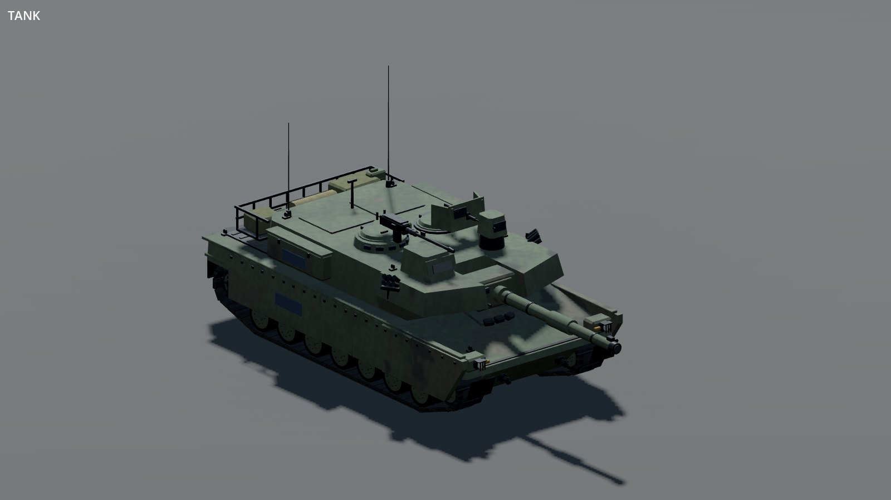 | 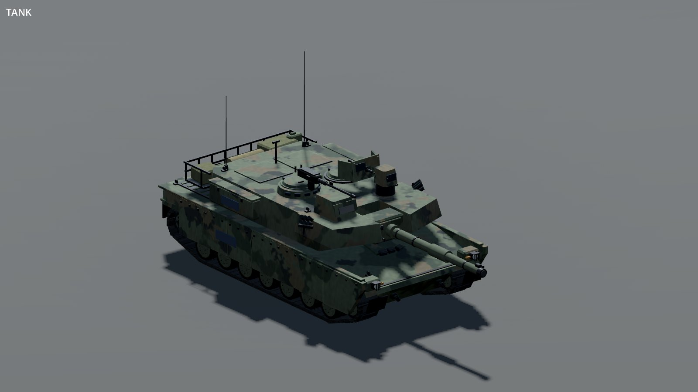 |
| zamak | 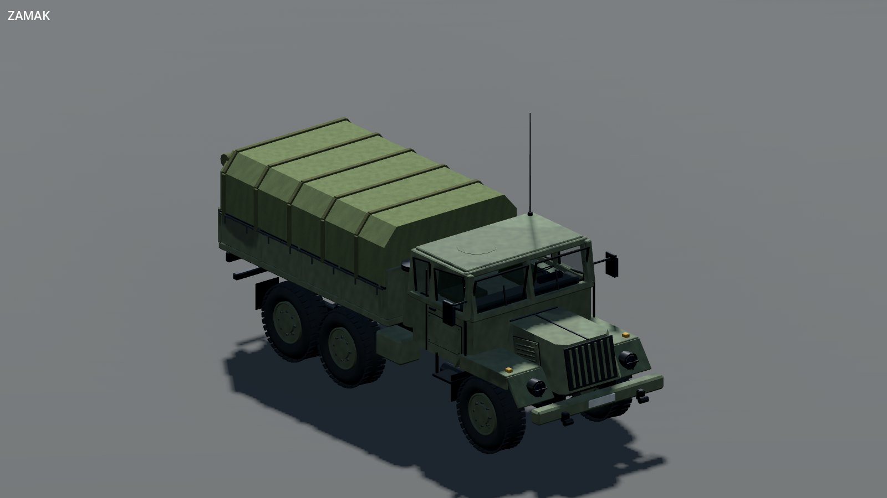 | 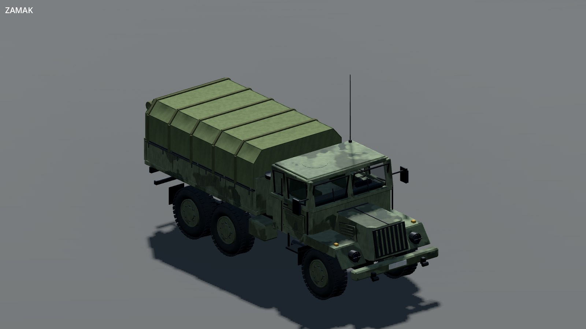 |
| hemtt | 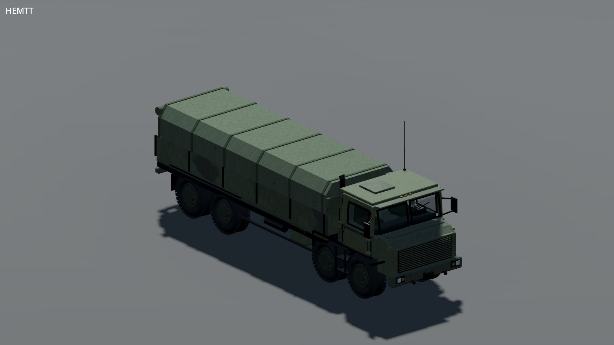 | 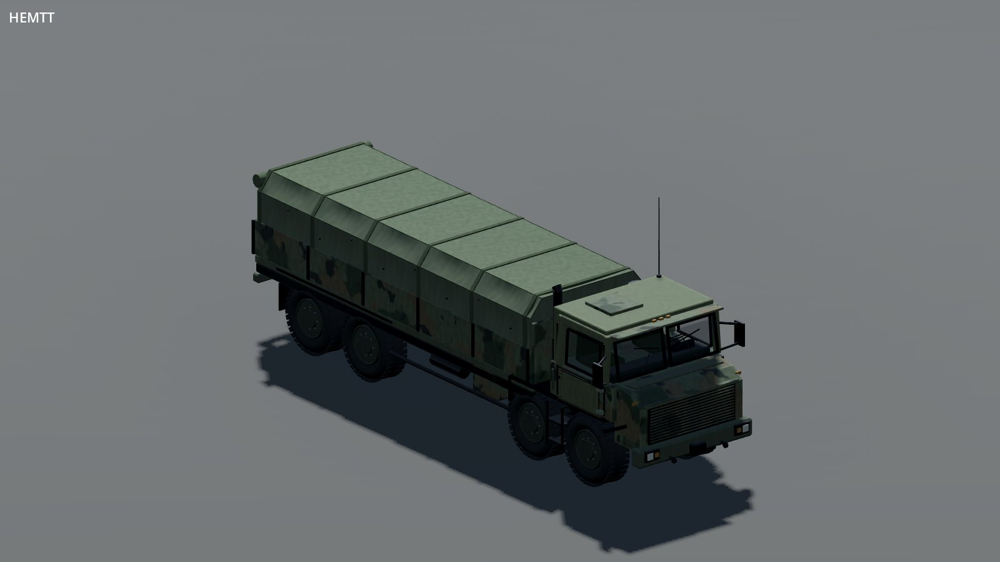 |
| tempest | 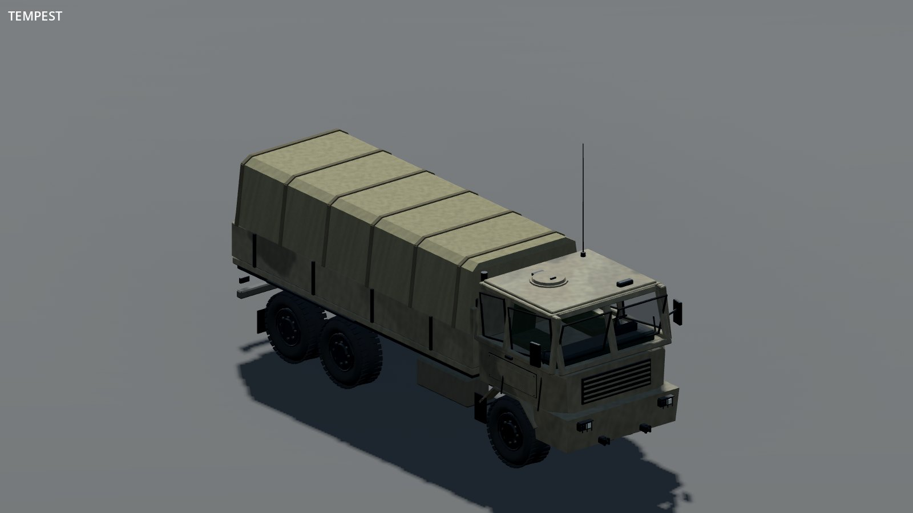 |  |
| heli | 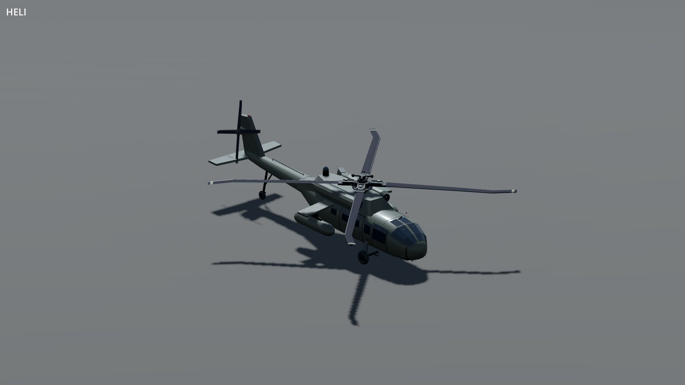 | 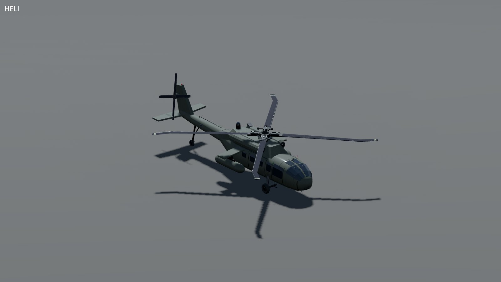 |
| hunter | 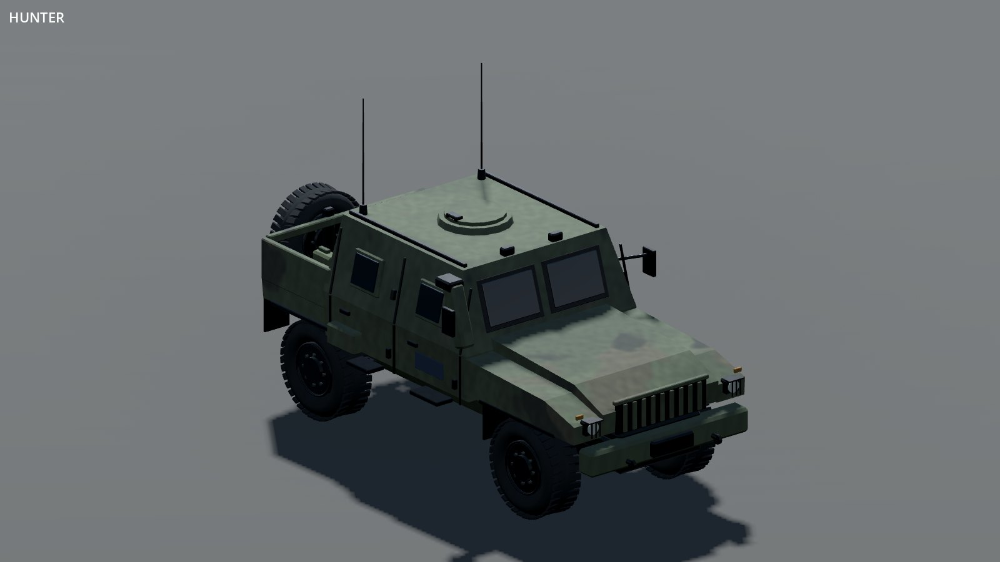 | 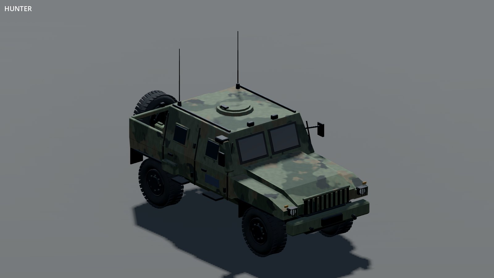 |
| patrol_ship | 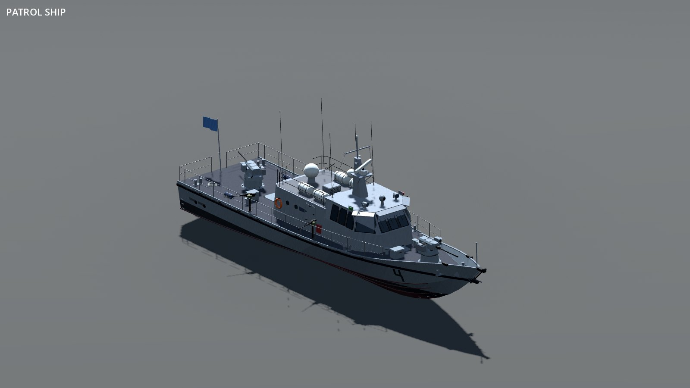 |  |
| offroad | 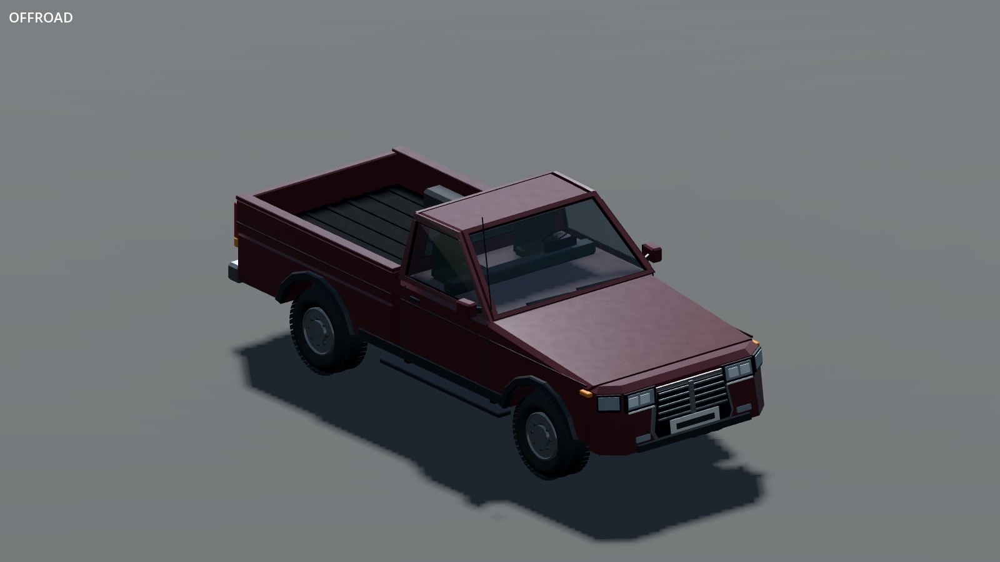 |  |

Camouflage changes are most obvious on tanks and military trucks. They now use larger,
more separated colours rather than low-contrast mottling. Aircraft paint is more matte;
its silhouette is unchanged. Edge rubs, primer chips and runoff remain subtle at this scale.
Offroad is included as a civilian control: it retains its existing automotive paint.

## Shared builders

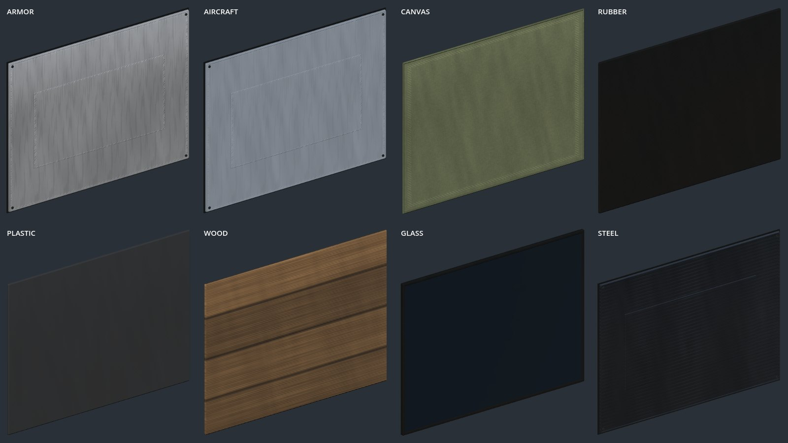

This standalone panel stage uses a front-facing inspection light to show the construction.
It is not a lighting-matched comparison with the whole vehicles above.

| Material | Automatic construction |
|---|---|
| Painted / exposed metal | Folded borders, gasket, fasteners, pressed centre or louvres |
| Fabric / canvas | Draped cloth, rolled hems and filtered stitches |
| Rubber / plastic | Chamfered moulded sheet, without metal hardware |
| Wood | Solid sheet with directional grain |
| Glass | Opaque pane in a fitted rubber seal |

Call `VehicleBody.panel` with the existing material name; it chooses the construction.
`VehicleCloth.canopy` accepts a cross-section and support stations. HEMTT, Zamak and
Tempest troop bodies now use it, with their own rear openings and fittings. Shared cargo
covers also get perimeter hems. This is static draped geometry, not a cloth simulation.

Painted body parts retain per-piece edge coordinates through baking. Curved faces use
neutral coordinates, preserving their authored seams rather than drawing bounding boxes
on curved skins. Wear is an approximation based on the source part bounds, not an
ambient-occlusion or curvature bake. The photographic material maps remain shared and
triplanar; no new texture downloads or licences are required.

## Roster and renderer checks

The 143-subject roster, eight Forward+ subjects and eight rear/team-1 subjects below were
captured at **00d74c5**. The final change at **25a2c2b** only reduces runoff darkness and
primer-chip opacity; the main comparisons and panel stage above include that tuning.

[Roster 1](roster-roster-00.jpg) · [Roster 2](roster-roster-01.jpg) · [Roster 3](roster-roster-02.jpg) · [Roster 4](roster-roster-03.jpg) · [Roster 5](roster-roster-04.jpg) · [Roster 6](roster-roster-05.jpg) · [Roster 7](roster-roster-06.jpg) · [Roster 8](roster-roster-07.jpg) · [Roster 9](roster-roster-08.jpg) · [Roster 10](roster-roster-09.jpg) · [Roster 11](roster-roster-10.jpg) · [Roster 12](roster-roster-11.jpg) · 

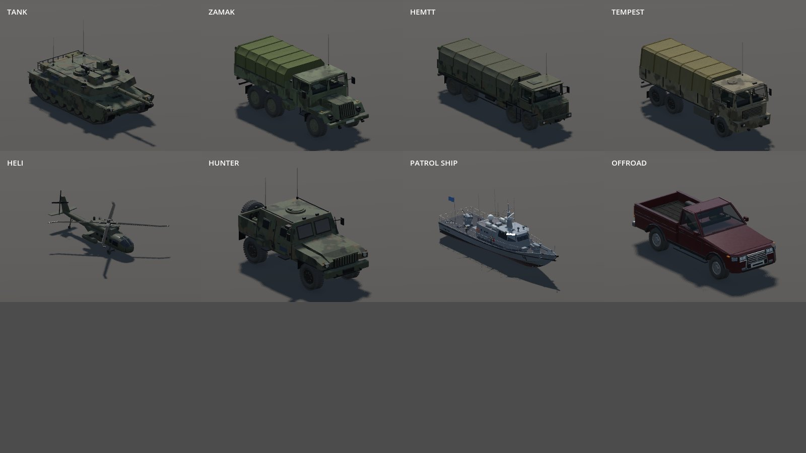

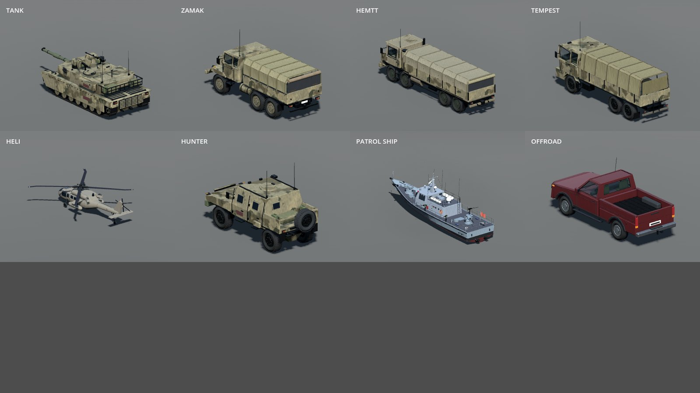

Six vehicle tests pass on Godot 4.7.2: materials across both palettes, components, distance
meshes, motion, sockets and rotors. New assertions check material-appropriate construction,
unchanged source mesh positions/normals and edge coordinates surviving the bake. Import,
Compatibility/Forward+ shader renders, changelog validation and presentation audit pass.
The roster scenario completes without script errors; it reports shutdown resource warnings.
No performance improvement is claimed: cloth bays add cached geometry and painted parts
carry UVs through their existing material batches.

## Reproduce

```
godot --path . --rendering-method gl_compatibility --audio-driver Dummy tools/showcase/vehicle-surfaces.tscn -- --surface-out=OUTPUT --surface-single --surface-kinds=tank,zamak,hemtt,tempest,heli,hunter,patrol_ship,offroad --surface-ground
```

Use `--surface-panels` for the construction sheet. Omit single/kinds for the roster;
use `--surface-team=1 --surface-rear` for the second palette from behind. Repeat the selected
vehicles with `--rendering-method forward_plus` for desktop rendering. Each capture manifest
records the renderer, camera settings, model keys and seed. Capture waits five process frames.
