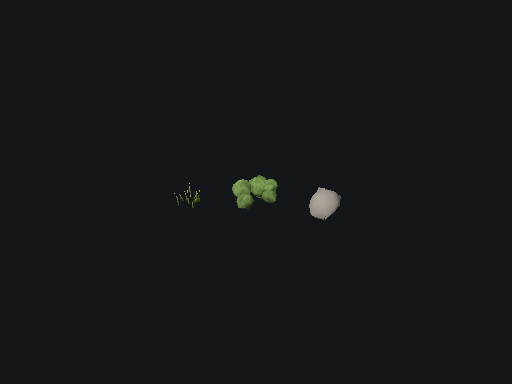
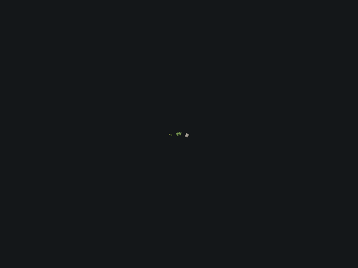
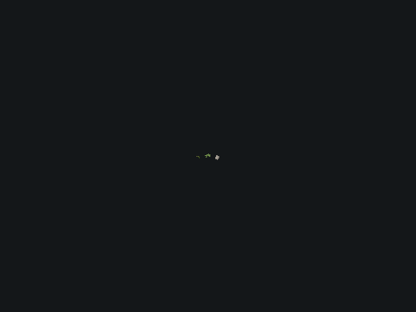

# Ground cover geometry

The three shared procedural meshes previously stored 270 vertices for grass,
2,100 for bushes and 48 for stones. Indexing preserves all original triangle
positions while reducing the first two to 120 and 310 vertices. Godot's existing
ImporterMesh LOD generator supplies smaller bush and stone index buffers.
Thin grass blades retain every triangle; their wind deformation is unchanged.
No per-frame script work, new workers or dependencies are introduced.

## Rendering checks

Compared to `97343cb`, an isolated stage uses the real ground-cover shaders,
fixed wind time, matching lighting and three cameras. Full-detail triangle
positions match. Near and medium images have zero changed pixels on Forward+
and Compatibility. At the distant camera (0,40,60), 860 triangles become 246;
61 RGB channels differ by more than 3/255 on Forward+ and 56 on Compatibility.

| View | Before | After |
| --- | --- | --- |
| Medium |  |  |
| Distant |  |  |

These are controlled asset fixtures, not historical battle screenshots. The
reference uses `scripts/game/grass.gd` from `97343cb`, with only its class_name
removed so both versions can be loaded together. Capture script and full logs
are retained in the ground-cover-lod worktree under `build/check-ground-render.*`,
`build/grass-before.gd`, `build/ground-render.log` and `build/ground-render-gl.log`.

## Large city measurements, 5 November 2026

Godot 4.7.2 release, Windows, i9-11900K, RTX 3090, Forward+, High, 1280x720,
uncapped, 3072 m generated city, 500 initial soldiers, team 0, focus 0,0,
130 m zoom. Every run starts the same saved initial state, warms for 30 seconds
after client readiness, then captures 30 seconds. Other applications remain
running. No local builds or tests overlap the measured windows.

The six runs interleave an independent, unshipped shadow experiment:
control, shadow, ground cover, ground cover, shadow, control.

| Build | Average FPS | Frame p99, ms | Adjacent-frame difference p99, ms | Rendered primitives |
| --- | ---: | ---: | ---: | ---: |
| Valid control (`97343cb`) | 44.34 | 38.52 | 16.50 | 7.21 million |
| Ground cover, run 1 | 48.49 | 33.66 | 12.72 | 6.64 million |
| Ground cover, run 2 | 49.72 | 34.18 | 14.07 | 6.68 million |

The first control and first shadow run are **excluded from the FPS comparison**:
their servers completed only 1708 and 1780 ticks in the 30-second server window,
instead of 1800. The changed runs and final control completed all 1800 ticks.
The first control averaged 32.26 FPS, showing substantial changing machine load.
With only one valid bracketing control, these data do not establish an isolated
percentage FPS improvement. They also do not meet sustained 60 FPS. The geometry
reduction is supported independently by the fixed asset fixture.

[Compact captures, including excluded runs](ground-cover.json). Raw captures and
the cached-state launch script are `build/cover-*/` and `build/compare-cover.py`.
The saved initial is in the soldier-presentation-queue worktree at
`build/large.initial`. The benchmark uses the same release settings as
`tools/benchmark_scaling.py --rendered --local-server --units 500 --map-size 3072
--mode combat --seed 3 --team 0 --warmup 30 --duration 30 --zoom 130 --preset high
--width 1280 --height 720`, reusing that initial to keep authored scenery identical.

Validation: mesh/index/LOD regression, grass streaming, both rendered comparisons,
script import and Windows release export pass. This does not validate low-end
GPUs or a moving camera.
