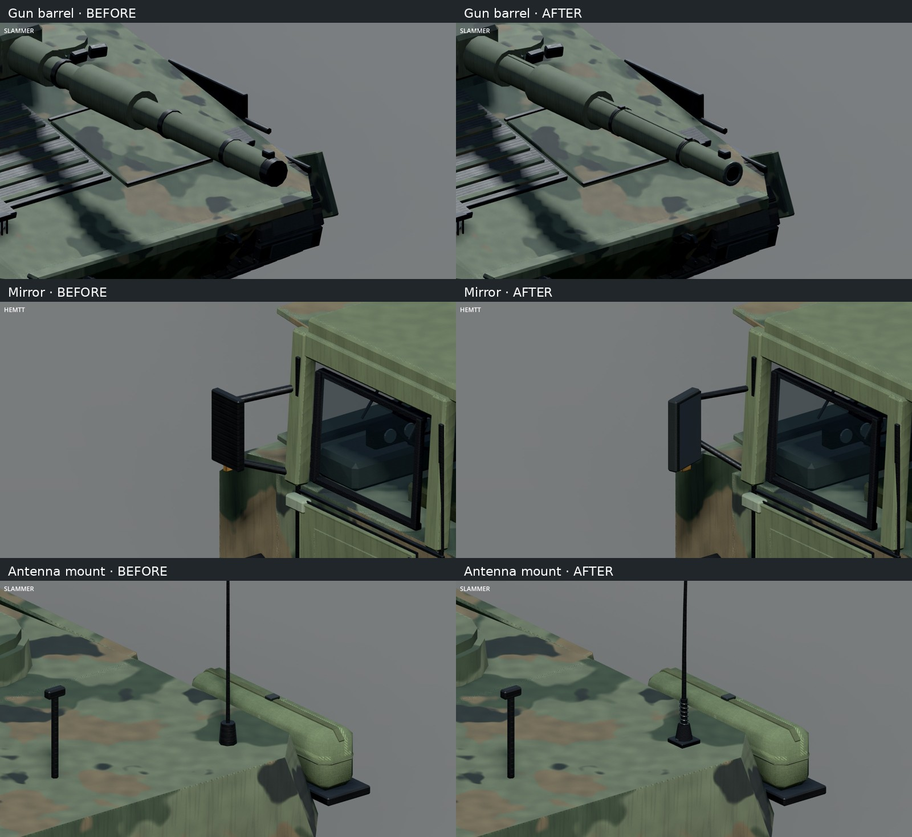
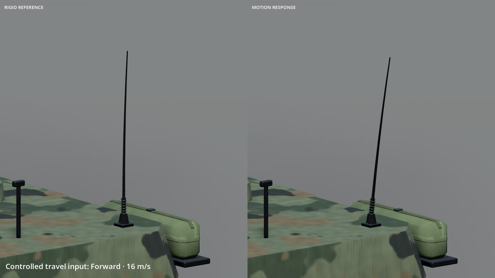
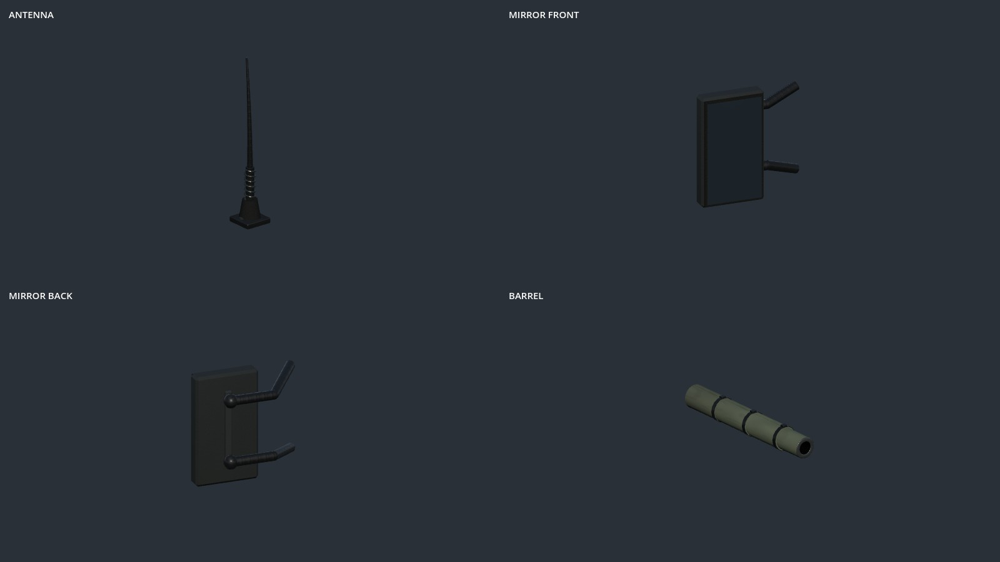
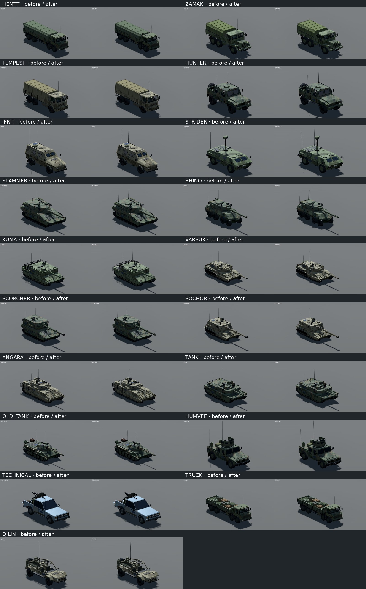

# Vehicle accessories: combined review

This review keeps three combined stills and one short motion comparison. Individual vehicle screenshots and full-roster sheets are not checked in.

## Detail comparison



Before: `37085ab` (main after #153). Static after: `21ed5c4`. Godot 4.7.2, Compatibility, team 0, seed 3; each source view was 1600 × 900 and is resized without cropping into the combined sheet. Matching pairs use the same studio light and fixed camera.

The barrel has an open bore, crown, sleeve seams and clamps. Mirrors have convex faces, seals and support arms behind the glass; their environment reflections can look dark and are not live rear-view cameras. Antennas share bolted feet, rubber boots, springs and tapered whips.

## Motion comparison

[](../../changelog/unreleased/vehicle-antennas-mirrors-barrels/antenna-motion.webm)

Motion source: `0206a22`. The 12-second silent clip is a controlled inspection rig: both cameras hold the current Slammer model fixed, the left whip remains rigid, and the right uses the production motion helper with labelled forward, lateral and reverse travel inputs, followed by settling. It is not historical driving footage. Camera-follow framing isolates the response; gameplay supplies velocity from displayed vehicle movement.

One exact damped spring per vehicle combines travel drag and clamped acceleration. Each whip uses one pivot and one material batch; the boot stays in the hull bake. There are no physics bodies, bones or mesh rebuilds. Updates stop for hidden vehicles or beyond 100 m, and reset after large corrections or long frame gaps. Turret-mounted antennas retain the correct world-space lean while traversing.

## Shared construction and representative vehicles





Antennas are shared by the core, NATO, CSAT and independent land-vehicle builders. Mirrors cover ten families; barrels cover nine tank/artillery families and their shared variants. The T-55 stays unsleeved. Aircraft aerials, radar arrays and unique autocannons retain their authored construction. Small fittings are deliberately subtle at whole-vehicle scale.

## Reproduce and validation

```sh
godot --path CHECKOUT --rendering-method gl_compatibility --audio-driver Dummy tools/showcase/vehicle-surfaces.tscn -- --surface-out=OUTPUT --surface-single --surface-kinds=KINDS --surface-ground
```

Whole views use bounds-based framing and direction `(1,.65,-1.25)`. Close-up flags:

| Detail | Flags |
|---|---|
| Mirror | `--surface-kinds=hemtt --surface-focus=-1.52,2.28,-4.52 --surface-size=1.4 --surface-rear` |
| Antenna base | `--surface-kinds=slammer --surface-focus=1.05,2.9,3.15 --surface-size=1.4 --surface-rear` |
| Barrel | `--surface-kinds=slammer --surface-focus=0,2.22,-4.6 --surface-size=2.1` |

Construction uses `--surface-accessories` without ground/single flags. Motion uses `--surface-antenna-motion --surface-ground`, records 180 frames at a fixed simulated 15 Hz, then encodes VP9 WebM at 15 fps with no audio. Its left/right cameras share focus `(1.05,3.5,3.15)`, size 2.5 and direction `(-1,.35,1.25)`.

Six vehicle tests pass, including forward/reverse lean, settling, hidden/reset behavior, rotated-parent direction and one material per whip. Roster materials in both palettes, LOD, movement, sockets and rotor contracts also pass. The seeded roster scenario ran without script errors; shutdown reported ObjectDB/resource cleanup warnings. The static pass rendered all 143 showcase entries and checked 19 representatives in Forward+; the motion rig was also checked in Compatibility and Forward+. Full capture frames remain local review outputs rather than repository assets.
