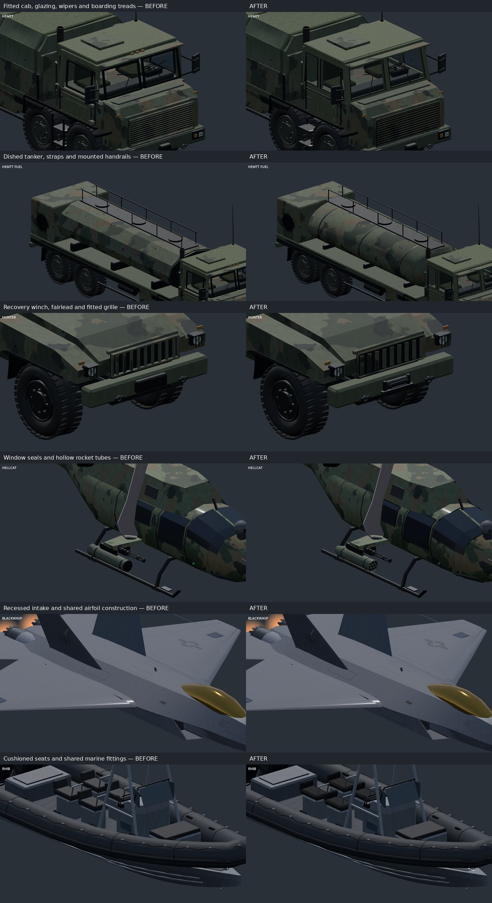

# Shared vehicle construction: implementation review

Thirty reusable construction techniques now have active consumers in at least
three independent builder roots each. These include visible detail upgrades and
explicitly identified kernel extractions. A whole-vehicle silhouette comparison
will not show every small fitting, and the loft extraction is enabling work.
Existing CC0 surface materials remain shared; this change adds no texture pack.

Use the [programmatic index](../tools/vehicles/README.md) to look up a model,
its owner, reachable shared APIs and candidate duplicated construction. It covers
137 model keys, including five ambient bodies, and can join 98 gameplay aliases
from the runtime roster. It would exclude a shadowed dispatcher (none remain) and
does not count variants or the team-dependent convoy union as additional designs.
Conditional branches are a union: a fuel-tank method reachable from a truck root
does not mean the cargo variant carries a tank. Source links and keyword evidence
are navigation aids, not an automatic presence detector.

## Techniques and representative adopters

The API registry is [features.json](../tools/vehicles/features.json); tests verify
its 30 entries have at least three independent active construction roots. The
examples below use one model per root. Dimensions, styles, variants and positions
remain authored in family builders. The component guide defines the
[coordinate, material, baking and animation contracts](vehicle-components.md).

| # | Technique / shared entry point | Representative model keys | Result and reuse boundary |
|---|---|---|---|
| 1 | Surface-following polygon panels — `VehicleBody.fitted` | `ac130`, `hemtt`, `zamak`, `humvee`, `hunter` (7 roots) | Fitted edge/gasket on access leaves. Authored planar and curved surface adapters; family silhouettes remain local. |
| 2 | Real body openings and reveals — `VehicleCab.framed_face` | `hemtt`, `zamak`, `tempest` (3 roots) | Cab reveal and continuous opening frames. Rectangular apertures in quad cabin faces; curved full-body cutouts remain specialized. |
| 3 | Outline-aware glazing assemblies — `VehicleGlazing.polygon` | `suv`, `heli`, `m900`, `orca`, `taru` (27 roots) | Outline seals and retaining beads. Opaque glass by default. Authored faceted pane meshes may be supplied to preserve creases. |
| 4 | Door and access-panel assemblies — `VehicleDoors.closed` | `ac130`, `hemtt`, `zamak`, `humvee`, `hunter` (7 roots) | Joined leaf, hinges and raised pull. Closed leaves and access panels; sliding rails and opening animation remain vehicle-specific. |
| 5 | Surface boundary seams and fastener layouts — `VehicleBody.boundary` | `suv`, `heli`, `m900`, `orca`, `taru` (27 roots) | Single fitted boundary; cheaper seam mesh. Sampled seams and corner fasteners; no automatic arbitrary hole drilling. |
| 6 | Fitted vent and louvre panels — `VehicleFittings.vent` | `hemtt`, `zamak`, `hunter`, `tempest` (4 roots) | Clipped louvres with recessed backing. Polygon-clipped fins in metre-scaled domains; bespoke engine intake mouths use ducts. |
| 7 | Projected markings and wear masks — `VehicleMarkings.polygons` | `a10`, `jet`, `wipeout`, `blackwasp`, `gun_trawler` (6 roots) | Enabling extraction; ship polygons follow individual projected vertices. Projected polygons; national symbols and text layouts remain authored. |
| 8 | Wheel arches, liners and fender lips — `VehicleWheelArches._flare` | `suv`, `mb4wd`, `aa_tech`, `offroad`, `tractor` (7 roots) | Arch kernel extraction plus a thin inner liner. Convex cut-body strips, arc flares and liners; faceted military arches retain their shape. |
| 9 | Chassis, axles and suspension layouts — `VehicleRunningGear.frame` | `hemtt`, `zamak`, `aa_tech` (3 roots) | Separate rails, crossmembers and axle detail. Ladder frames and solid axles; independent wishbones retain their distinct suspension. |
| 10 | Steps and boarding ladders — `VehicleFrames.step` | `heli`, `hemtt`, `huron`, `zamak`, `hunter` (7 roots) | Grip ribs and rolled tread lips. Treads and rung assemblies; unique retractable stairs remain specialized. |
| 11 | Handrail and stanchion runs — `VehicleFrames.railing` | `hemtt`, `zamak`, `tempest` (3 roots) | Mounted feet and stanchions. Explicit stanchion paths on tankers; optimized ship rail meshes remain specialized. |
| 12 | Seating and cockpit furniture — `VehicleCab.seat` | `suv`, `rhib`, `hemtt`, `qilin`, `zamak` (9 roots) | Cushion divisions, seams and seat supports. Parameterized seat construction; cockpit instruments and benches retain their layouts. |
| 13 | Hinge, latch and pull-handle sets — `VehicleDoors.hinge` | `mora`, `ac130`, `hemtt`, `zamak`, `futura` (14 roots) | Pins, hinge leaves and mounted handles. Independent hinge/pull fittings reused by doors and storage lids. |
| 14 | Storage-bin and toolbox shells — `VehicleEquipment.storage` | `mora`, `futura`, `hunter`, `sochor`, `varsuk` (8 roots) | Lid gasket, hinges, pulls and latches. Closed top-lid bins/toolboxes; ammunition cans and open baskets remain separate. |
| 15 | Segmented armour skirts — `VehicleEquipment.skirt` | `mora`, `bobcat`, `futura`, `sochor`, `varsuk` (10 roots) | Attachment hangers and lower metal folds. Segmented skirt attachments; reactive blocks and cage armour remain authored. |
| 16 | Cargo support and restraint layouts — `VehicleCargo.restraints` | `hemtt`, `zamak`, `tempest` (3 roots) | Pallet slats, fitted straps and buckles. Pallet supports and bound-fitting straps; covers stay in VehicleCloth. |
| 17 | Windshield wiper assemblies — `VehicleFittings.wiper` | `suv`, `hemtt`, `mb4wd`, `zamak`, `aa_tech` (10 roots) | Raised arms and separate blades. Static parked blades and raised arms; no new animation. |
| 18 | Routed hoses, ropes and cables — `VehicleFrames.cable` | `bobcat`, `humvee`, `hunter`, `cheetah`, `panther` (11 roots) | Supported cable sag and end collars. Static supported routes with optional sag and collars; no rope simulation. |
| 19 | Winch and fairlead assemblies — `VehicleEquipment.winch` | `humvee`, `hunter`, `prowler`, `fia_truck` (4 roots) | Spool wraps, fairlead rollers and frame. Compact recovery spool and fairlead; powered crane drums remain specialized. |
| 20 | Mounted fuel and pressure vessels — `VehicleEquipment.vessel` | `hemtt`, `zamak`, `tempest` (3 roots) | Dished ends, oval sections and saddles. Oval/cylindrical tankers with dished ends; rectangular and aerodynamic fuel tanks differ. |
| 21 | Aircraft landing-gear assemblies — `VehicleAircraft.gear_leg` | `jet`, `orca`, `ac130`, `huron`, `mohawk` (7 roots) | Oleo sleeves and torque links. Oleo legs and torque links on existing parents; complex bogies and door pivots remain authored. |
| 22 | Profiled intake and exhaust ducts — `VehicleAircraft.duct` | `jet`, `shikra`, `buzzard`, `gryphon`, `neophron` (6 roots) | Double walls, rim and recessed engine face. Double-wall loop ducts and recessed engine faces; distinctive nozzle petals remain authored. |
| 23 | Station-loft and revolved-profile mesh kernel — `VehicleProfiles.loft` | `a10`, `jet`, `xian`, `ac130`, `caesar` (15 roots) | Enabling extraction; authored loft shapes retained. Loft and revolution kernels; no universal silhouette generator. |
| 24 | Airfoil and control-surface construction — `VehicleAirfoils.surface` | `a10`, `jet`, `xian`, `ac130`, `caesar` (15 roots) | Shared airfoil kernel; consistent metre-scaled gaps. Spanwise airfoil sections and metre-scaled control gaps; planforms remain authored. |
| 25 | Hardpoint, pylon and launcher mounts — `VehicleAircraft.hardpoint` | `a10`, `jet`, `xian`, `shikra`, `buzzard` (10 roots) | Tapered pylon and sway braces. Pylons and sway-brace mounts; specialized missile rails retain their geometry. |
| 26 | Rocket-pod housings and tube banks — `VehicleAircraft.rocket_pod` | `a10`, `m900`, `orca`, `xian`, `kajman` (11 roots) | Hollow tube mouths and rolled rims. Seven- and nineteen-tube pods; other tube patterns must be explicitly added. |
| 27 | Optical sensor and gimbal housings — `VehicleEquipment.sensor` | `m900`, `huron`, `falcon`, `kajman`, `nyx_aa` (7 roots) | Recessed paired optics, bezels and trunnions. Box and spherical optical housings; mast mechanisms remain vehicle-specific. |
| 28 | Navigation and marker-light assemblies — `VehicleFittings.marker` | `a10`, `jet`, `m900`, `orca`, `xian` (21 roots) | Lamp housing and recessed lens. Side navigation housings and optics; beacon timing remains unchanged. |
| 29 | Propeller, spinner and blur assembly — `VehiclePropellers.blade` | `ac130`, `caesar`, `greyhawk`, `blackfish`, `fenghuang` (5 roots) | Shared profiled blade/spinner/blur; existing animation retained. Profiled blades, spinners and blur; existing wheel/rotor registration remains intact. |
| 30 | Mooring fitting assemblies — `VehicleMarine.mooring` | `rhib`, `motorboat`, `gun_trawler`, `patrol_ship`, `speedboat_hmg` (5 roots) | Mounted feet and rounded cleat/bitts horns. Cleat and bitts styles with independent dimensions; marine propellers remain separate. |

## Review evidence

One combined sheet is committed. All raw captures remain outside Git. The
baseline is `a6d3708` (roadmap branch with `origin/main` at `baccc6d` merged);
comparison captures use the same team, seed, lighting, camera and engine per pair.
The full 143-view roster pass used Godot 4.6.3 Compatibility; final close-ups use
Godot 4.7.2 Compatibility. Camera settings and reproduction commands are recorded
in the [media inventory](../changelog/unreleased/shared-vehicle-construction/capture.json).

The full roster was inspected for missing surfaces, glass seams, wheel clearance
and changed silhouettes. This caught a helicopter glazing regression: resampling
a faceted pane produced stripes, so the shared seal now accepts the original
crease-preserving pane mesh. A geometry audit also replaced repeated small
cylinders around glass with one four-sided seam mesh. Small fittings are most
visible close up; the shared loft kernel intentionally retains existing shapes.

Clear glass remains limited to builders with actual openings and interiors.
Curved helicopter shell cutouts, animated sliding doors, optimized marine rail
meshes, independent wishbone suspension, special nozzle petals and complex
landing bogies remain specialized. The original roadmap's examples were
candidates, not a requirement to force incompatible surfaces into one builder.
The registry records each supported boundary so future work can extend it
without accidentally adding a competing helper.

## Validation and cost

Surface tests exercise mirrored winding, curved samples, real apertures,
opaque baking, clear-glass near/far and wreck behavior, profile cache identity,
and a bounded single-mesh seal. Index tests exercise active ownership, the absence of
shadowed builders, convoy routing and the three-root minimum. Existing material, component,
LOD, motion and socket tests cover the model roster and animation contracts.

Godot 4.7.2 headless smoke scenarios (`roster`, `tank`, `naval`) completed without
script errors. Seven targeted Node tests passed. Final Compatibility renders
cover 18 representative affected models; Forward+ renders cover six ground,
air and marine examples. Scenario shutdown still reports ObjectDB/resource
cleanup warnings; these checks do not claim leak-free teardown.

The construction metric tool builds 135 sorted gameplay/family model keys at
team 0, seed 3, once per process. Both revisions used Godot 4.7.2 on this workspace,
with no simultaneous rendering or tests during measurement. Counts include
near/far LOD alternatives and all stored mesh surfaces, not simultaneous draw
calls. Build times include cache warm-up and are a single-run diagnostic, not a
frame-rate benchmark.

| Measure (all 135 models) | Baseline | Implementation | Change |
|---|---:|---:|---:|
| Stored vertices | 24,112,120 | 25,306,054 | +5.0% |
| Stored surfaces | 6,014 | 6,181 | +2.8% |
| Nodes | 4,348 | 4,376 | +0.6% |
| Summed build time (seconds) | 14.39 | 14.74 | +2.4% |

The extra geometry is principally seals and equipment detail. Existing opaque
batching and LOD remain active; no per-frame construction work was added. A
repeatable in-game draw-call/frame-time benchmark remains separate from this
construction-cost measurement. Run `tools/vehicles/construction-metrics.tscn`
on both revisions to reproduce the counts, keeping its JSON outside Git.
