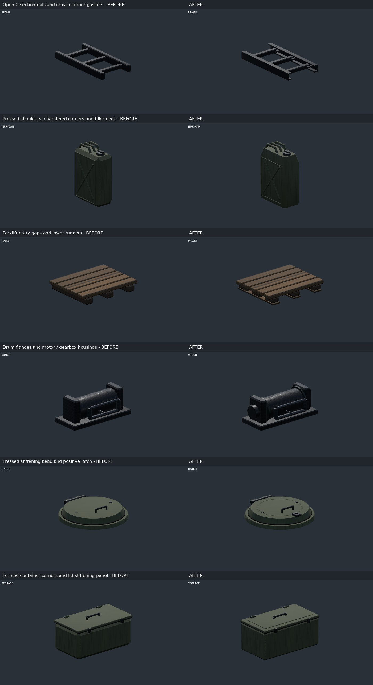

# Forty shared vehicle detail improvements

This pass upgrades 20 existing shared assemblies, with two concrete changes per
assembly. It adds no competing equipment library and no texture downloads.
The baseline is `7a96dd4`, main after PR #161. The previous 30 techniques remain
registered separately; these 40 are improvements to their construction and the
existing fittings, not 40 new APIs.

The [machine-readable list](../tools/vehicles/detail-improvements.json) and
[construction index](../tools/vehicles/README.md) make the accounting reviewable.
Tests require 40 distinct entries and at least three independent active builder
roots for every API involved. Variants and the team-dependent convoy union do
not inflate that count. Source reachability still includes conditional branches:
a truck family can build a tanker without every truck variant carrying a vessel.

| IDs | Assembly / shared method | Two improvements | Representative active designs |
|---|---|---|---|
| 1–2 | jerrycan / `VehicleFittings.jerrycan` | Independent body dimensions with legacy width compatibility; Chamfered pressed shoulders and a raised filler neck | `ifv`, `tank`, `marid`, `qilin` (20 roots) |
| 3–4 | ammo_can / `VehicleFittings.ammo_can` | Outline-following rolled lower seam; Hinged lid closure and raised clasp | `tank`, `mb4wd`, `humvee`, `aa_tech` (6 roots) |
| 5–6 | storage / `VehicleEquipment.storage` | Dimension-clamped formed body corners; Pressed lid stiffening panel | `mora`, `futura`, `hunter`, `sochor` (8 roots) |
| 7–8 | winch / `VehicleEquipment.winch` | Cable-retaining drum flanges; Motor and gearbox housings within the mount envelope | `humvee`, `hunter`, `prowler`, `fia_truck` (4 roots) |
| 9–10 | sensor / `VehicleEquipment.sensor` | Box sunshade or spherical neck seal; Attached service cover with housing-specific shape | `m900`, `huron`, `falcon`, `kajman` (7 roots) |
| 11–12 | vessel / `VehicleEquipment.vessel` | Circumferential end welds; Rubber isolation pads under mounting bands | `hemtt`, `zamak`, `tempest` (3 roots) |
| 13–14 | skirt / `VehicleEquipment.skirt` | Clipped lower corners on formed skirt leaves; Replaceable attachment pins | `mora`, `bobcat`, `futura`, `sochor` (10 roots) |
| 15–16 | door / `VehicleDoors.pull`, `VehicleDoors.hinge` | Pull-handle mounting escutcheons; Hinge-pin end retainers | `mora`, `tank`, `ac130`, `hemtt` (19 roots) |
| 17–18 | seat / `VehicleCab.seat` | Raised cushion side bolsters; Separate rear support shell | `suv`, `rhib`, `hemtt`, `qilin` (9 roots) |
| 19–20 | pallet / `VehicleCargo.pallet` | Open forklift-entry gaps between support blocks; Lower deck runners | `hemtt`, `zamak`, `tempest` (3 roots) |
| 21–22 | restraints / `VehicleCargo.restraints` | Open ratchet frame and winding spindle; Loose webbing tail | `hemtt`, `zamak`, `tempest` (3 roots) |
| 23–24 | frame / `VehicleRunningGear.frame` | Open C-section chassis rails; Crossmember reinforcing gussets | `hemtt`, `zamak`, `aa_tech` (3 roots) |
| 25–26 | axle / `VehicleRunningGear.axle` | Differential cover bolt circle; Pinion neck and driveline flange | `hemtt`, `zamak`, `aa_tech` (3 roots) |
| 27–28 | gear / `VehicleAircraft.gear_leg` | Routed brake hose; Strut clamp collars | `jet`, `orca`, `ac130`, `huron` (7 roots) |
| 29–30 | pylon / `VehicleAircraft.hardpoint` | Side inspection panels; Sway-brace adjustment nuts | `a10`, `jet`, `xian`, `shikra` (10 roots) |
| 31–32 | rocket_pod / `VehicleAircraft.rocket_pod` | Mounting-band closures; Rear electrical service connector | `a10`, `m900`, `orca`, `xian` (11 roots) |
| 33–34 | mooring / `VehicleMarine.mooring` | Deck bedding pads; Flared upright roots | `rhib`, `motorboat`, `gun_trawler`, `patrol_ship` (5 roots) |
| 35–36 | mirror / `VehicleFittings.mirror` | Chamfered mirror shell; Arm mounting shoes | `m35`, `hemtt`, `ifrit`, `qilin` (10 roots) |
| 37–38 | exhaust / `VehicleFittings.exhaust` | Open-ended heat-shield sleeve; Heat-shield clamp lugs and screws | `hemtt`, `tempest`, `tractor` (3 roots) |
| 39–40 | hatch / `VehicleFittings.hatch` | Circular pressed stiffening bead; Positive latch opposite the hinge | `apc`, `ifv`, `tank`, `ifrit` (24 roots) |

## Adoption and construction decisions

- Tempest ammunition loads now sit on the shared pallets. The crates and their
  restraints rise by the pallet height; shorter missile cases retain clearance
  under the folded loading crane. The crane stays in place.
- The tractor uses the common hollow exhaust stack and heat shield, retaining
  its separately authored silencer, rain cap and adjacent intake. HEMTT and
  Tempest already used this stack. Underbody silencers and turbine outlet
  grilles remain different construction.
- Jerrycans accept an optional body `size` in metres. Omit it to preserve the
  legacy width/height/depth convention. The complete cap/handle/rib assembly
  scales with the body and rotates together; this is a size variant, not a
  simulation of a particular container capacity. Tests exercise small, standard
  and larger examples.
- Box sensor sunshades and spherical neck seals remain different styles. Their
  service covers follow the housing type. Clear sensor glass is omitted on
  wrecks, through the existing material/bake contract.
- Chassis rail bounds, wheel registrations, aircraft gear parents and payload
  axes remain unchanged. Pallet openings, rail channels and ratchet frames are
  actual geometry. Hoses are static authored routes, not physics simulations.
- Parts use the existing shared mesh/profile/material builders and opaque
  bake. There are no new animation pivots, lights, textures or per-frame jobs.

## Visual review

The combined sheet shows actual shared component output, not standalone concept
art. These are close-up refinements; most do not alter a whole vehicle's
silhouette at normal gameplay zoom. The capture stage has fixed component camera
sizes and centres so changed bounds cannot secretly change the comparison scale.

All 20 assemblies were captured before and after with the same Godot 4.7.2
Compatibility renderer, lighting and camera. Nineteen whole-vehicle comparisons
check placement across ground, air and marine examples. Final Forward+ examples
cover tractor, Tempest ammunition truck, Hunter, Kajman, RHIB and Slammer.
Individual captures and review sheets stay outside Git. The single committed
sheet and capture inventory are shared by this review, the changelog and PR.

The first review caught protruding ammunition-can seam ends, excessively sharp
fuel-can corners and a flat service plate that did not fit a spherical sensor.
The revised seams use the existing surface-boundary builder, can shoulders use
chamfered loft stations, and ball housings use an attached round service cap.

## Validation

New geometry tests check actual rail/pallet voids, independent can sizes,
rotation, static baking, sensor bounds and wreck materials. The index test checks
the 40-entry inventory and three-design reuse threshold. Existing component,
material, LOD, motion, socket and fitted-surface tests cover inherited behavior.

Eight targeted Node tests passed on Godot 4.7.2. A subsequent focused test also
checks the palletized Tempest load clears the folded crane. The headless roster
scenario completed without script errors; shutdown still reports ObjectDB/resource
cleanup warnings, as in the previous pass. Compatibility and Forward+ output was
visually inspected. Changelog and presentation checks passed before push.

The following single-process construction measurements use Godot 4.7.2 headless,
135 sorted model keys, team 0 and seed 3. No tests or rendering ran concurrently.
Counts include stored near/far LOD alternatives and do not represent simultaneous
draw calls. Timings include cache warm-up and are not gameplay frame rates.

| Measure | Main baseline | Detail pass | Change |
|---|---:|---:|---:|
| Stored vertices | 25,306,054 | 26,099,637 | +3.1% |
| Stored surfaces | 6,181 | 6,214 | +0.5% |
| Nodes | 4,376 | 4,376 | +0.0% |
| Summed construction time (s) | 16.48 | 15.05 | -8.7% |
