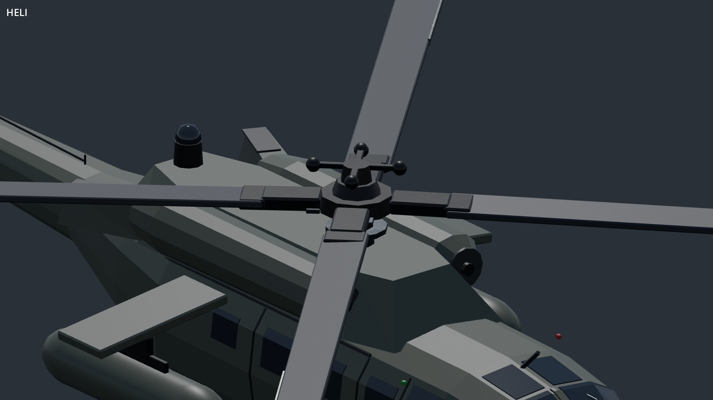
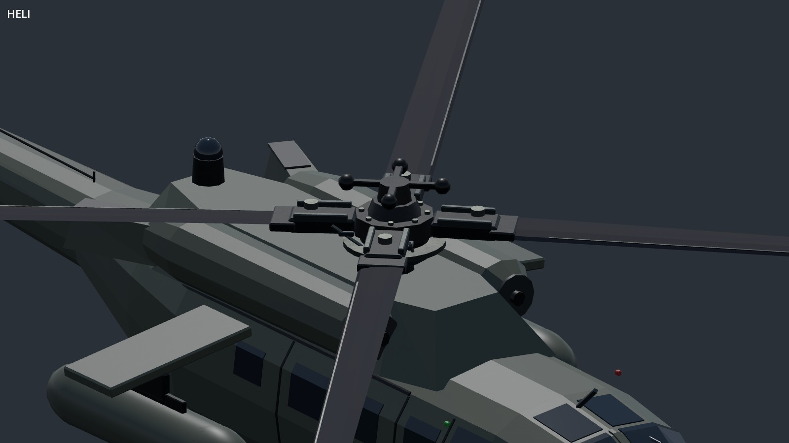

# Shared rotor improvements

This pass changes visible parts, not just their construction code: rectangular blades become tapered airfoil sections, and simple hub blocks gain forked grips, hinge pins, pitch links and stepped swashplates. Blades have a dedicated matte, nonmetallic finish. Leading-edge protection follows their shape, and tip markings sit on the same shaped sections.

| Rotor head before | Rotor head after |
| --- | --- |
|  |  |

These are native 1600 × 900 captures with identical lighting, camera direction and a fixed 3 m orthographic view centred on the main rotor. Before is `b1a20ef`; after is `a149298`. The baseline uses the same extended capture harness. No image retouching, exposure adjustment or artificial detail was added.

## Whole-aircraft comparisons

| Aircraft / configuration | Before | After |
| --- | --- | --- |
| UH-60 / conventional swept blades | [Before](before-heli.jpg) | [After](after-heli.jpg) |
| Huron / tandem | [Before](before-huron.jpg) | [After](after-huron.jpg) |
| Mohawk / paddle tips | [Before](before-mohawk.jpg) | [After](after-mohawk.jpg) |
| Kajman / coaxial | [Before](before-kajman.jpg) | [After](after-kajman.jpg) |
| Hummingbird / light five-blade rotor | [Before](before-hummingbird.jpg) | [After](after-hummingbird.jpg) |

[Mohawk hub before](hub-before-mohawk.jpg) / [after](hub-after-mohawk.jpg). Forward+ checks: [UH-60](forward-heli.jpg), [Mohawk](forward-mohawk.jpg).

## Coverage and limits

All 17 variants were rendered and inspected: heli, gunship, Ghosthawk, Ghosthawk Stub, Huron, Mohawk, Kajman, Taru, Taru Lift, Hummingbird, Pawnee, M900, Hellcat, Blackfoot, Orca, armed Orca and Falcon. See [sheet 1](family-roster-00.jpg) and [sheet 2](family-roster-01.jpg).

The shared builder preserves blade count, radius, phase, hub caps and aircraft-specific layout. Exposed tail rotors use the same blade sections. Enclosed fans and drone propellers remain specialised. Full airframes have not been rebuilt by this pass.

Details are clearest at rest and low speed. At flight speed the existing blur disc replaces explicit main blades, while hub fittings remain visible. This is geometry detail, not a new aerodynamic simulation or a high-speed blur redesign.

Five focused tests pass, covering rotor visibility contracts, tandem/coaxial pivots, wrecks, finite airfoil normals, matte material properties, roster materials, distance meshes, vehicle motion and weapon sockets. The sling scenario runs for 10 seconds without script errors. Local checks use Godot 4.6.3; the project targets 4.7. Both Compatibility and Forward+ captures were inspected. [Capture provenance and hashes](capture.json).

See [the shared component guide](../vehicle-components.md) for reuse. Improving `VehicleRotors` now updates all callers together, while the existing family adapters preserve their dimensions and styles.
