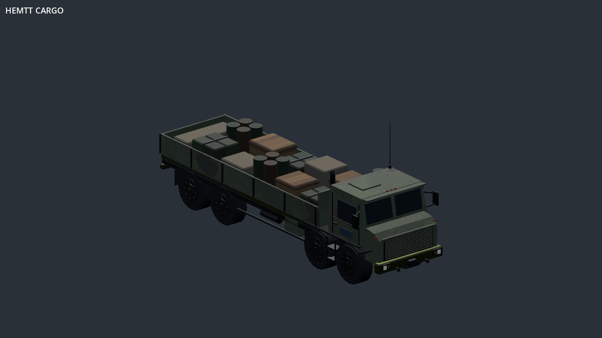
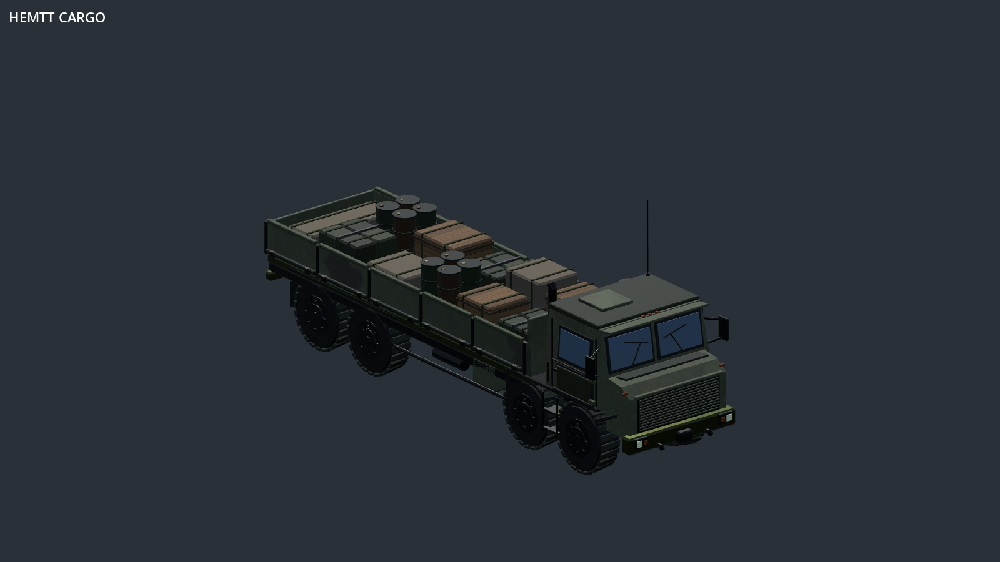
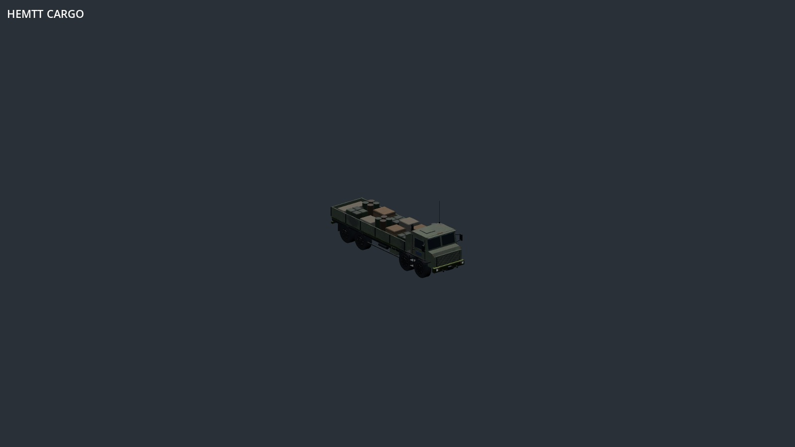
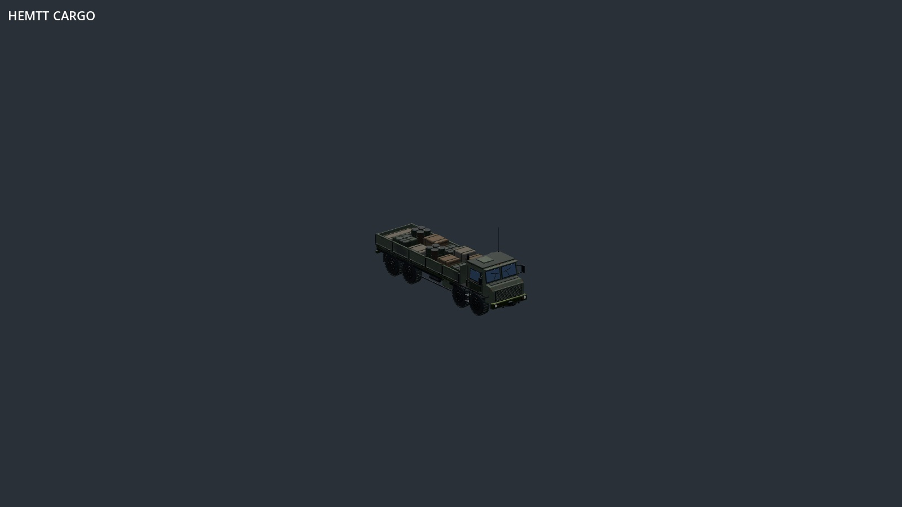

# HEMTT cargo: focused art pass

This records the earlier pass at `e7fee16`. See the [subsequent cab, tyre and cloth rebuild](hemtt-rebuild.md) for the current result.

This comparison starts **after** the CC0 material integration (`f0b8191`). Only the HEMTT cargo variant receives the new modeled details. Both sides use the same seed, studio lighting, view direction, renderer and camera size. Images are full-frame captures, not retouched renders.

## Close view

| Before | After |
| --- | --- |
|  |  |

Window gaskets and wipers, a pressed door panel, raised bed rails and latch hardware break up the large flat surfaces. Tyre lugs change the silhouette. Drums now have reinforcing hoops and filler bungs; straps wrap over and down the other loads. Small rub marks follow step lips and bed hinges.

## Wider view

| Before | After |
| --- | --- |
|  |  |

This is a gameplay-scale **studio** check, not an in-match screenshot. The windows and tyre silhouette remain readable; the small fittings fade with distance. It is still a procedural model with opaque glazing and simple cargo shapes, not a photorealistic vehicle asset.

## Reproduce

Godot 4.6.3 Compatibility, 1600×900, seed 3, palette 0. Orthographic size 10 for close views and 28 for wide views. The camera direction is (1, 0.65, -1.25); studio sky and key light are unchanged. The baseline uses f0b8191 with only the extended capture harness copied in. The revised model uses this art-pass commit.

```sh
DISPLAY=:100 godot --path . --rendering-method gl_compatibility --audio-driver Dummy tools/showcase/vehicle-surfaces.tscn -- --surface-single --surface-kinds=hemtt_cargo --surface-size=10 --surface-out=/tmp/truck-close
# Repeat with --surface-size=28 for the wide view.
```

The second palette is also checked with Vulkan Forward+ using software rendering. This is a visual review, not a hardware performance benchmark.
