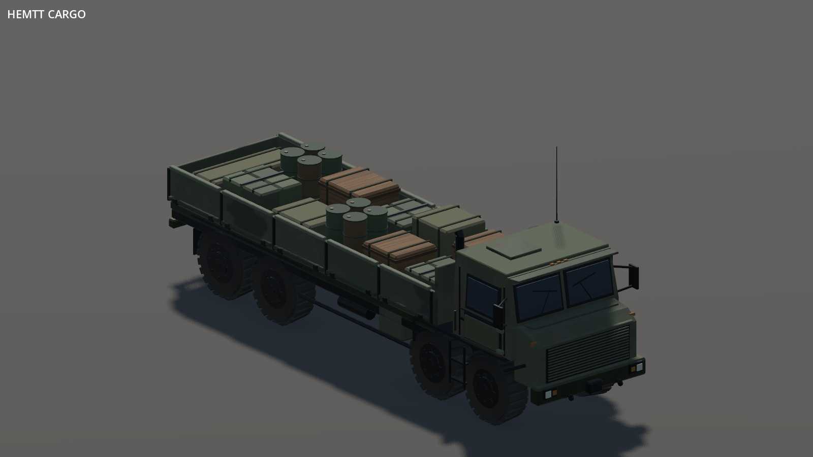
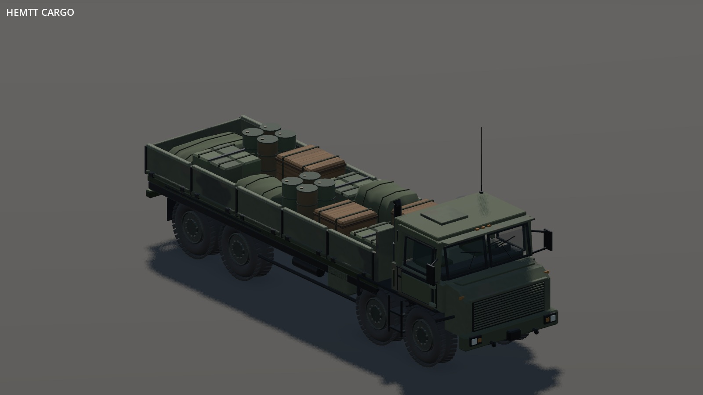
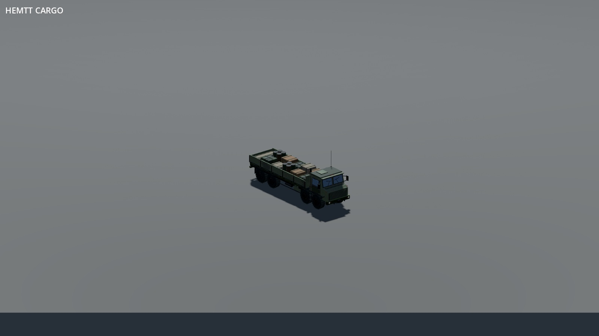
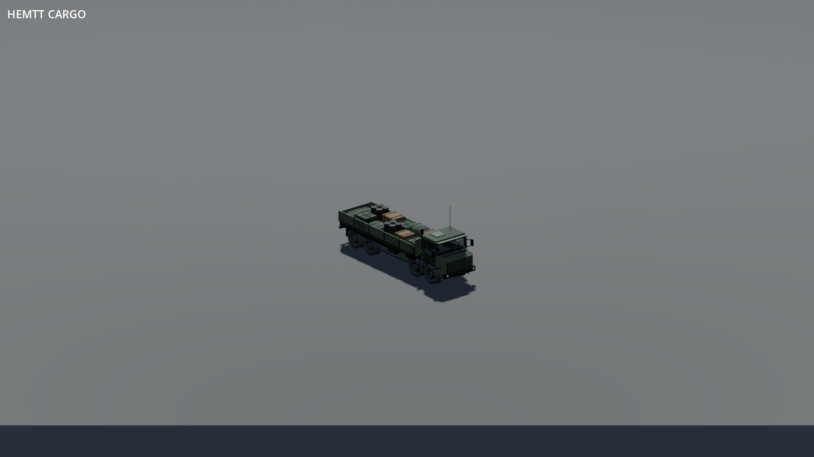
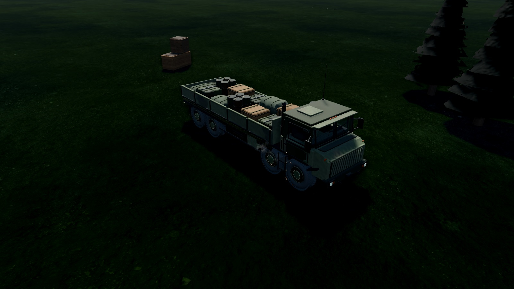

# HEMTT cargo rebuild

This replaces the previous solid cab, flat blue windows and bar-shaped tyre tread. The cab now has an interior behind transparent glazing; tyres have rounded shoulders and recessed rims; covered loads have shaped cloth shells. Changes also apply to the Coalition supply convoy's `truck` alias.

## Matched grounded renders

| Before (e7fee16) | Rebuilt |
| --- | --- |
|  |  |

Both images use the same ground plane, lighting, shadows, camera, palette and renderer. The floor is part of the comparison fixture, not a change to the game's maps. These are unretouched game-engine renders.

## Wider view

| Before | Rebuilt |
| --- | --- |
|  |  |

## Actual game scene



The ordinary attack scenario supplies terrain, daylight, camera and effects. A showcase-only truck is placed at (-20, -10) and parked by setting its copied definition's speed to zero. The shared gameplay definition is unchanged. This image uses Compatibility with the game's High preset, MSAA enabled and post effects disabled for the capture; it is separate from the matched studio pair.

## Reference and implementation

The [M977 reference gallery](https://midwestmilitaryequipment.com/2005-rebuild-m977-oshkosh-hemtt-8x8-truck-with-material-handling-crane/) and [wheel close-up gallery](https://midwestmilitaryequipment.com/1988-m977-oshkosh-hemtt-8x8-truck-with-grove-material-handling-crane/) informed the tyre shoulders, recessed rims, cab construction and cargo restraints. Reference photographs are not redistributed or used as textures. Runtime texture derivatives remain covered by the existing CC0 provenance records.

This remains a procedural RTS model, not a photogrammetric asset or an exact restoration of one production HEMTT variant. The cab glazing is transparent without refraction, the interior is simplified, and shader detail is restrained at gameplay distances. The comparison should be judged on the visible result rather than the number of parts added.

Opaque detail remains merged into chassis and wheel meshes. Four transparent panes bypass that bake; four opaque replacements become visible at 100 m. Intact glass is omitted from wrecks. The material fixture checks both distance ranges and wreck handling.

## Capture and validation

Godot 4.6.3. Close pairs: Vulkan Forward+, software llvmpipe, palette 0, seed 3, 1600×900, orthographic size 8. Wide pairs: Compatibility, size 28. Camera direction (1, 0.65, -1.25); five settled frames then frame_post_draw. The baseline is e7fee16 with only the grounded capture harness copied in. Palette 1 was separately checked in Forward+; Compatibility was checked at close range too. No hardware performance claim is made.

```sh
DISPLAY=:101 VK_DRIVER_FILES=/path/to/lvp_icd.json godot --path . --rendering-method forward_plus --audio-driver Dummy tools/showcase/vehicle-surfaces.tscn -- --surface-out=/tmp/truck --surface-single --surface-kinds=hemtt_cargo --surface-size=8 --surface-ground
DISPLAY=:101 godot --path . --fixed-fps 30 --rendering-method gl_compatibility --audio-driver Dummy tools/showcase/vehicle-in-world.tscn -- --scenario=attack --seed=3 --nohud --preset=high --set=perf:0,aa:2,post:0 --mood=day --focus=-20,-10 --zoom=16 --pitch=-28 --cam-yaw=2.45 --screenshot=/tmp/truck-world.png --shot-at=1 --quit-after=2
```
