# Vehicle detail rollout

The accepted HEMTT cargo treatment now extends to the other HEMTT bodies, the Zamak and Tempest families, and the Offroad, hatchback and SUV glasshouses. Shared wheels use rounded shoulders, recessed rims and rotating tread; aircraft tyres stay smooth. Zamak loads now use draped cloth with restraints fitted to the surface. Painted bumpers and panels use dielectric coatings; light truck canvas uses a neutral tint base to avoid pink highlights in the second palette.

The six CC0 texture sources from the earlier pass are reused. This pass changes geometry and assignments, rather than adding more texture noise.

## Close comparisons

Before: `1bdecfd`, the accepted HEMTT cargo rebuild. After: the roster detail rollout in this PR. Both use Godot 4.6.3 Forward+, seed 3, team 0, 1600 × 900, identical grounded studio lighting and the same automatic bounds-based camera settings. Open an image for full resolution.

| Family | Before | After |
|---|---|---|
| hemtt fuel | 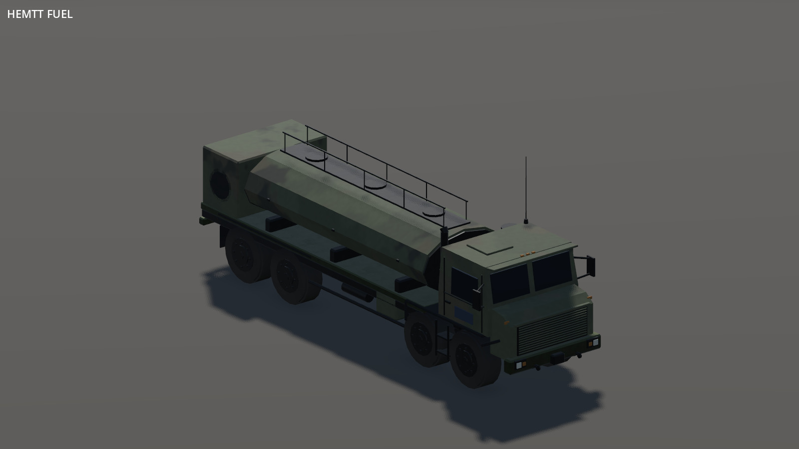 | 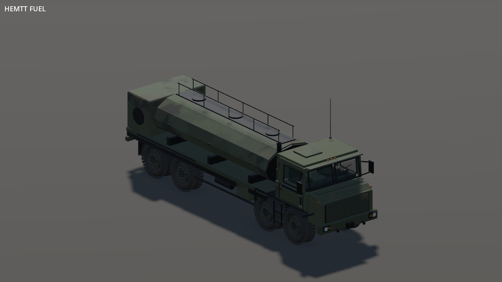 |
| zamak cargo | 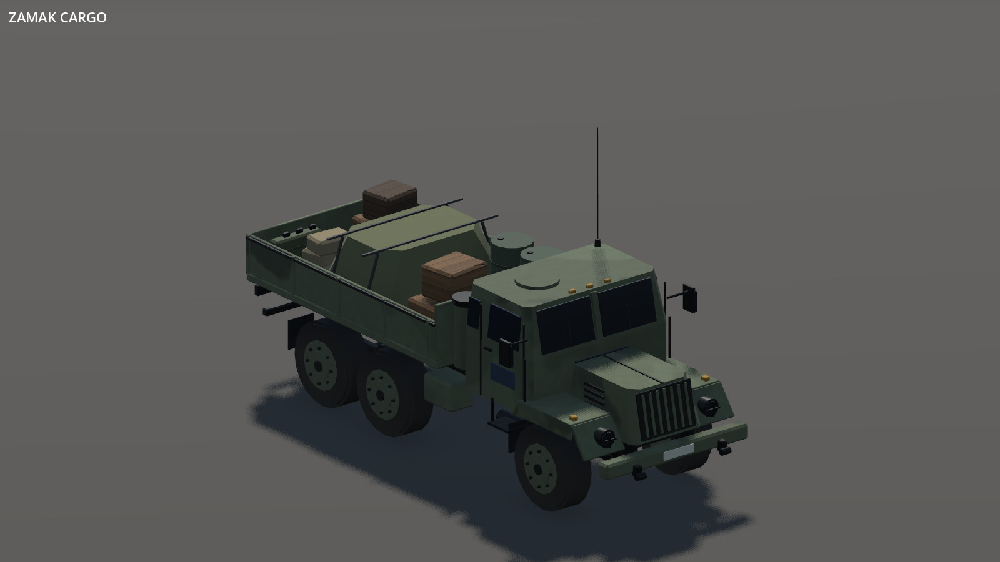 | 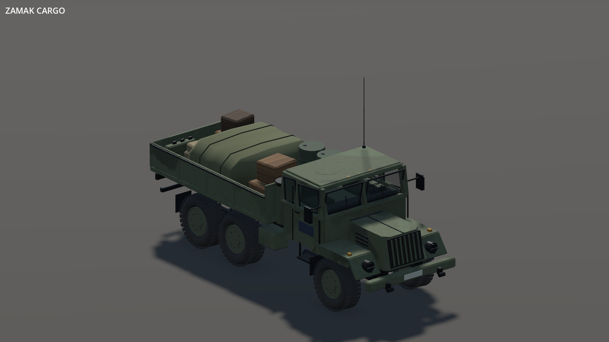 |
| tempest | 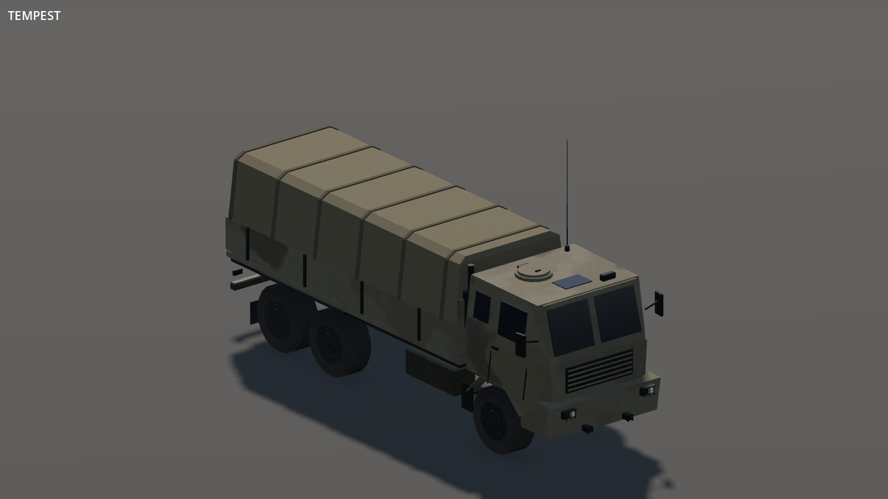 |  |
| hunter |  | 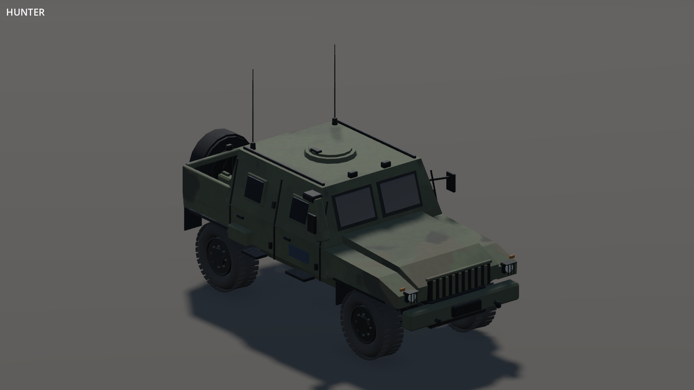 |
| offroad | 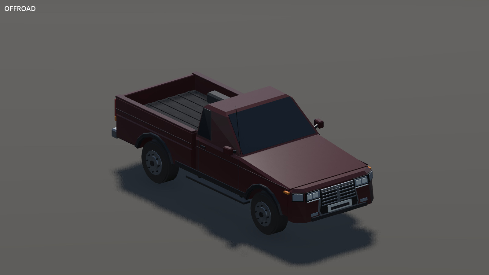 | 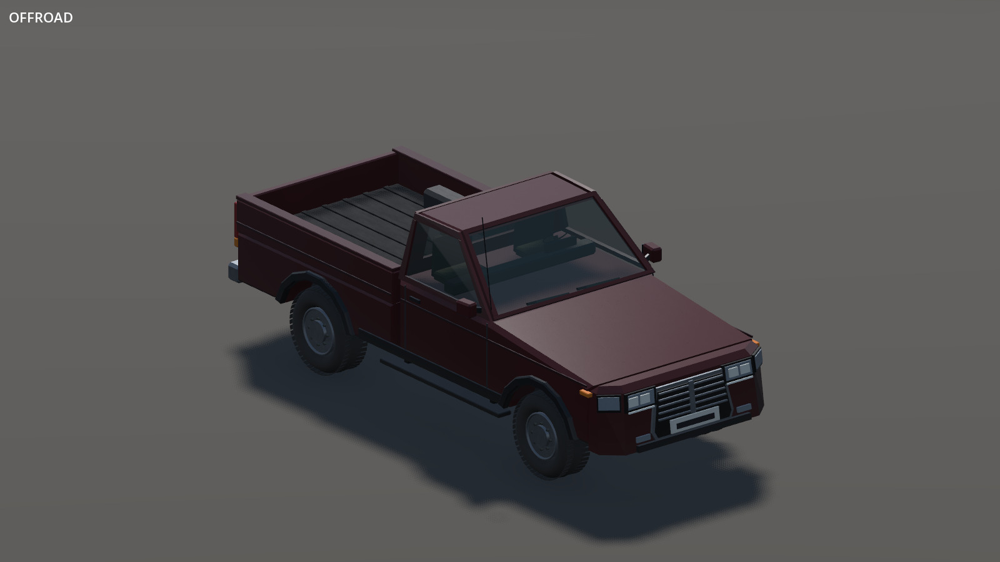 |
| hatchback | 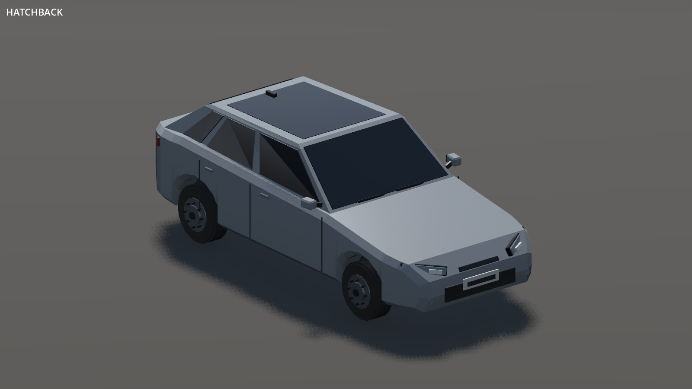 | 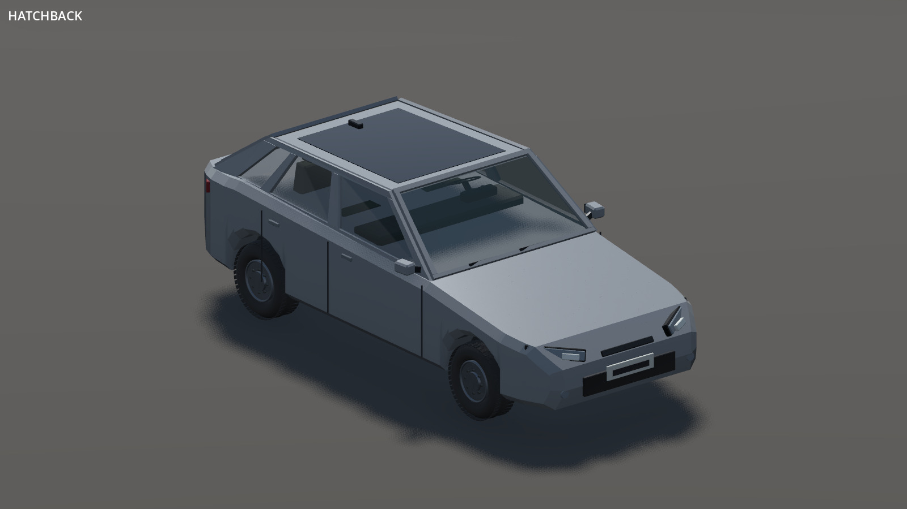 |
| suv | 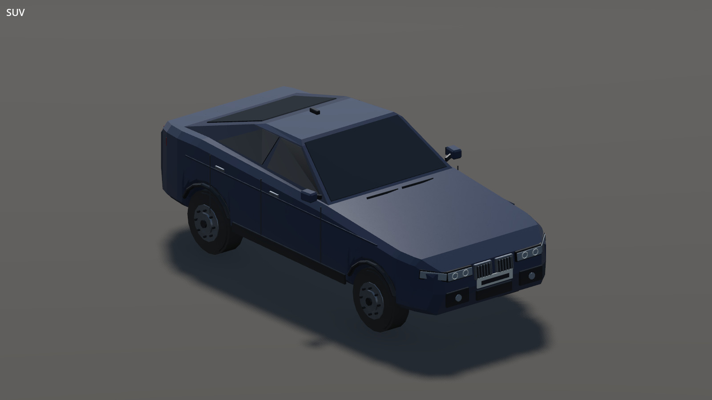 | 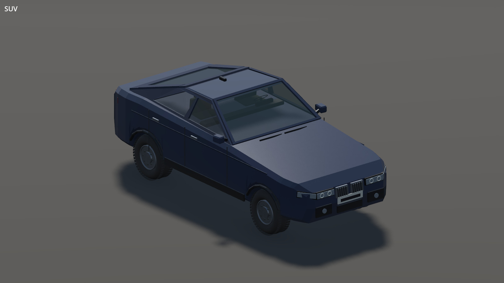 |
| heli |  | 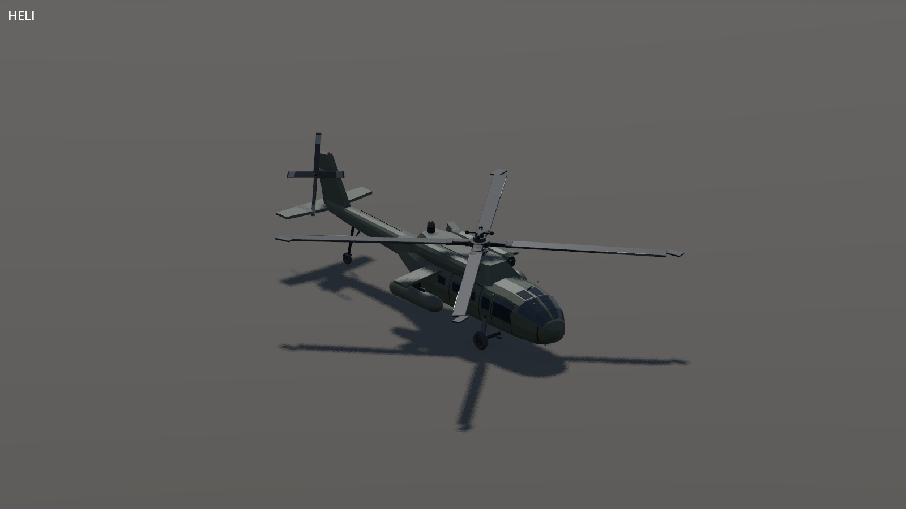 |

## In the game

The Offroad pickup in the attack scenario, using the actual game terrain and Compatibility renderer. The showcase parks the vehicle without changing its shared gameplay definition. No exposure or colour edits were applied.

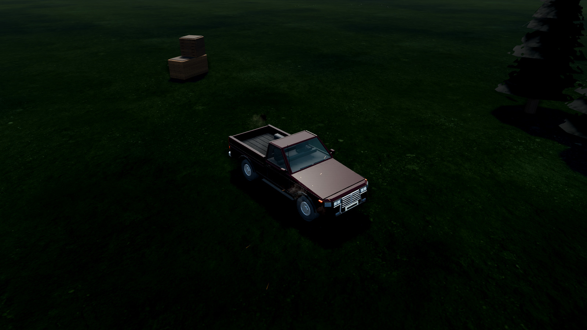

## Complete roster comparisons

All 143 subjects are captured before and after in both palettes: 135 roster/builder subjects, five parked civilian variants and three wrecks. These are Compatibility renders, with the same seed, studio and framing rules on each side. Unchanged aircraft, naval and tracked models remain in the gallery for regression review; this is not a claim that every hull was rebuilt. The larger cab changes are visible on the families listed above; many other vehicles change only at their wheels. Existing low-poly silhouettes and opaque glazing on bodies without interiors remain limitations.

| Sheet | Subjects | Palette 0 before / after | Palette 1 before / after |
|---|---|---|---|
| 1 | a10, aa_tech, ac130, angara, angara_k, apc, assault_boat, blackfish, blackfish_armed, blackfoot, blackwasp, bobcat | [Before](roster-detail/team-0-before-roster-00.jpg) · [After](roster-detail/team-0-after-roster-00.jpg) | [Before](roster-detail/team-1-before-roster-00.jpg) · [After](roster-detail/team-1-after-roster-00.jpg) |
| 2 | btr, buzzard, caesar, cheetah, civilian_0, civilian_1, civilian_2, civilian_3, civilian_4, darter, demining_drone, ed1 | [Before](roster-detail/team-0-before-roster-01.jpg) · [After](roster-detail/team-0-after-roster-01.jpg) | [Before](roster-detail/team-1-before-roster-01.jpg) · [After](roster-detail/team-1-after-roster-01.jpg) |
| 3 | falcon, fenghuang, fenghuang_uav, fia_truck, fia_truck_box, futura, ghosthawk, ghosthawk_stub, gorgon, greyhawk, gryphon, gun_trawler | [Before](roster-detail/team-0-before-roster-02.jpg) · [After](roster-detail/team-0-after-roster-02.jpg) | [Before](roster-detail/team-1-before-roster-02.jpg) · [After](roster-detail/team-1-after-roster-02.jpg) |
| 4 | gunship, hatchback, hatchback_sport, heli, hellcat, hemtt, hemtt_ammo, hemtt_cargo, hemtt_fuel, hemtt_medical, hemtt_repair, hummingbird | [Before](roster-detail/team-0-before-roster-03.jpg) · [After](roster-detail/team-0-after-roster-03.jpg) | [Before](roster-detail/team-1-before-roster-03.jpg) · [After](roster-detail/team-1-after-roster-03.jpg) |
| 5 | humvee, hunter, hunter_gmg, hunter_hmg, huron, ifrit, ifrit_gmg, ifrit_hmg, ifv, jet, kajman, kamysh | [Before](roster-detail/team-0-before-roster-04.jpg) · [After](roster-detail/team-0-after-roster-04.jpg) | [Before](roster-detail/team-1-before-roster-04.jpg) · [After](roster-detail/team-1-after-roster-04.jpg) |
| 6 | kart, kuma, m35, m900, marid, marshall, mb4wd, mb4wd_at, mb4wd_lmg, mohawk, mora, motorboat | [Before](roster-detail/team-0-before-roster-05.jpg) · [After](roster-detail/team-0-after-roster-05.jpg) | [Before](roster-detail/team-1-before-roster-05.jpg) · [After](roster-detail/team-1-after-roster-05.jpg) |
| 7 | neophron, nyx_aa, nyx_ac, nyx_at, nyx_recon, offroad, offroad_at, offroad_hmg, offroad_repair, old_tank, orca, orca_armed | [Before](roster-detail/team-0-before-roster-06.jpg) · [After](roster-detail/team-0-after-roster-06.jpg) | [Before](roster-detail/team-1-before-roster-06.jpg) · [After](roster-detail/team-1-after-roster-06.jpg) |
| 8 | panther, patrol_ship, pawnee, prowler, prowler_at, prowler_hmg, qilin, qilin_at, qilin_mg, quadbike, rhib, rhino | [Before](roster-detail/team-0-before-roster-07.jpg) · [After](roster-detail/team-0-after-roster-07.jpg) | [Before](roster-detail/team-1-before-roster-07.jpg) · [After](roster-detail/team-1-after-roster-07.jpg) |
| 9 | rhino_up, sandstorm, scorcher, sdv, sentinel, shikra, slammer, slammer_up, sochor, speedboat_hmg, speedboat_minigun, stomper | [Before](roster-detail/team-0-before-roster-08.jpg) · [After](roster-detail/team-0-after-roster-08.jpg) | [Before](roster-detail/team-1-before-roster-08.jpg) · [After](roster-detail/team-1-after-roster-08.jpg) |
| 10 | strider, strider_gmg, strider_hmg, suv, tank, taru, taru_lift, tayran, technical, tempest, tempest_ammo, tempest_fuel | [Before](roster-detail/team-0-before-roster-09.jpg) · [After](roster-detail/team-0-after-roster-09.jpg) | [Before](roster-detail/team-1-before-roster-09.jpg) · [After](roster-detail/team-1-after-roster-09.jpg) |
| 11 | tempest_medical, tempest_repair, tigris, tractor, truck, utility_drone, van_ambulance, van_services, van_transport, varsuk, water_scooter, wipeout | [Before](roster-detail/team-0-before-roster-10.jpg) · [After](roster-detail/team-0-after-roster-10.jpg) | [Before](roster-detail/team-1-before-roster-10.jpg) · [After](roster-detail/team-1-after-roster-10.jpg) |
| 12 | wreck_heli, wreck_patrol_ship, wreck_tank, xian, zamak, zamak_ammo, zamak_cargo, zamak_fuel, zamak_medical, zamak_mrl, zamak_repair | [Before](roster-detail/team-0-before-roster-11.jpg) · [After](roster-detail/team-0-after-roster-11.jpg) | [Before](roster-detail/team-1-before-roster-11.jpg) · [After](roster-detail/team-1-after-roster-11.jpg) |

## Capture and checks

```sh
godot --path CHECKOUT --rendering-method gl_compatibility --audio-driver Dummy tools/showcase/vehicle-surfaces.tscn -- --surface-out=OUTPUT --surface-team=0
# Repeat with team 1; close views add --surface-single --surface-ground
# and --surface-kinds=hemtt_fuel,zamak_cargo,tempest,hunter,offroad,hatchback,suv,heli
# Close comparisons use --rendering-method forward_plus.
```

- Both palette sheets were visually reviewed. Re-rendered sheets after coating corrections use the same ordered 12-subject `--surface-kinds` selection and settings.
- Forward+ close views and Compatibility close checks cover the new hollow cabs. The complete fixture builds both palettes, checks shared surface maps, and verifies every rebuilt family has matching near/far glass and no intact panes on wrecks.
- Vehicle materials, distance LOD, motion and weapon-socket tests pass. The roster scenario runs headlessly for ten seconds at fixed 30 FPS.
- Godot 4.6.3 and llvmpipe software rendering were available here; the project targets Godot 4.7. No hardware frame-rate claim is made. Transparent windows add near-view draws; opaque detail stays baked into existing chassis and wheel surfaces.

Earlier evidence: [accepted HEMTT rebuild](hemtt-rebuild.md), [CC0 texture pass](cc0-pass/README.md).
